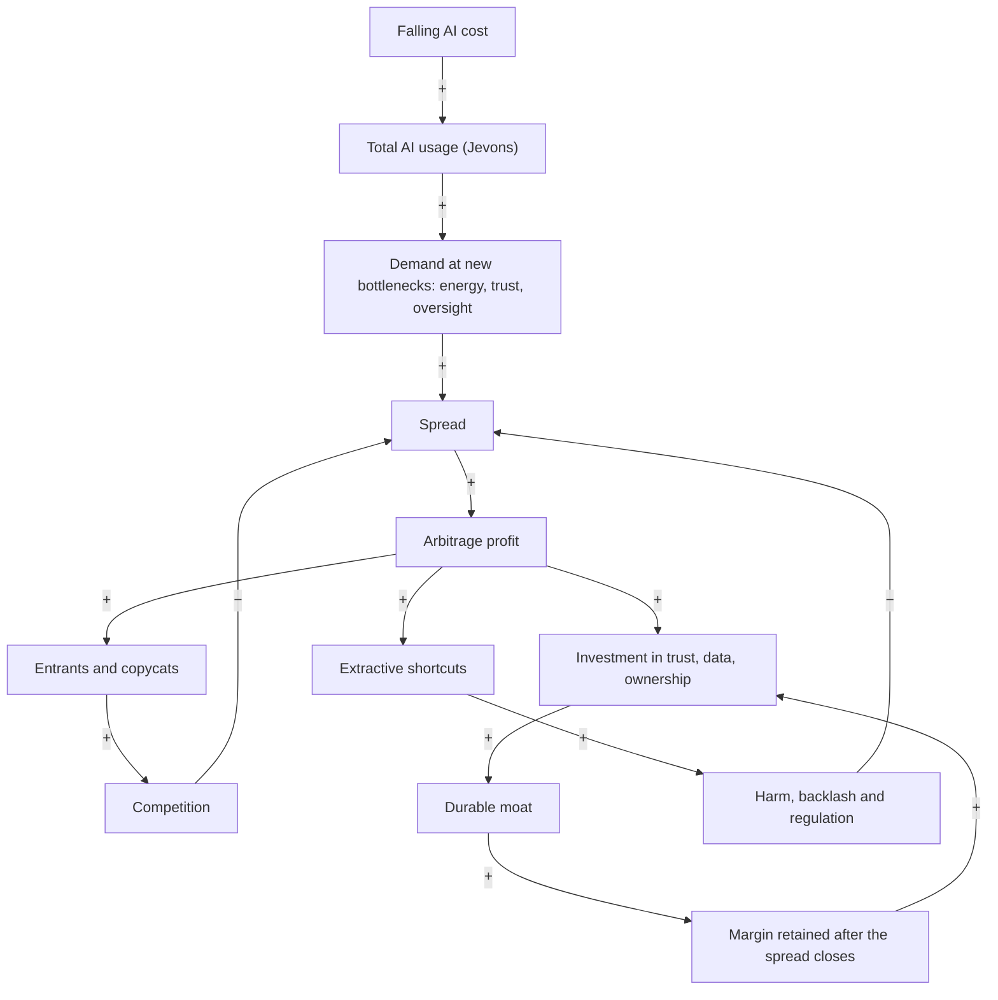
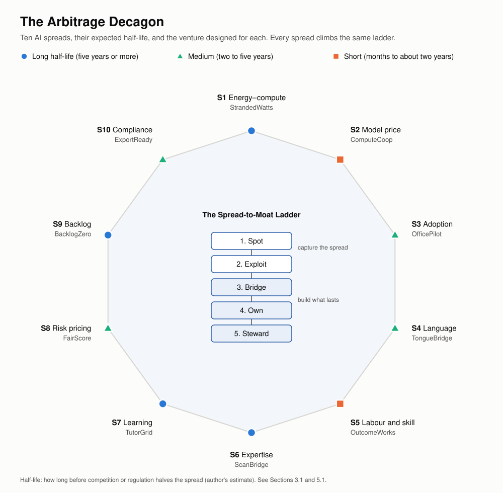
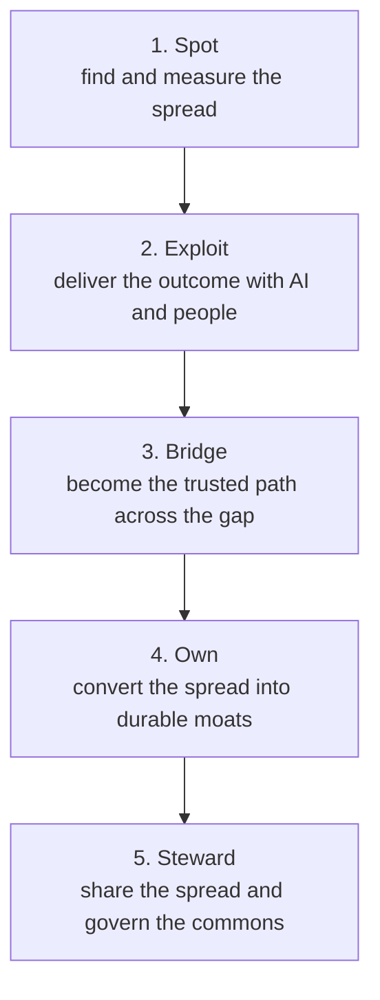
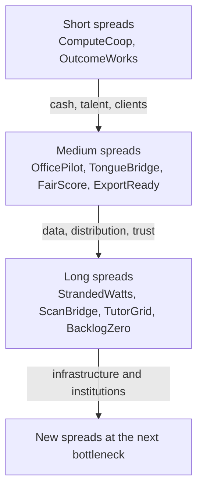

# The Arbitrage Decagon

## AI Arbitrage as a Framework for Disruptive Innovation

*Volume III of The Innovation Decagon. It uses Uber, Airbnb, the sixteen-sector map, the twenty ventures of Volumes I and II, and the Double Decagon as baselines and benchmarks for a framework for AI arbitrage, and proposes ten AI arbitrage ventures.*

Working paper · October 2026

---

## Executive summary

**What AI arbitrage is.** Arbitrage is profiting from a *spread*: the same thing is cheap in one place and valuable in another. AI has opened spreads of a size and number never seen before. The cost of a given level of AI capability has collapsed: GPT-3.5-level inference fell more than 280-fold in about two years (Stanford AI Index 2025). Meanwhile the *outcomes* AI can now produce, such as a bookkeeping service, a tutored lesson, a read X-ray, a dubbed film or a compliance file, are still scarce and expensive for most people and businesses, especially in Africa. **AI arbitrage is the business of closing those gaps.**

**The central insight.** Every spread closes. Competition, price cuts and copycats erase arbitrage profits, often within months for software-only plays. Uber and Airbnb began as arbitrage businesses (regulated taxi prices against idle cars; hotel rates against spare rooms), and their spreads did close. What lasted was what they built on top: trust, networks and brands. So the rule for AI arbitrage is:

> **The spread is the door; the moat is the house.** Enter through a spread, but build something that lasts after the spread has closed, and share it with the people on the cheap side of the gap.

**What Volume III provides:**

1. **Foundations** (Part 1): a definition, the **AI arbitrage equation**, the evidence for why spreads are opening now, and Uber and Airbnb re-read as arbitrage businesses.
2. **Theory and philosophy** (Part 2): Kirzner and Schumpeter, Baumol's productive and destructive entrepreneurship, Ricardo's comparative advantage reshuffled by AI, the Jevons paradox, the theory of constraints, Moravec's paradox, a system dynamics model of arbitrage, and the ethics of arbitrage from Aristotle to Ubuntu.
3. **The framework: the Arbitrage Decagon** (Part 3):
   - **The Spread Map**: ten kinds of AI spread.
   - **The Spread-to-Moat Ladder**: five rungs from spotting a spread to stewarding what it builds.
   - **Seven moats** that survive when spreads close.
   - **The Spread Quality Score** (out of 25), calibrated against Uber, Airbnb and common AI hustles.
   - **The Productive Arbitrage Test**, with red lines.
   - **The Dark Decagon**: ten AI arbitrages to avoid.
   - Integration with the **Double Decagon** of Volume II.
4. **Ten AI arbitrage ventures** (Part 4), one for each spread, Africa-first and globally scalable:

| # | Spread | Venture | The gap it closes |
|---|---|---|---|
| S1 | Energy–compute | **StrandedWatts** | Flared gas and curtailed renewables wasted while AI compute sells out |
| S2 | Model price | **ComputeCoop** | AI prices vary by orders of magnitude, while African builders pay the most, in dollars |
| S3 | Adoption | **OfficePilot** | AI can run a small firm's back office, but few small firms use it, and new tax rules raise the stakes |
| S4 | Language | **TongueBridge** | Films, music, lessons and catalogues trapped in one language |
| S5 | Labour and skill | **OutcomeWorks** | AI-augmented African teams can deliver global-quality services, priced by outcome |
| S6 | Expertise | **ScanBridge** | Sub-Saharan Africa has about 2 radiologists per million people, against 93 in rich countries |
| S7 | Learning | **TutorGrid** | One-to-one tutoring transforms learning but is unaffordable; AI tutoring showed large gains in Nigeria |
| S8 | Risk pricing | **FairScore** | Creditworthy small firms and farmers are mispriced or excluded |
| S9 | Backlog | **BacklogZero** | Citizens wait years for land titles, permits and records that AI could help clear in days |
| S10 | Compliance | **ExportReady** | New export rules (e.g., EU deforestation rules from December 2026) could shut out smallholders |

5. **Portfolio** (Part 5): the scoreboard, a strategy of *harvesting short spreads to fund long ones*, links to Volumes I and II, Africa's comparative advantages in the AI era, a fifth mission (**a fair AI dividend for Africa**), and a closing philosophy: **close the gap; don't farm it.**

---

## How to read this volume

| Part | Content | Use it if you want to… |
|---|---|---|
| 1 | Foundations: definition, equation, evidence, benchmarks | Understand AI arbitrage precisely |
| 2 | Theory, system dynamics and ethics | Understand why spreads open, close and sometimes harm |
| 3 | The Arbitrage Decagon framework | Find, measure and judge AI arbitrage opportunities |
| 4 | Ten AI arbitrage ventures | Get concrete startup ideas |
| 5 | Portfolio, strategy and closing philosophy | Build and sequence a portfolio |
| Appendices | Canvas, rubric, test checklist, sources | Apply the framework yourself |

*Scores and judgements are the author's analysis. Venture concepts are hypotheses to be tested, not investment, legal or financial advice.*

---

# Part 1: Foundations

## 1.1 What AI arbitrage is, and is not

**Classic arbitrage** buys an asset where it is cheap and sells it where it is dear. **Entrepreneurial arbitrage**, in Israel Kirzner's sense, is noticing a gap that others have missed, such as a resource used poorly in one place and needed badly in another, and acting to close it.

**AI arbitrage** is a special case:

> **AI arbitrage** is capturing the spread between what an outcome costs to produce with AI (plus the human and physical work around it) and what the same outcome is worth, or currently costs, to the people who need it.

The term is also used for less admirable things: reselling a chatbot under a new name, flooding the web with AI content to farm advertising, or using AI to impersonate people. Volume III separates **productive arbitrage**, which closes real gaps and creates capability, from **extractive and destructive arbitrage**, which exploits gaps or creates new harms (Section 3.6).

## 1.2 The AI arbitrage equation

> **Net spread = Value of the outcome − (AI cost + human cost + physical cost) − Friction**

- **Value of the outcome:** what the customer gains or would otherwise pay. Examples: an accountant's fee, a radiologist's report, a year of learning, avoiding a late-filing penalty.
- **AI cost:** model inference, fine-tuning and compute. This is falling fast, but unevenly.
- **Human cost:** supervision, sign-off, quality assurance and customer care. In serious domains a human stays in the loop.
- **Physical cost:** energy, connectivity, devices, logistics.
- **Friction:** everything between the AI and the customer: trust, distribution, language, regulation, payment, quality risk and liability.

Two more terms decide whether a spread can become a venture:

- **Spread half-life:** how long before competition, price cuts or regulation halves the spread. Software-only spreads can halve within months; spreads anchored in energy, regulation, trust or expertise can last years.
- **Moat conversion:** how much of the spread can be turned into durable assets before it closes (Section 3.3).

> **Venture value ≈ (spread × volume × half-life) + value of the moat that remains when the spread has closed**

Most AI hustles maximize the first term and ignore the second. Durable ventures invest the first term into the second.

## 1.3 Why AI spreads are opening now

| Force | Evidence | Spread it creates |
|---|---|---|
| **Collapsing AI cost** | The cost of GPT-3.5-level inference fell from about $20 to about $0.07 per million tokens between late 2022 and late 2024, more than 280-fold (Stanford AI Index 2025); depending on the task, prices have fallen 9–900-fold a year | Cheap cognition against expensive outcomes (S3, S5–S10) |
| **Uneven adoption** | Even in the US, only about 18% of firms used AI in any business function in late 2025 to early 2026, and small firms used it least (US Census Bureau) | Adoption spread (S3) |
| **Volatile, scarce compute** | H100 GPU rental prices fell sharply during 2025, then rose again in 2026 as capacity sold out | Energy–compute and model-price spreads (S1, S2) |
| **Energy constraints** | Data-centre electricity demand is projected to more than double by 2030 (IEA); global gas flaring reached about 151 bcm in 2024, the highest since 2007, and Nigeria's flaring rose about 12% (World Bank) | Energy–compute spread (S1) |
| **Scarce experts** | Sub-Saharan Africa has about 2 radiologists per million people, against about 93 in high-income countries (IAEA data); Nigeria has perhaps 250–300 radiologists | Expertise spread (S6) |
| **Proven learning gains** | A World Bank trial in Edo State, Nigeria, found AI-assisted tutoring raised scores by about 0.3 standard deviations in six weeks, roughly 1.5–2 years of typical learning | Learning spread (S7) |
| **New rules and deadlines** | Nigeria's tax reform took effect in January 2026, with filing required even for zero-tax small firms; the EU deforestation regulation applies from 30 December 2026 (30 June 2027 for micro and small operators) | Compliance and adoption spreads (S3, S10) |
| **Language barriers** | Most AI value is created in a few languages; Africa has over 2,000 | Language spread (S4) |
| **Service exports under pressure** | The Philippine IT-BPM industry employs about 1.9 million people and earned about $40bn in 2025, and most firms report adopting AI tools | Labour–skill spread (S5) |

## 1.4 Benchmarks: Uber and Airbnb as arbitrage businesses

Seen through this lens, the first platform era was an arbitrage era.

| | **Uber** | **Airbnb** |
|---|---|---|
| **The spread** | Regulated, medallion-limited taxi prices versus the low marginal cost of idle private cars and drivers' spare hours | Hotel rates, especially at peak times, versus the near-zero marginal cost of spare rooms |
| **Secondary spreads** | Regulatory (operating outside taxi rules); capital (investor subsidies) | Regulatory (hotel taxes and zoning); trust (no one else had solved stranger-to-stranger trust at scale) |
| **How the spread closed** | Medallion values collapsed; subsidies ended and prices rose; driver earnings converged to their reservation wage (Volume I, Part II); regulation arrived | Hotels responded; regulation capped listings in high-demand cities; fees rose |
| **What lasted** | A global network, data, brand, and multi-sided expansion (delivery, freight, AV aggregation) | A trust system, unique supply, brand and community |
| **Lesson** | The pricing spread was the door; the network was the house | The price spread was the door; trust was the house |

Volume I's study of failed "Uber for X" startups adds the negative cases. **Washio's** spread was too thin to cover logistics; **Homejoy's** leaked as customers went direct. Neither converted its spread into a moat before it closed.

## 1.5 Five laws of AI arbitrage

Volume II distilled twelve laws of platform disruption. AI arbitrage adds five:

| # | Law | Statement |
|---|---|---|
| A1 | **The closing law** (Kirzner) | Every spread attracts entrants, and entrants close it. Plan for the spread's half-life, not its peak. |
| A2 | **The Jevons law** | When intelligence gets cheaper, total use rises, so demand for compute, energy, data and human oversight rises too. |
| A3 | **The bottleneck law** (theory of constraints) | Cheap cognition moves the bottleneck to whatever is still scarce: trust, energy, physical action, data rights, distribution, legitimacy. The best spreads sit at the new bottleneck. |
| A4 | **The Baumol law** | The rules of the game decide whether arbitrage is productive, unproductive or destructive. Where rules are weak, the most profitable arbitrage is often harmful. |
| A5 | **The sharing law** (Polanyi) | Who captures the spread decides the venture's legitimacy. Spreads extracted from workers, communities or users invite the double movement; spreads shared with them build allies. |

---

# Part 2: Theory, System Dynamics and Ethics

## 2.1 Kirzner and Schumpeter: two kinds of entrepreneur

Israel Kirzner (*Competition and Entrepreneurship*, 1973) described the entrepreneur as an **alert arbitrageur** who notices price differences others have missed and, by acting on them, pushes markets toward equilibrium. Joseph Schumpeter described the entrepreneur as a **creative destroyer** who introduces new combinations that overturn equilibrium altogether.

AI arbitrage *starts* Kirznerian: it notices that an outcome which used to need a scarce expert can now be produced cheaply, and it moves value across the gap. A venture that stays Kirznerian disappears when the gap closes. To last, it must *become* Schumpeterian. It must use the spread to build something new that changes the structure of the market: a trust network, a cooperative, a public data commons, a new profession. Uber and Airbnb made exactly this transition.

## 2.2 Baumol: productive, unproductive and destructive arbitrage

William Baumol ("Entrepreneurship: Productive, Unproductive, and Destructive", 1990) argued that the supply of entrepreneurial energy is roughly constant across societies. What differs is **where the rules of the game direct it**: toward innovation (productive), toward rent-seeking (unproductive) or toward activities that destroy value (destructive).

| Kind | AI arbitrage example | Effect |
|---|---|---|
| **Productive** | AI-assisted tutoring that brings one-to-one learning to students who could never afford it | Closes a real gap; creates capability |
| **Unproductive** | Reselling a general-purpose chatbot under a new name with exaggerated claims | Captures a spread without creating capability; disappears when buyers learn |
| **Destructive** | Deepfake impersonation scams; AI content farms polluting search; predatory AI-scored loans | Profits by creating harm; triggers backlash and regulation |

The lesson for founders and policymakers is the same: **design the rules so that the most profitable arbitrage is also the most productive.** This is why the framework includes the Productive Arbitrage Test and the Dark Decagon (Sections 3.5 and 3.6).

## 2.3 Ricardo reshuffled: comparative advantage in the AI era

David Ricardo showed that countries gain by specializing in what they do *relatively* best. AI is reshuffling comparative advantage. Routine cognitive work, once the basis of offshoring, is becoming cheap everywhere. New sources of comparative advantage emerge, and several favour Africa:

| New comparative advantage | Why it matters in the AI era | African position |
|---|---|---|
| **Young, connected workforce** | Human oversight, physical tasks and trust work grow as AI spreads | The world's youngest population |
| **Energy, especially stranded and solar** | Compute is energy-bound | Abundant sun; flared gas; under-used hydro |
| **Languages and cultures** | AI needs data and evaluation in many languages | Over 2,000 languages; large cultural industries |
| **Mobile-money and informal-economy know-how** | AI services must reach informal users | Among the world's most advanced mobile-money markets |
| **Diaspora networks** | Trust and capital across borders | Large, skilled diasporas |
| **Unmet demand** | Spreads are widest where services are scarcest | Wide gaps in health, education and public services |

## 2.4 Jevons, Goldratt and Moravec: where the bottleneck moves

- **The Jevons paradox.** William Stanley Jevons observed in 1865 that more efficient steam engines *increased* total coal use, because cheaper energy found more uses. Cheaper AI is doing the same: as cost per task falls, total AI use and total demand for compute and electricity rise.
- **The theory of constraints.** Eliyahu Goldratt showed that a system's output is set by its tightest bottleneck, and that relieving one bottleneck moves it elsewhere. As AI relieves the cognition bottleneck, the binding constraints become **energy, compute, trust, data rights, distribution, physical action and legitimacy**.
- **Moravec's paradox.** Hans Moravec noted that what is hard for humans (calculation, logic) is often easy for machines, and what is easy for humans (perception, movement, common sense in messy places) is hard for machines. Physical, relational and trust-intensive work therefore stays scarce.

Taken together: **the best AI arbitrage spreads sit next to the new bottlenecks.** Of the ten ventures in Part 4, StrandedWatts sits at the energy bottleneck, ScanBridge at the expert-sign-off bottleneck, FairScore at the trust-in-data bottleneck, and BacklogZero at the legitimacy bottleneck.

## 2.5 The system dynamics of arbitrage

- **B1, the closing loop (Kirzner):** spread → profit → entrants → competition → smaller spread. Every arbitrage contains this loop.
- **R1, the moat loop (Schumpeter):** profit → investment in trust, data and ownership → moat → retained margin → more investment. This is the only loop that outlives the spread.
- **The bottleneck pathway (Jevons and Goldratt):** falling AI cost → more usage → more demand at the new bottlenecks → new spreads. This is not a closed loop but a steady external push: new spreads keep appearing, in different places.
- **B2, the backlash loop (Baumol and Polanyi):** profit tempts extractive shortcuts → harm → regulation → the spread is closed by force, often for everyone.

**Strategic implication:** the race in AI arbitrage is between B1 and R1. A venture must build its moat faster than competition closes its spread, and must never feed B2.

## 2.6 The ethics of arbitrage: from Aristotle to Ubuntu

Arbitrage has always attracted moral suspicion. Aristotle distinguished *oikonomia*, household management aimed at a good life, from *chrematistike*, money-making pursued for its own sake, and was wary of the latter. Medieval thinkers debated the "just price". Modern critics see arbitrage as parasitic: profiting from gaps without making anything.

Yet arbitrage can be a service. Moving food from where it rots to where people are hungry is arbitrage, and so is bringing a specialist's judgement to a village that has none. The moral question is not *whether* one profits from a gap, but **how**:

1. **Does it close the gap or farm it?** Productive arbitrage makes the gap smaller over time. Extractive arbitrage keeps the gap open, because the gap is the business.
2. **Who receives the spread?** If the cheap side (workers, communities, data contributors) receives nothing, the arbitrage is extraction dressed as efficiency.
3. **Is anyone deceived?** Arbitrage that depends on customers not knowing what they are buying fails the test of honest exchange.

The African ethic of **Ubuntu**, "a person is a person through other persons", sharpens the point. An arbitrage is legitimate when it strengthens the web of relationships it passes through. **Close the gap; don't farm it.**

---

# Part 3: The Framework: The Arbitrage Decagon

## 3.1 The Spread Map: ten AI spreads

*Figure 1. The Arbitrage Decagon. Ten kinds of AI spread, each marked by its expected half-life, around the Spread-to-Moat Ladder that turns a temporary spread into a durable venture.*

| # | Spread | The gap | Evidence | Who loses today | Expected half-life | Venture |
|---|---|---|---|---|---|---|
| **S1** | **Energy–compute** | Energy that is wasted or stranded, against compute that sells out | Record gas flaring (2024); compute rental prices rising again in 2026 | Communities near flare sites; AI builders priced out | Long | StrandedWatts |
| **S2** | **Model price** | The same task costs 10–1,000× more on one model or provider than another | Price declines of 9–900× a year depending on task | Builders who can't shop around or pay in dollars | Short | ComputeCoop |
| **S3** | **Adoption** | AI can do a task, but most firms don't use it | About 18% of US firms use AI; small firms less | Small and informal businesses | Medium | OfficePilot |
| **S4** | **Language** | Value trapped in one language | Over 2,000 African languages; dubbing costs collapsing | Creators, sellers and learners outside major languages | Medium | TongueBridge |
| **S5** | **Labour and skill** | AI-augmented workers in lower-cost regions can deliver global-quality outcomes | Global service exports of tens of billions of dollars, now being reshaped by AI | Young workers without access to global demand | Short to medium | OutcomeWorks |
| **S6** | **Expertise** | Specialists are scarce; AI can pre-read and triage | ~2 radiologists per million in sub-Saharan Africa versus ~93 in rich countries | Patients without diagnosis | Long | ScanBridge |
| **S7** | **Learning** | One-to-one tutoring is transformative but unaffordable | ~0.3 standard deviations in six weeks in a Nigerian trial | Students in crowded classrooms | Long | TutorGrid |
| **S8** | **Risk pricing** | Creditworthy people without credit files are mispriced or excluded | Abusive loan apps prompted strict new rules in Nigeria (2025) | Small firms, farmers, informal workers | Medium | FairScore |
| **S9** | **Backlog** | Citizens wait months or years for public decisions that are mostly paperwork | Large registry, permit and court backlogs are common | Citizens, small firms, investors | Long | BacklogZero |
| **S10** | **Compliance** | New standards are expensive to prove for small producers | EU deforestation rules apply from December 2026 | Smallholders and small exporters | Medium to long | ExportReady |

## 3.2 The Spread-to-Moat Ladder

Every AI arbitrage venture should climb five rungs. The first two capture the spread; the last three turn it into something that lasts.

| Rung | Question | Uber | Airbnb | Common failure |
|---|---|---|---|---|
| **1. Spot** | How big is the spread, and how long will it last? | Taxi prices versus idle cars | Hotel rates versus spare rooms | Mistaking a fad for a spread |
| **2. Exploit** | Can we deliver the outcome reliably and profitably? | Black cars, then UberX | Air mattresses, then whole homes | Spread too thin to cover friction (Washio) |
| **3. Bridge** | Do customers trust us as *the* way across? | Ratings, tracking, payments | Reviews, verification, AirCover | Customers go direct (Homejoy) |
| **4. Own** | What remains when the spread closes? | Network, data, brand | Trust system, unique supply | Software-only "moats" copied overnight |
| **5. Steward** | Is the spread shared with the people on the cheap side? | Weak, so regulation followed | Partial; housing backlash followed | Double movement |

## 3.3 Seven moats that survive the spread closing

AI is making software cheap to copy, so a clever app is no longer a moat. Seven kinds of advantage survive:

1. **Verified trust:** reputations, guarantees and verification records accumulated over time (Volume I's trust law).
2. **Consented data rights:** data contributed under fair terms, which competitors cannot legally scrape.
3. **Distribution and relationships:** agent networks, associations, schools and governments that already rely on you.
4. **Physical infrastructure:** sites, power contracts, connectivity, devices.
5. **Ownership alignment:** cooperatives and shared equity that give providers and users a reason to stay.
6. **Regulatory standing:** licences, approvals, certifications and a record with regulators.
7. **Community legitimacy:** the trust of the communities whose resources or labour the venture uses.

## 3.4 The Spread Quality Score

Each potential arbitrage is scored on five dimensions, 0–5 each (rubric in Appendix B), for a maximum of 25.

| Dimension | Question |
|---|---|
| **Size (S)** | How large is the net spread, per transaction and in total? |
| **Half-life (H)** | How long will the spread last before competition or regulation halves it? |
| **Productivity (P)** | Does it close a real gap and create capability (Baumol)? |
| **Moat conversion (M)** | How much of the spread can be turned into the seven durable moats? |
| **Fair sharing (F)** | How much of the spread reaches the cheap side (workers, communities, users)? |

**Calibration against benchmarks and common AI hustles:**

| Case | S | H | P | M | F | **Total** | Reading |
|---|---|---|---|---|---|---|---|
| Uber (c.2012) | 5 | 3 | 3 | 5 | 1 | **17** | Large spread, strong moat, poor sharing; regulation followed |
| Airbnb (c.2009) | 4 | 4 | 4 | 5 | 2 | **19** | Good spread and moat; housing externalities |
| Rebranded chatbot resold to small firms | 3 | 1 | 2 | 1 | 2 | **9** | Closes as soon as buyers learn |
| Predatory AI-scored loan app | 4 | 2 | 0 | 1 | 0 | **7** | Profitable until regulation; destructive |
| AI content farm for advertising | 3 | 1 | 0 | 0 | 0 | **4** | Pollutes the commons; search engines fight back |
| **The ten ventures in Part 4 (average)** | | | | | | **20.5** | Productive, moat-building, shared |

**Interpretation bands:** 20–25 *build it*; 15–19 *build only with a clear moat plan*; 10–14 *harvest briefly or avoid*; below 10 *avoid*.

## 3.5 The Productive Arbitrage Test

Before any scoring, an AI arbitrage must pass four **red lines**. Failing any one disqualifies it, whatever its profits.

| Red line | The question |
|---|---|
| **No deception** | Does the venture depend on customers not knowing what they are buying, or on impersonating anyone? |
| **No consent violation** | Does it use data, voices, likenesses or creative work without consent and fair terms? |
| **No harmful evasion** | Does it profit by evading rules that protect people (e.g., practising medicine, lending or advising without the safeguards the law requires)? |
| **No exploitation** | Does it depend on paying the cheap side less than a fair wage or price, or on unsafe conditions? |

It should then answer "yes" to most of five **productivity questions**:

1. Does it close a real gap for people who are under-served today?
2. Does it create new capability (skills, data, infrastructure, trust), not just move money?
3. Would the venture survive, in some form, if the spread halved tomorrow?
4. Does it share the spread with the people on the cheap side?
5. Will the gap be *smaller* in five years because the venture exists?

## 3.6 The Dark Decagon: ten AI arbitrages to avoid

Each of these is tempting because it is profitable today. Each fails the Productive Arbitrage Test, scores close to zero on productivity and fair sharing, and invites the backlash loop (B2).

| # | Dark arbitrage | Why it tempts | Why it fails |
|---|---|---|---|
| 1 | **AI content farms** for advertising and search traffic | Near-zero production cost | Pollutes shared information; platforms and search engines demote it |
| 2 | **Fake reviews and synthetic social proof** | Cheap to generate | Deception; illegal in many jurisdictions; destroys the trust law it relies on |
| 3 | **Deepfake and impersonation scams** | Large payoffs | Criminal; destructive; drives the synthetic-reality crisis (Volume II) |
| 4 | **Assignment and exam cheating mills** | Steady demand | Destroys the value of credentials; harms the learners who pay |
| 5 | **Predatory AI-scored lending** | High interest margins | Exploitative; prompted strict regulation in Nigeria and elsewhere |
| 6 | **Scraping and reselling data without consent** | Free inputs | Consent violation; lawsuits; poisoned supply |
| 7 | **Unlicensed AI medical, legal or financial advice** | Large, under-served demand | Harmful evasion; liability; regulatory shutdown |
| 8 | **Ghost-work wage dumping** | Cheap annotation and moderation labour | Exploitation; reputational and regulatory risk |
| 9 | **"AI-washing"**: exaggerated AI claims on ordinary products | Easy marketing premium | Deception; regulators now pursue misleading AI claims |
| 10 | **Algorithmic collusion and manipulative pricing** | Higher margins | Anti-competitive; prosecuted (as in the RealPage case) |

**Note the pattern:** several dark arbitrages are distorted versions of productive ones. Predatory lending is the dark twin of FairScore; cheating mills are the dark twin of TutorGrid; unlicensed medical advice is the dark twin of ScanBridge. **The same spread can be served productively or destructively. The design decides.**

## 3.7 Integration with Volumes I and II

Every AI arbitrage venture in this volume is assessed four ways:

| Instrument | Source | What it checks |
|---|---|---|
| **Productive Arbitrage Test** | This volume | Red lines and productivity |
| **Spread Quality Score** (/25) | This volume | Whether the spread is worth pursuing |
| **Inner Decagon** (/50) | Volume I | Whether the venture is well designed |
| **Future-Fitness Decagon** (/50) | Volume II | Whether it will thrive in 2030–2050 |

The **Double Decagon Index** (/100) remains the headline measure of venture quality. The Spread Quality Score is the headline measure of arbitrage quality. A venture should score at least **20/25** and at least **70/100** before significant investment.

## 3.8 The Arbitrage-to-Venture process

| Step | Activity | Output |
|---|---|---|
| 1. **Map** | Scan the ten spread types in a sector or country | A list of candidate spreads |
| 2. **Measure** | Apply the AI arbitrage equation; estimate half-life | Net spread and half-life per candidate |
| 3. **Filter** | Apply the Productive Arbitrage Test | Candidates that pass the red lines |
| 4. **Design the bridge** | Design the AI-plus-human service, the trust stack and the friction removal | A service blueprint |
| 5. **Pilot** | Deliver the outcome to one atomic network by hand | Evidence of real value and real cost |
| 6. **Convert** | Invest early profits in the seven moats | A moat plan with milestones |
| 7. **Share** | Design how the cheap side shares the spread (wages, royalties, equity, prices) | A sharing model |
| 8. **Re-score** | Re-score as the spread closes; move up the value chain or move to the next bottleneck | An updated plan each cycle |

---

# Part 4: Ten AI Arbitrage Ventures

Each venture captures one spread from the Spread Map and is designed to climb the full Spread-to-Moat Ladder. Each follows the same template:

- **Spread code**: the spread, its value and cost sides, its main friction, its half-life, the moats it converts into, and its archetype (from Volume II).
- **The gap**: the evidence.
- **Benchmarks**: what it borrows and inverts.
- **How it works**.
- **From spread to moat**: what remains when the spread closes, and who shares the spread.
- **System dynamics**.
- **Design thinking**.
- **Business model**.
- **Risks and safeguards**, including its "dark twin".
- **First 100 days**.
- **Scores**: Spread Quality Score (/25) and Double Decagon Index (/100).

---

## Venture 1: STRANDEDWATTS, compute where energy is wasted

> **Thesis.** AI compute is constrained by electricity, while large amounts of energy are wasted: gas flared at oil fields, solar output curtailed at midday, and hydropower with no grid to reach. StrandedWatts builds modular AI data centres at stranded-energy sites in Africa. They serve latency-tolerant workloads (batch inference, model training, rendering) for global and African customers, and a fixed share of the power and profits goes to local communities.

| Spread code | |
|---|---|
| Spread | **S1 Energy–compute** |
| Value side | The price of AI compute in a constrained global market |
| Cost side | Near-zero or negative-value energy (flared gas, curtailed renewables) |
| Main friction | Connectivity; security; site permits; community legitimacy |
| Half-life | Long: energy constraints on AI are structural |
| Moats | Physical infrastructure; long-term energy contracts; regulatory standing; community legitimacy |
| Archetype and governance | A2 idle-asset marketplace (for stranded energy) + A8 protocol (open workload scheduling); steward-owned with a community benefit trust |

**The gap**

- Global gas flaring reached about 151 billion cubic metres in 2024, the highest since 2007. Nigeria's flaring rose about 12%, and its flaring intensity is more than twice the global average (World Bank Global Gas Flaring Tracker).
- Nigeria's Gas Flare Commercialisation Programme has awarded flare sites to companies to put the gas to use.
- Data-centre electricity demand is projected to more than double to about 945 TWh by 2030 (IEA). GPU rental prices rose again in 2026 as capacity sold out.
- Africa hosts a tiny share of the world's data-centre capacity, limiting AI sovereignty and local services.

**Benchmarks: borrowed and inverted**

- **From Airbnb:** an idle asset (stranded energy) becomes valuable once a platform makes it usable.
- **From Volume I's FluxCommons:** compute as a flexible, interruptible load.
- **From flare-to-compute precedents:** companies have powered computing with flared gas elsewhere, for example in North American oilfields.
- **Inverts:** extraction economies that left communities with pollution and no power become sites of shared benefit. *Compute never comes before people*: a fixed share of power serves local mini-grids.

**How it works**

1. **Site selection.** Flare sites under the commercialisation programme, curtailed solar plants and stranded hydropower, chosen for security, connectivity (fibre or satellite) and community consent.
2. **Modular data centres.** Containerized GPU units, power generation from captured gas or renewables, and cooling.
3. **Workload marketplace.** Latency-tolerant jobs (batch inference, fine-tuning, training checkpoints, rendering, scientific computing) are scheduled by price and availability through an open interface.
4. **Community power share.** A fixed percentage of generated power feeds local mini-grids (clinics, schools, homes), and a community benefit trust receives a share of profits.
5. **Transition plan.** Flare-gas sites carry a published plan to shift to renewables. Capturing gas that would otherwise be flared cuts methane and black-carbon emissions, but it remains fossil energy, and the venture says so.
6. **Sovereign services.** A share of capacity is reserved for African universities, start-ups and public services at cost.

**From spread to moat.** When compute prices fall, StrandedWatts still holds the sites, power contracts, community relationships and permits that competitors would need years to replicate. **Who shares the spread:** host communities (power and profit share), local technicians (jobs and training), African builders (reserved capacity at cost).

**System dynamics**

- **R1, the capacity loop:** profitable sites → capital for more sites → more capacity → more customers.
- **R2, the community loop:** shared power and profit → community support → secure operations → lower costs.
- **B1, legitimacy risk:** being seen as extending fossil infrastructure or ignoring local needs. The transition plan, the power share and transparent emissions reporting contain it.
- **Leverage point:** rules (flare commercialisation and power-sharing terms) and paradigm (communities as partners, not bystanders).

**Design thinking**

- *Personas:* **Chief Ebi**, community leader near a flare site in the Niger Delta whose village has never had reliable power. **A start-up founder in Lagos** who cannot afford GPUs priced in dollars. **A research lab** in Europe needing cheap batch compute.
- *How might* energy that has been burned into the sky for decades power both AI and the villages beside it?
- *Moment of truth:* the flare goes dark, and the clinic down the road has 24-hour power for the first time.

**Business model.** Compute sales (per GPU-hour or per job); reserved-capacity contracts; carbon and methane-reduction credits where credible; community benefit trust funded by a fixed share of revenue.

| Risk | Safeguard |
|---|---|
| Fossil lock-in and greenwashing | Published transition plan; honest emissions accounting; no claims beyond verified reductions |
| Security in volatile regions | Community partnership; site selection; insurance |
| Connectivity | Fibre where available; satellite backhaul; latency-tolerant workloads only |
| "Compute before people" (dark twin) | Contractual power share for local mini-grids |

**First 100 days.** One flare site awarded under the commercialisation programme and one curtailed-solar site; feasibility and community consent; a 1-megawatt pilot with two batch-compute customers.

**Scores.** Spread Quality **22/25** (S5 · H5 · P4 · M5 · F3). Double Decagon **74/100**: Inner 37/50 (V1 5 · V2 4 · V3 3 · V4 3 · V5 4 · V6 4 · V7 3 · V8 4 · V9 3 · V10 4); Future-Fitness 37/50 (F1 4 · F2 4 · F3 3 · F4 3 · F5 4 · F6 5 · F7 4 · F8 4 · F9 3 · F10 3). *The lowest index in this volume: a large, durable spread with contested legitimacy, which must be earned site by site.*

---

## Venture 2: COMPUTECOOP, fair AI access for African builders

> **Thesis.** The same AI task can cost ten to a thousand times more depending on which model, provider or region is used. African developers and small firms often pay the most, in dollars, by card, with no local data residency. ComputeCoop is a member-owned cooperative that routes every task to the cheapest model meeting its quality, language and data-residency needs, pools purchasing power, and bills in local currency.

| Spread code | |
|---|---|
| Spread | **S2 Model price** |
| Value side | What members currently pay (often list prices, in dollars, with FX and card fees) |
| Cost side | The cheapest adequate model for each task, bought at pooled rates |
| Main friction | Quality verification; FX and payments; data residency |
| Half-life | Short: routing tools are becoming common |
| Moats | Ownership alignment (co-op); local billing and payment rails; African-language evaluation data; regulatory standing on data residency |
| Archetype and governance | A9 agent-native exchange + A10 cooperative; member-owned |

**The gap**

- AI prices have fallen at very different rates by task, from 9× to 900× a year (Stanford AI Index 2025), so the cheapest adequate model for a task changes constantly.
- Many African builders pay in foreign currency with high card and FX costs, and lack bargaining power.
- Data-residency and sovereignty rules increasingly require certain data to stay in-country or in-region.
- Models perform worse in many African languages, and builders lack evaluation data to know which model works for their use case.

**Benchmarks: borrowed and inverted**

- **From Uber:** real-time matching, here of tasks to models.
- **From Volume II's AgentUnion:** collective bargaining, here for AI buyers.
- **From credit unions:** member ownership and local-currency services.
- **Links** to DataGuild (African-language evaluation sets) and StrandedWatts (local compute).
- **Inverts:** the smallest buyers get the best prices, not the worst.

**How it works**

1. **One interface.** Members call one API (or use a no-code workspace); ComputeCoop routes each request.
2. **Quality-aware routing.** For each task type and language, continuous evaluations (using DataGuild's African-language test sets) pick the cheapest model that meets the member's quality threshold.
3. **Residency rules.** Data that must stay local is routed only to compliant regions or to local compute (StrandedWatts, local clouds).
4. **Pooled purchasing.** Volume contracts with model providers and compute clouds.
5. **Local billing.** Payment in naira, cedis, shillings and other currencies via local rails.
6. **Distillation service.** For high-volume tasks, small specialized models are trained to run cheaply, even on phones.
7. **Patronage dividends.** Surplus returns to members.

**From spread to moat.** When routing becomes a commodity, ComputeCoop still owns its member relationships, local billing rails, residency compliance and evaluation data, and members own it. **Who shares the spread:** members, through lower prices and dividends.

**System dynamics**

- **R1, the bargaining loop:** more members → more volume → better prices → more members.
- **R2, the evaluation loop:** more usage → better quality data by language and task → better routing.
- **B1, commoditization:** routing features appear everywhere. The co-op's other moats are the response.
- **Leverage point:** ownership structure (who captures the savings).

**Design thinking**

- *Personas:* **Ada**, founder of a Lagos health-tech start-up spending a large share of revenue on AI APIs. **A state government IT team** that must keep citizens' data in-country. **A Kenyan student** building a Swahili tutoring app.
- *How might* the smallest AI builders get the best prices and the right models for their languages?
- *Moment of truth:* Ada's monthly AI bill falls by more than half, paid in naira, with quality unchanged.

**Business model.** A small margin on routed usage; distillation and fine-tuning services; residency-compliant hosting; membership fees for premium services. Surplus is returned as dividends.

| Risk | Safeguard |
|---|---|
| Provider terms prohibiting resale or routing | Direct reseller agreements; compliance with provider terms |
| Quality failures after routing | Member-set thresholds; continuous evaluation; fallback models |
| Data leakage | Residency enforcement; encryption; audits |
| Commoditization | Co-op ownership, local billing and evaluation data as moats |

**First 100 days.** Two hundred member developers in Lagos and Nairobi; routing across at least five providers; naira and shilling billing; publish savings achieved.

**Scores.** Spread Quality **18/25** (S4 · H2 · P4 · M3 · F5). Double Decagon **84/100**: Inner 42/50 (V1 4 · V2 5 · V3 4 · V4 4 · V5 5 · V6 5 · V7 4 · V8 3 · V9 4 · V10 4); Future-Fitness 42/50 (F1 5 · F2 4 · F3 3 · F4 4 · F5 5 · F6 5 · F7 5 · F8 3 · F9 4 · F10 4).

---

## Venture 3: OFFICEPILOT, an AI back office for small and informal businesses

> **Thesis.** AI can now keep books, issue invoices, prepare tax filings, answer customers and track stock. Most small firms, and nearly all informal ones, use none of it. OfficePilot is an AI back office delivered through WhatsApp and voice in local languages, supervised by human accountants, and priced for market traders and small shops. It arrives just as Nigeria's tax reform requires even zero-tax small businesses to register and file.

| Spread code | |
|---|---|
| Spread | **S3 Adoption** |
| Value side | Accountant and admin costs avoided; penalties avoided; time saved; access to credit unlocked |
| Cost side | AI processing plus a small amount of human review |
| Main friction | Trust; digital literacy; distribution to informal businesses |
| Half-life | Medium: big software firms will move down-market, but slowly and without local trust |
| Moats | Distribution through trader associations and agents; verified trust; consented financial data (with FairScore) |
| Archetype and governance | A3 skills marketplace (AI plus supervised accountants) + A5 relationship platform; steward-owned |

**The gap**

- Even in the US, only about 18% of firms used AI in any business function in late 2025 to early 2026, and the smallest firms used it least (US Census Bureau). Adoption among African small and informal businesses is far lower.
- Nigeria's tax reform took effect on 1 January 2026. Small businesses below the turnover threshold pay 0% company income tax but must still have a tax ID and file annual returns. Late-filing penalties rose to ₦100,000 for the first month and ₦50,000 for each month after.
- Advisers recommend that small businesses move to digital payments and keep e-receipts, which most informal businesses do not yet do.

**Benchmarks: borrowed and inverted**

- **From Urban Company** (Volume I, Part VI): standardizing a fragmented service.
- **From Uber:** making a complex service feel like one gesture, here a voice note on WhatsApp.
- **Links** to Guildhall (supervised apprentice accountants), FairScore (consented records unlock credit) and TongueBridge (local-language voice).
- **Inverts:** compliance becomes a benefit (credit, protection from penalties) rather than a burden.

**How it works**

1. **Capture by voice or photo.** Traders send voice notes, photos of receipts or mobile-money statements by WhatsApp or USSD, in Pidgin, Yoruba, Hausa, Igbo or English.
2. **AI bookkeeping.** Transactions are categorized, invoices issued and stock tracked.
3. **Tax and compliance.** Registration, annual returns and reminders, prepared by AI and reviewed by human accountants (Guildhall pods).
4. **Customer replies.** An AI assistant answers routine customer questions on WhatsApp, in the trader's voice and with the trader's approval.
5. **Credit readiness.** With consent, verified records feed FairScore to unlock fair credit.
6. **Distribution.** Partnerships with market associations, trade unions, cooperatives and mobile-money agents.

**From spread to moat.** When big software firms add AI features, OfficePilot still owns its distribution through associations and agents, its local-language trust, and consented records that link to credit. **Who shares the spread:** traders (lower costs, avoided penalties, credit access) and apprentice accountants (paid work and training).

**System dynamics**

- **R1, the trust loop:** penalties avoided and credit unlocked → word of mouth in markets → more users.
- **R2, the data loop:** more records → better categorization in local contexts → fewer errors.
- **B1, fear of tax authorities:** traders fear that records expose them. Clear explanation that small firms pay 0% income tax, plus data protection, contains it.
- **Leverage point:** information flows (making the benefits of compliance visible).

**Design thinking**

- *Personas:* **Mama Nkechi**, who sells fabrics in Onitsha market and keeps accounts in her head. **Tunde**, who runs a phone-repair shop in Ibadan and received a tax notice he doesn't understand. **A market association chairman** who wants members protected from penalties.
- *How might* a market trader get the back office of a big company for the price of a phone recharge?
- *Moment of truth:* Mama Nkechi files her first annual return by voice note, pays nothing, and qualifies for a loan the following month.

**Business model.** Monthly subscriptions in small amounts; tiered pricing by business size; referral fees from lenders (via FairScore, with consent and caps); association partnership fees.

| Risk | Safeguard |
|---|---|
| Errors in tax filings | Human accountant review; guarantees; professional indemnity insurance |
| Data misuse | Consent; data minimization; no sale of personal data |
| Distrust of digital records | Association partnerships; plain-language explanations |
| Dark twin: tax-evasion tools | Firm policy against evasion; compliance-first design |

**First 100 days.** One large market (e.g., Onitsha or Balogun) with its association; 2,000 traders; tax registration and first filings; measure time saved and penalties avoided.

**Scores.** Spread Quality **20/25** (S4 · H3 · P5 · M4 · F4). Double Decagon **83/100**: Inner 43/50 (V1 5 · V2 5 · V3 4 · V4 4 · V5 5 · V6 4 · V7 4 · V8 4 · V9 4 · V10 4); Future-Fitness 40/50 (F1 4 · F2 4 · F3 3 · F4 4 · F5 4 · F6 4 · F7 5 · F8 4 · F9 4 · F10 4).

---

## Venture 4: TONGUEBRIDGE, unlocking value trapped in one language

> **Thesis.** Africa produces films, music, lessons and products that could reach hundreds of millions more people in other languages, but dubbing, subtitling and translation have been too expensive. AI has collapsed those costs. TongueBridge combines AI translation and voice with human post-editing and consenting, paid voice actors. It carries Nollywood films into French, Portuguese and Swahili, lessons into local languages, and small firms' catalogues across the continent's language borders.

| Spread code | |
|---|---|
| Spread | **S4 Language** |
| Value side | New audiences and markets in other languages |
| Cost side | AI translation and voice, plus human post-editing |
| Main friction | Quality and cultural nuance; rights; voice consent; distribution |
| Half-life | Medium: AI dubbing tools are spreading, but rights, quality and distribution are slow to build |
| Moats | A rights catalogue; consented voice-actor network with royalties; distribution partnerships; quality reputation |
| Archetype and governance | A3 skills marketplace (translators, voice actors) + A7 data trust (voice rights); steward-owned with royalty sharing |

**The gap**

- Africa has over 2,000 languages, and cross-border trade under the African Continental Free Trade Area requires communication across English, French, Portuguese, Arabic, Swahili and many others.
- Nollywood is one of the world's most prolific film industries, but most of its catalogue reaches only English-speaking audiences.
- AI translation and synthetic voice have cut the cost of dubbing and localization dramatically, but quality, cultural nuance and voice rights remain unsolved.

**Benchmarks: borrowed and inverted**

- **From Airbnb:** unique supply (films, lessons, products) reaching a global audience.
- **From Volume I's DataGuild:** consent and royalties for the people whose voices and knowledge train AI.
- **Links** to TutorGrid (local-language lessons) and OfficePilot (local-language voice).
- **Inverts:** voice cloning, a dark arbitrage when done without consent, becomes a source of royalties for voice actors.

**How it works**

1. **Rights first.** Content owners license language rights, and voice actors license their voices on consent-based, royalty-paying terms.
2. **AI first pass.** Transcription, translation and synthetic dubbing in the target language.
3. **Human post-editing.** Native-speaker editors fix meaning, idiom and cultural references; directors check performance.
4. **Distribution.** Streaming platforms, broadcasters, YouTube channels, schools and e-commerce marketplaces in target markets.
5. **Revenue sharing.** Royalties flow to content owners, voice actors and editors per view or sale.
6. **Trade localization.** Small firms' product catalogues and customer service, translated for cross-border trade.

**From spread to moat.** When dubbing tools become cheap for everyone, TongueBridge holds the rights catalogue, consented voice library, distribution partnerships and quality reputation. **Who shares the spread:** content owners, voice actors, editors and translators through royalties.

**System dynamics**

- **R1, the catalogue loop:** more titles in more languages → more audiences → more revenue for owners → more titles licensed.
- **R2, the quality loop:** human edits train better models for each language pair.
- **B1, quality backlash:** poor dubbing harms reputation. Human post-editing and quality tiers contain it.
- **Leverage point:** rules (voice and likeness rights).

**Design thinking**

- *Personas:* **A Nollywood producer** with 200 films earning nothing outside Anglophone markets. **Fatou**, a viewer in Dakar who would watch them in French. **Bisi**, a voice actor worried about being cloned without pay.
- *How might* a story told in Lagos be heard in Kinshasa, Luanda and Dar es Salaam, with every voice paid?
- *Moment of truth:* Bisi receives her first royalty statement for her licensed voice, used in films she never had to record again.

**Business model.** Localization fees; revenue share on distribution; voice-library licensing (with royalties to actors); catalogue translation for traders.

| Risk | Safeguard |
|---|---|
| Voice cloning without consent (dark twin) | Consent-only voice library; royalties; watermarking and provenance |
| Cultural errors | Native post-editors; community review |
| Piracy | Distribution partnerships; watermarking |
| Rights disputes | Clear contracts; rights registry |

**First 100 days.** Fifty Nollywood titles dubbed into French and Swahili with consenting voice actors; two distribution partners; measure views and revenue.

**Scores.** Spread Quality **19/25** (S4 · H3 · P4 · M4 · F4). Double Decagon **80/100**: Inner 43/50 (V1 5 · V2 5 · V3 4 · V4 4 · V5 4 · V6 4 · V7 4 · V8 4 · V9 5 · V10 4); Future-Fitness 37/50 (F1 4 · F2 4 · F3 3 · F4 4 · F5 4 · F6 4 · F7 4 · F8 3 · F9 4 · F10 3).

---

## Venture 5: OUTCOMEWORKS, AI-augmented service exports priced by results

> **Thesis.** AI is reshaping the global outsourcing industry. Routine call-centre and back-office work is being automated, while demand grows for AI-augmented teams that deliver *outcomes* (resolved cases, edited videos, tested software, reconciled accounts) to a guaranteed standard. OutcomeWorks builds those teams in African cities, prices by outcome rather than by hour, and gives workers equity.

| Spread code | |
|---|---|
| Spread | **S5 Labour and skill** |
| Value side | What global clients pay for the outcome |
| Cost side | Local wages multiplied by AI productivity |
| Main friction | Trust in quality; time zones; connectivity; payment |
| Half-life | Short to medium: AI keeps automating the tasks, so the business must keep climbing the value chain |
| Moats | Outcome guarantees and track record; client relationships; certified talent pipeline (Guildhall); worker ownership |
| Archetype and governance | A3 skills marketplace + A10 worker cooperative; worker-owned operating company |

**The gap**

- The Philippine IT-BPM industry alone employs about 1.9 million people and earned about $40bn in 2025, and most of its firms report adopting AI tools, a sign of how fast the service-export model is changing.
- Clients increasingly want outcomes, not hours, because AI makes hours a poor measure of value.
- Africa's young, English- and French-speaking workforce is under-represented in global service exports.

**Benchmarks: borrowed and inverted**

- **From Uber:** matching supply to demand in real time, here across time zones.
- **From Urban Company:** standardized quality and guarantees.
- **Links** to Guildhall (training), RemoteHands (moving workers up to robot supervision as tasks automate) and ComputeCoop (affordable AI tools).
- **Inverts:** offshoring arbitrage traditionally kept the wage gap for the firm; OutcomeWorks shares it with workers through equity.

**How it works**

1. **Outcome catalogue.** Defined, priced outcomes: per resolved support case, per edited video minute, per tested software release, per reconciled ledger.
2. **AI-augmented pods.** Small teams use AI tools for drafting, analysis and checking, with human judgement and quality control.
3. **Guarantees.** Missed standards are redone free or refunded.
4. **Follow-the-sun delivery.** African time zones overlap with European working hours, with handoffs to the Americas.
5. **Career ladder.** As tasks automate, workers move up: quality assurance, AI supervision, client management, robot supervision (RemoteHands).
6. **Worker equity.** Workers accumulate cooperative shares and profit distributions.

**From spread to moat.** As AI erodes the price of routine outcomes, OutcomeWorks keeps its client relationships, guarantee track record, talent pipeline and worker-owners. **Who shares the spread:** workers through fair wages and equity.

**System dynamics**

- **R1, the reputation loop:** outcomes delivered → client trust → more contracts → more trained workers.
- **B1, automation erosion:** AI automates tasks and prices fall. Continuous climbing of the value chain is built into the model (future-fitness test F8).
- **Leverage point:** goals (paying for outcomes, not hours) and ownership.

**Design thinking**

- *Personas:* **Efosa**, 26, a Benin City graduate who edits video on his phone. **A European e-commerce firm** that needs 10,000 product descriptions checked a week. **A Nairobi team lead** who wants her team to share in the profits it creates.
- *How might* African teams sell outcomes to the world, and own a share of the firms they build?
- *Moment of truth:* Efosa's team hits its quality target for a full quarter, and his first profit share arrives.

**Business model.** Per-outcome pricing with guarantees; managed-team retainers; training partnerships. Platform share of at most 25%; remainder to workers; profit distributions to worker-owners.

| Risk | Safeguard |
|---|---|
| Ghost-work wage dumping (dark twin) | Wage floors; fair-work standards; worker ownership |
| Quality failures | Guarantees; quality-assurance layers |
| Rapid automation of tasks | Built-in climbing of the value chain; training budget |
| Connectivity and power | Hubs with backup power (SecondCell, StrandedWatts) |

**First 100 days.** Three pods in Lagos, Nairobi and Kigali; two outcome lines (customer-support resolution and content quality assurance); five international clients.

**Scores.** Spread Quality **18/25** (S5 · H2 · P4 · M3 · F4). Double Decagon **79/100**: Inner 41/50 (V1 5 · V2 4 · V3 4 · V4 4 · V5 5 · V6 5 · V7 3 · V8 4 · V9 4 · V10 3); Future-Fitness 38/50 (F1 4 · F2 3 · F3 3 · F4 4 · F5 4 · F6 3 · F7 5 · F8 4 · F9 4 · F10 4).

---

## Venture 6: SCANBRIDGE, specialist judgement where there are no specialists

> **Thesis.** Sub-Saharan Africa has about two radiologists per million people, against about 93 in high-income countries. AI can now pre-read X-rays, ultrasounds, ECGs and pathology slides, flag urgent cases and draft reports. Specialists are still needed to confirm. ScanBridge pairs AI triage with a network of licensed specialists, including African specialists in the diaspora, who sign off remotely. Diagnosis reaches district hospitals in hours instead of weeks.

| Spread code | |
|---|---|
| Spread | **S6 Expertise** |
| Value side | Timely diagnosis; avoided transfers; lives and costs saved |
| Cost side | AI pre-reading plus minutes of specialist time per case |
| Main friction | Regulatory approval; liability; image quality; connectivity |
| Half-life | Long: specialist scarcity will persist for decades |
| Moats | Clinical validation and approvals; hospital network; diaspora specialist network; verified outcome data |
| Archetype and governance | A1 dispatch (cases to specialists) + A3 skills marketplace; steward-owned, with clinicians on the governance board |

**The gap**

- IAEA data cited in 2024 show about 2 radiologists per million people in sub-Saharan Africa versus about 93 in high-income countries.
- Nigeria is estimated to have about 250–300 radiologists for more than 200 million people, roughly one per 600,000. Some sub-Saharan countries have none.
- Thousands of Nigerian and other African doctors work abroad, many willing to serve home systems remotely.

**Benchmarks: borrowed and inverted**

- **From Uber:** dispatch of each case to the nearest *available, qualified* specialist, wherever they are.
- **From Airbnb:** verified profiles and quality reviews, here for specialists.
- **Links** to SurgeNet (surge capacity in outbreaks), GroundTruth (verified records) and SecondCell (power for imaging).
- **Inverts:** brain drain becomes "brain circulation": diaspora specialists serve home hospitals without relocating.

**How it works**

1. **Capture.** District hospitals upload images and tracings from existing machines; low-cost devices are added where needed.
2. **AI pre-read.** Validated algorithms flag urgent findings (for example, suspected tuberculosis or fractures), prioritize the queue and draft structured reports.
3. **Specialist sign-off.** Cases are dispatched to licensed specialists by urgency, specialty and licensing jurisdiction. Every report carries a named, accountable clinician.
4. **Feedback.** Outcomes are tracked to audit both AI and specialist accuracy.
5. **Training.** Local clinicians receive feedback and training, raising local capacity over time.
6. **Payment.** Per-read fees paid by hospitals, insurers and health programmes, scaled to ability to pay.

**From spread to moat.** As AI reading improves everywhere, ScanBridge keeps its approvals, clinical evidence, hospital network and specialist network. **Who shares the spread:** patients (faster, cheaper diagnosis), specialists (paid remote work) and local clinicians (training).

**System dynamics**

- **R1, the network loop:** more hospitals → more cases → more specialists join → faster turnaround → more hospitals.
- **R2, the evidence loop:** outcome tracking → better validation → regulatory approvals → more payers.
- **B1, liability and quality risk:** errors damage trust. Human sign-off, audits and insurance contain it.
- **Leverage point:** delays (from weeks to hours) and rules (approvals and licensing).

**Design thinking**

- *Personas:* **Dr Hauwa**, the only doctor at a district hospital in Bauchi with an X-ray machine but no radiologist. **Dr Femi**, a Nigerian radiologist in Manchester who wants to help home. **A mother** waiting a week for her son's chest X-ray result.
- *How might* every district hospital have a specialist's judgement within hours?
- *Moment of truth:* the AI flags suspected TB at 10 a.m.; Dr Femi confirms by 11; treatment starts the same day.

**Business model.** Per-read fees; hospital subscriptions; health-programme contracts (e.g., TB screening); training services. Specialists receive most of the per-read fee.

| Risk | Safeguard |
|---|---|
| Unlicensed AI diagnosis (dark twin) | Named clinician sign-off on every report; regulatory approval for algorithms |
| Algorithm bias on local populations | Local validation; continuous auditing |
| Cross-border licensing | Specialists licensed where the patient is treated; partnerships with medical councils |
| Data privacy | Consent; encryption; national data residency |

**First 100 days.** Ten district hospitals in one state; chest X-rays and ECGs; 30 licensed specialists (including diaspora); measure turnaround time, accuracy and treatment started.

**Scores.** Spread Quality **23/25** (S5 · H5 · P5 · M4 · F4). Double Decagon **85/100**: Inner 44/50 (V1 5 · V2 4 · V3 5 · V4 3 · V5 5 · V6 4 · V7 4 · V8 5 · V9 5 · V10 4); Future-Fitness 41/50 (F1 4 · F2 4 · F3 4 · F4 4 · F5 4 · F6 4 · F7 4 · F8 4 · F9 5 · F10 4).

---

## Venture 7: TUTORGRID, one-to-one learning for every child

> **Thesis.** Benjamin Bloom found in 1984 that one-to-one tutoring could raise performance dramatically, but no country can afford a tutor for every child. In a World Bank trial in Edo State, Nigeria, AI-assisted tutoring guided by teachers raised scores by about 0.3 standard deviations in six weeks, roughly 1.5–2 years of typical learning. TutorGrid brings teacher-led AI tutoring to schools and homes, in local languages, on phones as well as computers, paid for by outcomes.

| Spread code | |
|---|---|
| Spread | **S7 Learning** |
| Value side | Learning gains (and lifetime earnings) previously available only through private tutoring |
| Cost side | AI tutoring at very low marginal cost, plus teacher time |
| Main friction | Devices; connectivity; teacher adoption; curriculum alignment |
| Half-life | Long: learning is a public good and needs persist; providers will commoditize, but school relationships and evidence will not |
| Moats | Curriculum alignment; teacher networks; state contracts; local-language content; measured outcomes |
| Archetype and governance | A5 relationship platform + A8 protocol (open curriculum content); steward-owned, with public partnerships |

**The gap**

- The World Bank's Edo State trial (2024) found effects of about 0.31 standard deviations on a combined assessment and 0.23 on English, with the largest gains for girls. Participants also did better on end-of-year exams. The trial was short and teacher-led, so long-term effects and scaling remain to be proven.
- Classrooms in many African countries are crowded, and private tutoring is unaffordable for most families.
- Many students have a family phone but no computer or reliable data.

**Benchmarks: borrowed and inverted**

- **From Airbnb Experiences:** learning from a guide, here an AI guide supervised by a teacher.
- **From Volume I's Guildhall and Agora:** learning in groups and communities.
- **Links** to TongueBridge (local languages) and DataGuild (language data).
- **Inverts:** the dark twin, AI cheating mills, does students' work for them. TutorGrid is designed to make students do the thinking.

**How it works**

1. **Teacher-led sessions.** Teachers run AI tutoring sessions in school labs or on shared tablets, starting each with a guided prompt, as in the Edo trial.
2. **Phones at home.** Practice by WhatsApp and voice for feature phones, with low data use.
3. **Local languages.** Explanations in the language children think in, alongside the language of instruction.
4. **Curriculum alignment.** Content mapped to national curricula and exams.
5. **Anti-cheating design.** Socratic tutoring that asks questions rather than giving answers; teacher dashboards.
6. **Outcome measurement.** Regular assessments; results shared with schools and states.
7. **Outcome-based contracts.** States and donors pay per measured learning gain.

**From spread to moat.** When AI tutors are everywhere, TutorGrid holds curriculum alignment, teacher networks, state contracts, local-language content and the evidence of what works. **Who shares the spread:** students and families (free or low-cost access) and teachers (training and tools).

**System dynamics**

- **R1, the evidence loop:** measured gains → state contracts → more schools → more evidence.
- **R2, the teacher loop:** trained teachers → better sessions → better results → more teacher buy-in.
- **B1, novelty fade:** engagement drops after the novelty wears off. Teacher-led structure and group sessions contain it.
- **Leverage point:** goals (learning gains, not screen time) and information flows (outcome data).

**Design thinking**

- *Personas:* **Amara**, 15, in a class of 80 in Benin City. **Mr Osagie**, her English teacher, sceptical of technology. **A state commissioner for education** who must show results.
- *How might* every child have a patient tutor who speaks their language?
- *Moment of truth:* Amara explains a grammar rule to her classmates, in Edo and in English, that she could not grasp six weeks earlier.

**Business model.** Outcome-based contracts with states and donors; school subscriptions; low-cost family plans. Free access for the poorest students.

| Risk | Safeguard |
|---|---|
| Cheating (dark twin) | Socratic design; teacher oversight; no answer-giving mode |
| Unequal access | School-based sessions; feature-phone mode; free tiers |
| Over-claiming results | Independent evaluation; publish all results |
| Child data protection | Minimal data; parental consent; strict privacy |

**First 100 days.** Twenty secondary schools in one state; English and mathematics; teacher training; pre- and post-assessment with a comparison group.

**Scores.** Spread Quality **23/25** (S5 · H4 · P5 · M4 · F5). Double Decagon **87/100**: Inner 45/50 (V1 5 · V2 5 · V3 4 · V4 4 · V5 5 · V6 4 · V7 4 · V8 5 · V9 5 · V10 4); Future-Fitness 42/50 (F1 4 · F2 4 · F3 4 · F4 4 · F5 4 · F6 4 · F7 5 · F8 4 · F9 5 · F10 4).

---

## Venture 8: FAIRSCORE, fair credit for people with no credit file

> **Thesis.** Millions of creditworthy traders, farmers and workers are excluded from credit or charged punishing rates because lenders cannot see their records. In Nigeria, the gap was filled partly by abusive loan apps, which prompted strict new rules in 2025. FairScore is consent-based AI credit scoring built on verified records: trading records from OfficePilot, warehouse receipts from HarvestGrid, verified building stages from BuildBridge. It is sold to licensed lenders and cooperatives with explainability, fairness audits and rate caps.

| Spread code | |
|---|---|
| Spread | **S8 Risk pricing** |
| Value side | The difference between the risk lenders assume and the true risk of good borrowers |
| Cost side | AI scoring on consented, verified data |
| Main friction | Consent and data protection; regulation; lender adoption |
| Half-life | Medium: credit bureaus and lenders will improve, but consented, verified data networks are slow to build |
| Moats | Consented data network; regulatory standing; lender integrations; fairness reputation |
| Archetype and governance | A7 data trust (borrowers' data held for them) + A8 protocol; steward-owned, with a borrower advisory council |

**The gap**

- Nigeria's consumer-protection regulator introduced digital lending regulations in 2025 after widespread abuses by loan apps, including harassment and misuse of borrowers' contacts and photos. Fines reach ₦100m or 1% of turnover, and apps may not access contact lists or photos. A court ruling in July 2026 upheld the regulator's authority.
- Formal lenders often cannot assess informal businesses, so good borrowers are refused or overcharged.
- Verified data already exists in fragments: mobile-money histories, trading records, warehouse receipts, building milestones.

**Benchmarks: borrowed and inverted**

- **From Airbnb:** reputations built from verified transactions.
- **From Volume I's DataGuild:** a data trust that holds data on behalf of the people it describes.
- **Links** to OfficePilot, HarvestGrid, BuildBridge and Bastion (insurance).
- **Inverts:** the dark twin, predatory app lending, profits from desperation and data abuse. FairScore profits only when borrowers succeed.

**How it works**

1. **Consent.** Borrowers choose which records to share, for what purpose and for how long, and can revoke consent.
2. **Verified data.** Records come from verified sources (OfficePilot books, mobile-money statements, HarvestGrid receipts, BuildBridge milestones), not phone contacts or photos.
3. **Explainable scoring.** AI models produce scores with plain-language reasons and tips for improving.
4. **Fairness audits.** Regular audits for bias by gender, region and ethnicity, published annually.
5. **Licensed lenders only.** Scores are sold only to licensed, compliant lenders and cooperatives that accept rate caps and fair-collection standards.
6. **Borrower benefits.** Good repayment builds a portable reputation that lowers rates over time.

**From spread to moat.** When credit scoring becomes common, FairScore keeps its consented, verified data network, its regulator relationships and its fairness reputation. **Who shares the spread:** borrowers through lower rates and access to credit.

**System dynamics**

- **R1, the reputation loop:** fair loans → successful repayment → better scores → lower rates → more borrowers.
- **R2, the data-network loop:** more data sources → better accuracy → more lenders.
- **B1, over-lending risk:** easy credit can trap borrowers. Affordability checks and caps contain it.
- **Leverage point:** rules (consent and fair-lending standards) and information (explainable scores).

**Design thinking**

- *Personas:* **Mama Nkechi** (from OfficePilot), refused by her bank. **Ibrahim**, a farmer with warehouse receipts but no collateral. **A cooperative lender** that wants to lend more but fears defaults.
- *How might* a trader's honest records become her best collateral?
- *Moment of truth:* Mama Nkechi gets a loan at a fair rate, with a clear explanation of why, and no one ever touches her phone contacts.

**Business model.** Per-score fees paid by lenders; subscription analytics for cooperatives; portfolio monitoring; no fees charged to borrowers.

| Risk | Safeguard |
|---|---|
| Predatory use (dark twin) | Licensed lenders only; rate caps; fair-collection standards; contract termination for abuse |
| Bias and discrimination | Fairness audits; explainability; borrower appeals |
| Data breaches | Encryption; data minimization; consent logs |
| Regulatory change | Close engagement with regulators; compliance by design |

**First 100 days.** One cooperative lender and one microfinance bank; 1,000 OfficePilot traders and 500 HarvestGrid farmers who consent; first loans; track repayment.

**Scores.** Spread Quality **20/25** (S4 · H4 · P4 · M4 · F4). Double Decagon **83/100**: Inner 42/50 (V1 4 · V2 5 · V3 5 · V4 3 · V5 5 · V6 4 · V7 4 · V8 4 · V9 4 · V10 4); Future-Fitness 41/50 (F1 4 · F2 4 · F3 4 · F4 5 · F5 4 · F6 4 · F7 5 · F8 3 · F9 4 · F10 4).

---

## Venture 9: BACKLOGZERO, clearing the public sector's paperwork mountain

> **Thesis.** Across many countries, citizens wait months or years for land titles, building permits, business registrations, pension verifications and court records. Most of the delay is paperwork: finding files, checking documents, matching records. BacklogZero combines AI document processing with trained human clerks to clear public-sector backlogs under outcome-based contracts, with public dashboards so citizens can see progress.

| Spread code | |
|---|---|
| Spread | **S9 Backlog** |
| Value side | The cost of delay to citizens, businesses and investors; revenue governments forgo |
| Cost side | AI processing plus human verification |
| Main friction | Procurement; data access; political will; integrity |
| Half-life | Long: backlogs regenerate, and public trust builds slowly |
| Moats | Government contracts and integrations; integrity reputation; regulatory standing |
| Archetype and governance | A8 protocol (open public records) + public–private partnership; steward-owned |

**The gap**

- Large backlogs in land registries, permits and courts are common across Africa and beyond. Only a small share of land in sub-Saharan Africa is formally registered, which limits credit and invites disputes.
- Delays impose real costs: idle capital, lost investment, disputes, and opportunities for corruption.
- AI can now read, classify and cross-check scanned documents at very low cost, while final decisions remain with officials.

**Benchmarks: borrowed and inverted**

- **From Uber:** turning invisible waiting into visible, tracked progress, like watching the car approach on the map.
- **Links** to BuildBridge and WildLedger (land records), FairScore (titles as collateral) and GroundTruth (verification).
- **Inverts:** delay that once created room for bribes becomes transparent progress that citizens can track.

**How it works**

1. **Digitize.** Paper files are scanned; AI extracts and classifies data.
2. **Cross-check.** AI checks documents for completeness, consistency and conflicts (for example, overlapping land claims).
3. **Human verification.** Trained clerks, many of them existing civil servants retrained, verify flagged cases.
4. **Official decision.** Decisions remain with authorized officials. BacklogZero prepares; officials decide.
5. **Public dashboard.** Citizens track their applications; average processing times are published.
6. **Outcome-based payment.** Governments pay per case cleared to a verified standard.

**From spread to moat.** When AI document tools are everywhere, BacklogZero keeps its government integrations, integrity track record and trained workforce. **Who shares the spread:** citizens (time saved), governments (revenue and trust) and clerks (retraining and better jobs).

**System dynamics**

- **R1, the trust loop:** cases cleared → visible progress → public trust → more government contracts.
- **B1, vested interests:** those who benefit from delay resist. Transparency, political sponsorship and outcome contracts contain it.
- **B2, data-quality limits:** poor original records slow progress. Field verification (with GroundTruth) helps.
- **Leverage point:** information flows (public dashboards) and delays.

**Design thinking**

- *Personas:* **Mr Adeyemi** (from Hearth), who has waited three years for a land title. **A registry director** who wants to clear the backlog but has no budget for staff. **A clerk** worried about losing her job.
- *How might* a three-year wait become a three-week wait, visible to everyone?
- *Moment of truth:* Mr Adeyemi receives a text that his title is approved, and his bank accepts it as collateral the same month.

**Business model.** Outcome-based contracts per case cleared; implementation fees; training services. Prices are capped and published.

| Risk | Safeguard |
|---|---|
| Privacy and data misuse | Government data stays under government control; strict access rules |
| Corruption and capture | Transparent dashboards; audits; random quality checks |
| Job losses for clerks | Retraining as verifiers; agreements with unions |
| Unfair automated decisions | Officials decide; AI only prepares; appeal rights |

**First 100 days.** One state land registry; 10,000 backlogged files; a public dashboard; measure clearance rate and processing time.

**Scores.** Spread Quality **21/25** (S5 · H4 · P5 · M3 · F4). Double Decagon **82/100**: Inner 43/50 (V1 5 · V2 5 · V3 4 · V4 3 · V5 5 · V6 4 · V7 4 · V8 4 · V9 5 · V10 4); Future-Fitness 39/50 (F1 4 · F2 4 · F3 3 · F4 4 · F5 4 · F6 5 · F7 4 · F8 3 · F9 4 · F10 4).

---

## Venture 10: EXPORTREADY, compliance that keeps smallholders in global trade

> **Thesis.** New rules in export markets require proof that products are deforestation-free, safe, traceable and of legitimate origin. The EU deforestation regulation applies from 30 December 2026 for most operators and from 30 June 2027 for micro and small ones. Large firms can afford compliance; smallholders and small exporters often cannot, and risk being cut out. ExportReady uses AI, satellite data and farmer-owned records to make compliance cheap. The farm data belongs to farmers' cooperatives.

| Spread code | |
|---|---|
| Spread | **S10 Compliance** |
| Value side | Continued market access and price premiums for compliant produce |
| Cost side | AI document preparation; satellite checks; shared cooperative systems |
| Main friction | Farm mapping; data quality; buyer acceptance; trust |
| Half-life | Medium to long: standards keep rising and multiplying |
| Moats | Verified farm data (farmer-owned); buyer and certifier integrations; regulatory standing |
| Archetype and governance | A7 data trust (farmer-owned) + A8 protocol; cooperative ownership with a steward-owned operator |

**The gap**

- The EU deforestation regulation requires geolocation and due-diligence evidence for commodities including cocoa, coffee, palm oil, soy, cattle, rubber and wood. After two delays, it applies from 30 December 2026, and from 30 June 2027 for micro and small operators.
- Ghana and Côte d'Ivoire produce more than half of the world's cocoa, much of it from smallholders. Analysts warn that land registries and digital mapping may not be ready in time.
- Exporters also face food-safety standards, rules of origin under the African Continental Free Trade Area, and carbon-related border measures.

**Benchmarks: borrowed and inverted**

- **From Airbnb:** verified listings, here verified farms.
- **Links** to WildLedger (satellite and stewardship data), GroundTruth (field verification), HarvestGrid (supply chains) and FairScore (compliance as creditworthiness).
- **Inverts:** compliance, often a barrier that concentrates trade in big firms, becomes an asset smallholders own.

**How it works**

1. **Farm mapping.** Farmers and cooperatives map plots with phones; satellite imagery confirms boundaries and forest cover.
2. **Deforestation check.** AI compares plots with historical satellite data against regulatory cut-off dates.
3. **Document automation.** Due-diligence statements, food-safety records and certificates of origin are prepared automatically from verified data.
4. **Field verification.** Random checks by independent verifiers (GroundTruth).
5. **Farmer-owned data.** The cooperative owns the farm data and licenses it to buyers and certifiers.
6. **Market link.** Buyers access verified, compliant supply; farmers receive price premiums where available.

**From spread to moat.** When compliance software becomes common, ExportReady keeps its verified, farmer-owned data network, its buyer and certifier integrations and its standing with regulators. **Who shares the spread:** farmers and cooperatives (market access, premiums, data royalties).

**System dynamics**

- **R1, the market-access loop:** verified farms → buyer demand → premiums → more farms join.
- **R2, the data loop:** more plots verified → better models → cheaper verification.
- **B1, exclusion risk:** farms that cannot be mapped or verified risk exclusion. Field support and grace processes help them qualify.
- **Leverage point:** rules (data ownership) and information (verifiable proof).

**Design thinking**

- *Personas:* **Kofi**, a cocoa farmer in Ghana's Western Region with three hectares and no maps. **A cooperative manager** in Ondo State facing new buyer demands. **A European chocolate maker** that must prove its supply chain.
- *How might* the smallest farmer prove what the biggest exporter can prove?
- *Moment of truth:* Kofi's cocoa ships with a verified compliance record, and the cooperative's data licence pays a royalty.

**Business model.** Per-plot verification fees (paid largely by buyers); compliance-document services for exporters; data licences paid to cooperatives; certification partnerships.

| Risk | Safeguard |
|---|---|
| Exclusion of the smallest farmers | Free field mapping support; cooperative cost-sharing |
| Data ownership disputes | Farmer-owned data trust; clear licences |
| Regulatory changes | Modular compliance engine; monitoring of rule changes |
| False compliance claims | Independent verification; audit trails |

**First 100 days.** Two cooperatives (one cocoa in Ghana, one in Nigeria); 3,000 farms mapped and verified; due-diligence documents for one buyer.

**Scores.** Spread Quality **21/25** (S4 · H4 · P5 · M4 · F4). Double Decagon **88/100**: Inner 44/50 (V1 4 · V2 5 · V3 5 · V4 4 · V5 4 · V6 4 · V7 5 · V8 5 · V9 4 · V10 4); Future-Fitness 44/50 (F1 3 · F2 4 · F3 5 · F4 5 · F5 4 · F6 4 · F7 5 · F8 4 · F9 5 · F10 5).

---

# Part 5: Portfolio, Strategy and Closing Philosophy

## 5.1 The scoreboard

| Venture | Spread | Half-life | Spread Quality (/25) | Inner Decagon (/50) | Future-Fitness (/50) | Double Decagon Index (/100) |
|---|---|---|---|---|---|---|
| StrandedWatts | S1 Energy–compute | Long | 22 | 37 | 37 | **74** |
| ComputeCoop | S2 Model price | Short | 18 | 42 | 42 | **84** |
| OfficePilot | S3 Adoption | Medium | 20 | 43 | 40 | **83** |
| TongueBridge | S4 Language | Medium | 19 | 43 | 37 | **80** |
| OutcomeWorks | S5 Labour and skill | Short–medium | 18 | 41 | 38 | **79** |
| ScanBridge | S6 Expertise | Long | 23 | 44 | 41 | **85** |
| TutorGrid | S7 Learning | Long | 23 | 45 | 42 | **87** |
| FairScore | S8 Risk pricing | Medium | 20 | 42 | 41 | **83** |
| BacklogZero | S9 Backlog | Long | 21 | 43 | 39 | **82** |
| ExportReady | S10 Compliance | Medium–long | 21 | 44 | 44 | **88** |
| **Average** | | | **20.5** | **42.4** | **40.1** | **82.5** |
| *Next Decagon (Volume II) average* | | | – | *42.1* | *40.7* | *82.8* |
| *Uber c.2012 / Airbnb c.2009 (Spread Quality)* | | | *17 / 19* | | | |

*Author's judgement; design-intent scores. Discount for execution risk.*

**What the scoreboard reveals**

1. **The best spreads sit at durable bottlenecks.** ScanBridge and TutorGrid score highest on spread quality (23) because expertise and learning gaps are large, long-lasting and productive to close.
2. **The biggest spread is not the best venture.** StrandedWatts has one of the largest, longest spreads (22) but the lowest Double Decagon Index (74), because its legitimacy and stewardship must be earned site by site. Arbitrage quality and venture quality are different things, which is why both are scored.
3. **Short spreads still matter.** ComputeCoop and OutcomeWorks have the shortest half-lives, but they generate early revenue, talent and customer relationships for the rest of the portfolio (Section 5.2).
4. **Regulation-driven spreads can be the most future-fit.** ExportReady scores highest overall (88): a deadline creates urgent demand, and farmer-owned data makes the venture fair and durable.

## 5.2 Harvest short spreads; invest in long spreads

Spreads close at different speeds. A portfolio can use this deliberately: **short spreads fund long ones.**

| Half-life | Ventures | Role in the portfolio |
|---|---|---|
| **Short** (months to about two years) | ComputeCoop, OutcomeWorks | Generate early revenue; build skills and client relationships; provide cheap AI and trained people to the other ventures |
| **Medium** (two to five years) | OfficePilot, TongueBridge, FairScore, ExportReady | Build consented data, distribution networks and trust that the long-spread ventures need |
| **Long** (five years or more) | StrandedWatts, ScanBridge, TutorGrid, BacklogZero | Build infrastructure and institutions that last decades; the portfolio's durable core |

## 5.3 How the ten ventures reinforce each other

| From | To | What flows |
|---|---|---|
| OfficePilot | FairScore | Consented trading records that become credit histories |
| TongueBridge | TutorGrid, OfficePilot | Local-language voice and translation |
| ComputeCoop | All ventures | Affordable, compliant AI access |
| StrandedWatts | ComputeCoop, ScanBridge, TutorGrid | Local, sovereign compute and power |
| OutcomeWorks | OfficePilot, BacklogZero | Trained, supervised AI-augmented workers |
| BacklogZero | FairScore | Land titles and registrations usable as collateral |
| ExportReady | FairScore | Compliance records that make farmers creditworthy |
| ScanBridge | TutorGrid | Health-education content; trained health workers |
| FairScore | OfficePilot, ExportReady | Credit that rewards compliance and good records |

## 5.4 Links with Volumes I and II

| Volume III venture | Builds on | Strengthens |
|---|---|---|
| StrandedWatts | FluxCommons (Vol I), SecondCell (Vol II) | RemoteHands, PartsGrid (power for hubs and workshops) |
| ComputeCoop | AgentUnion (Vol II), DataGuild (Vol I) | Every AI-dependent venture |
| OfficePilot | Guildhall (Vol I) | HarvestGrid, Hearth (financial records) |
| TongueBridge | DataGuild (Vol I) | Agora, KinGrid (local-language services) |
| OutcomeWorks | Guildhall (Vol I), RemoteHands (Vol II) | CommonFleet (remote operations) |
| ScanBridge | SurgeNet (Vol II) | KinGrid (diagnosis for elders) |
| TutorGrid | Guildhall, Agora (Vol I) | Guildhall (better-prepared apprentices) |
| FairScore | HarvestGrid (Vol I), BuildBridge (Vol II) | Hearth, BuildBridge (housing finance) |
| BacklogZero | GroundTruth (Vol II) | Hearth, BuildBridge, WildLedger (land records) |
| ExportReady | WildLedger, GroundTruth (Vol II) | HarvestGrid (export corridors) |

## 5.5 Africa's comparative advantage in the AI era

| Advantage | Ventures that use it |
|---|---|
| The world's youngest workforce | OutcomeWorks, TutorGrid, OfficePilot (supervised accountants) |
| Abundant sun; stranded gas and hydro | StrandedWatts |
| Over 2,000 languages and large cultural industries | TongueBridge, TutorGrid |
| Advanced mobile-money markets | OfficePilot, FairScore, ComputeCoop |
| Large, skilled diasporas | ScanBridge (diaspora specialists), FairScore |
| The widest service gaps (and so the widest spreads) | ScanBridge, TutorGrid, BacklogZero, ExportReady |

## 5.6 A fifth mission: a fair AI dividend for Africa

Volume II proposed four missions. AI arbitrage suggests a fifth.

| Element | Content |
|---|---|
| **Mission** | *A fair AI dividend for Africa* |
| **2040 goal** | Africa hosts a fair share of the world's AI compute, exports AI-augmented services owned partly by the people who deliver them, and every citizen benefits from AI in learning, health, finance and public services |
| **Ventures** | All ten in this volume, with ComputeCoop, StrandedWatts, OutcomeWorks and TutorGrid as anchors |
| **Public role** | Energy and flare-gas policy that favours shared benefit; data-residency and consent rules; outcome-based contracts for learning, health and public services; fair-lending and fair-work standards |
| **Measures** | Share of African AI workloads processed on the continent; service-export earnings and worker ownership; learning gains; diagnosis turnaround times; credit access for small firms; backlog clearance rates |

## 5.7 Sequencing and feasibility

| Venture | Capital intensity | Time to MVP | Regulatory complexity | First market | Wave |
|---|---|---|---|---|---|
| OfficePilot | Low | ~3 months | Medium (tax, data) | One large Nigerian market | **1** |
| ComputeCoop | Low | ~3 months | Medium (data residency) | Lagos and Nairobi developers | **1** |
| TongueBridge | Low | ~3 months | Medium (rights) | Nollywood into French and Swahili | **1** |
| OutcomeWorks | Low | ~3 months | Low–medium | Lagos, Nairobi, Kigali pods | **1** |
| ExportReady | Low–medium | 3–6 months | Medium | Cocoa cooperatives in Ghana and Nigeria (deadline-driven) | **1** |
| TutorGrid | Medium | ~6 months (school term) | Medium (child data) | 20 schools in one state | **2** |
| FairScore | Medium | ~6 months | High (lending rules) | One cooperative lender and one microfinance bank | **2** |
| ScanBridge | Medium | 6–9 months | High (medical) | 10 district hospitals | **2** |
| BacklogZero | Medium | 6–9 months | High (public procurement) | One state land registry | **2** |
| StrandedWatts | High | 12–18 months | High (energy, permits) | One flare site and one solar site | **3** |

## 5.8 Risks to the whole portfolio

| Risk | What could happen | Response |
|---|---|---|
| **AI price war** | Spreads close faster than expected | Moat conversion from day one; long-spread core |
| **Vertical integration by large AI firms** | Model makers sell outcomes directly | Local distribution, trust, ownership and regulation as moats; partner where possible |
| **Compute or energy shocks** | Prices spike or capacity disappears | StrandedWatts and ComputeCoop provide a hedge |
| **Regulatory change** | New AI, data or sector rules | Compliance by design; engagement with regulators |
| **Currency volatility** | Local revenues fall in dollar terms | Local-currency pricing; local compute; earnings in hard currency from exports |
| **Talent drain** | Trained workers leave | Worker ownership; career ladders; remote work at home |
| **Mission drift toward dark arbitrage** | Pressure to cut corners for profit | Red lines in governance; steward-ownership; published audits |

## 5.9 Closing philosophy: close the gap; don't farm it

Every age of technology produces arbitrageurs. Some move value to where it is needed: grain to the hungry, medicine to the sick, knowledge to the curious. Others profit from keeping people apart, ignorant or dependent. AI makes both kinds of arbitrage easier than ever.

The ten ventures in this volume are built on a single conviction: **the spreads AI opens should be used to close the gaps that have held people back.** The gaps are between the trader and the accountant, the child and the tutor, the patient and the specialist, the farmer and the market, the citizen and the state, the energy burned into the sky and the village in the dark. Profit is earned by closing those gaps, and shared with the people on the other side.

**Ten aphorisms of AI arbitrage**

1. *The spread is the door; the moat is the house.*
2. *Every spread closes. Build before it does.*
3. *Cheap intelligence moves the bottleneck. Stand where it moves.*
4. *The same spread can heal or harm. The design decides.*
5. *If the gap is your business, you are farming it.*
6. *Share the spread with the cheap side, or they will take it back.*
7. *Software is copied; trust is earned.*
8. *Harvest short spreads; invest in long ones.*
9. *No deception, no theft of consent, no evasion, no exploitation.*
10. *Leave the gap smaller than you found it.*

---

# Appendices

## Appendix A: The AI Arbitrage Venture Canvas

| Section | Prompt | Your answer |
|---|---|---|
| **Spread** | Which of the ten spreads? Describe the gap in one sentence. | |
| **Value side** | What is the outcome worth to the customer, or what does it cost them today? | |
| **Cost side** | AI cost + human cost + physical cost per outcome? | |
| **Friction** | Trust, distribution, language, regulation, payment, liability? | |
| **Net spread** | Value − costs − friction, per outcome and in total? | |
| **Half-life** | How long until competition or regulation halves the spread? | |
| **Red lines** | Deception? Consent violation? Harmful evasion? Exploitation? (Any "yes" disqualifies.) | |
| **Productivity** | Which of the five productivity questions are answered "yes"? | |
| **Bridge** | What AI-plus-human service carries customers across the gap? | |
| **Moats** | Which of the seven moats will the spread be converted into, and by when? | |
| **Sharing** | How does the cheap side share the spread (wages, royalties, equity, prices)? | |
| **Dark twin** | What is the destructive version of this venture, and how is it prevented? | |
| **Scores** | Spread Quality (/25); Inner Decagon (/50); Future-Fitness (/50); Index (/100) | |

## Appendix B: The Spread Quality Score rubric

Score each dimension 0–5; anchors are given for 0, 1, 3 and 5.

| Dimension | 0 | 1 | 3 | 5 |
|---|---|---|---|---|
| **Size (S)** | No real spread after friction | Thin spread, small market | Clear spread in a sizeable market | Large spread in a very large market |
| **Half-life (H)** | Closes within weeks | Closes within a year | Lasts two to five years | Lasts five years or more (structural) |
| **Productivity (P)** | Destructive (creates harm) | Unproductive (moves money, creates nothing) | Closes a real gap for some | Closes a major gap for under-served people and builds capability |
| **Moat conversion (M)** | Nothing remains when the spread closes | Brand only | Two or three of the seven moats | Four or more moats, including trust and ownership |
| **Fair sharing (F)** | The cheap side receives nothing or is harmed | Minimal sharing | Fair wages or prices | Wages or prices plus equity, royalties or community benefit |

## Appendix C: The Productive Arbitrage Test checklist

**Red lines (any "yes" disqualifies):**

- [ ] Does the venture depend on deceiving customers or impersonating anyone?
- [ ] Does it use data, voices, likenesses or creative work without consent and fair terms?
- [ ] Does it profit by evading rules that protect people?
- [ ] Does it depend on paying the cheap side less than a fair wage or price, or on unsafe conditions?

**Productivity questions (aim for at least four "yes"):**

- [ ] Does it close a real gap for under-served people?
- [ ] Does it create new capability, not just move money?
- [ ] Would it survive in some form if the spread halved tomorrow?
- [ ] Does it share the spread with the cheap side?
- [ ] Will the gap be smaller in five years because the venture exists?

## Appendix D: Sources and further reading

This volume builds on the sources in Volumes I and II. Additional sources:

**Evidence**

- Stanford HAI, *AI Index Report 2025*, as reported by [Tom's Hardware](https://www.tomshardware.com/tech-industry/artificial-intelligence/ai-costs-drop-280-fold-but-harmful-incidents-rise-56-percent-in-last-year-stanford-2025-ai-report-highlights-china-us-competition) and [The Journal](https://thejournal.com/Articles/2025/04/09/Stanford-2025-AI-Index-Reports-Surge-in-Adoption-Investment-and-Global-Impact.aspx?p=1)
- US Census Bureau, *Large Firms With at Least 20 Employees Biggest AI Users* (May 2026): [link](https://census.gov/library/stories/2026/05/ai-use-businesses.html)
- IntuitionLabs, *H100 Rental Prices Compared* (2026): [link](https://intuitionlabs.ai/articles/h100-rental-prices-cloud-comparison); Akash Network, *H100 rental price 2026*: [link](https://akash.network/the-bid/h100-rental-price-2026-cost-per-hour/)
- World Bank Global Gas Flaring Tracker 2025, as reported by [Nairametrics](https://nairametrics.com/2025/07/18/nigeria-records-second-highest-global-increase-in-gas-flaring-in-2024-world-bank/) and [The Guardian Nigeria](https://guardian.ng/energy/nigerias-gas-flaring-surges-12-despite-oil-growth-report/)
- World Bank, *From chalkboards to chatbots: Transforming learning in Nigeria, one prompt at a time*: [link](https://blogs.worldbank.org/en/education/From-chalkboards-to-chatbots-Transforming-learning-in-Nigeria); *Addressing the learning crisis with generative AI*: [link](https://blogs.worldbank.org/en/developmenttalk/addressing-the-learning-crisis-with-generative-ai--lessons-from-)
- Devex, *Opportunities to improve the future of skilled workforce* (IAEA radiology data): [link](https://www.devex.com/news/opinion-opportunities-to-improve-the-future-of-skilled-workforce-109580)
- Philstar, *Philippines BPO sector grows despite AI fears* (2026): [link](https://www.philstar.com/nation/2026/06/13/2534925/philippines-bpo-sector-grows-4-168m-despite-ai-fears); *IT-BPM sector on track to hit $40 billion revenue goal*: [link](https://www.philstar.com/business/2026/01/01/2498004/it-bpm-sector-track-hit-40-billion-revenue-goal)
- Techpoint Africa, *Nigerian Tax Reform Acts*: [link](https://techpoint.africa/guide/nigerian-tax-reform-acts/); Nairametrics, *Nigeria Tax Act 2025: practical steps small businesses should take now*: [link](https://nairametrics.com/2026/02/06/nigeria-tax-act-2025-practical-steps-small-businesses-should-take-now/)
- Fieldfisher, *Delay in application of the EU Deforestation Regulation confirmed*: [link](https://www.fieldfisher.com/en-be/locations/belgium/insights/delay-in-application-of-the-eu-deforestation-regulation); VinciWorks, *EUDR delayed again*: [link](https://vinciworks.com/blog/eudr-delayed-again-what-changed-what-is-now-fixed-and-what-businesses-should-do-in-2026/)
- Mondaq, *How the FCCPC's 2025 DEON Regulation is reshaping Nigeria's digital lending landscape*: [link](https://www.mondaq.com/nigeria/fin-tech/1699126/how-the-fccpcs-2025-deon-regulation-is-reshaping-nigerias-digital-lending-landscape); Nairametrics, *Loan apps: 521 companies now on FCCPC's radar*: [link](https://nairametrics.com/2026/01/07/loan-apps-521-companies-now-on-fccpcs-radar-as-january-deadline-lapses/)

**Theory**

- Baumol, W. (1990). Entrepreneurship: Productive, Unproductive, and Destructive. *Journal of Political Economy* 98(5).
- Bloom, B. (1984). The 2 Sigma Problem. *Educational Researcher* 13(6).
- Goldratt, E. (1984). *The Goal.*
- Jevons, W.S. (1865). *The Coal Question.*
- Kirzner, I. (1973). *Competition and Entrepreneurship.*
- Moravec, H. (1988). *Mind Children.*
- Ricardo, D. (1817). *On the Principles of Political Economy and Taxation.*
- Aristotle. *Politics*, Book I (on household management and wealth-getting).

---

*This volume is a framework for exploration. Venture concepts are hypotheses to be tested with real users, communities and regulators, not investment, legal or financial advice.*
