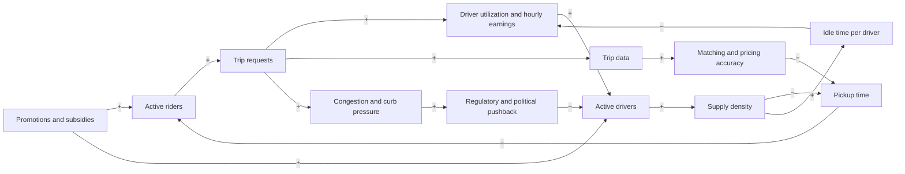
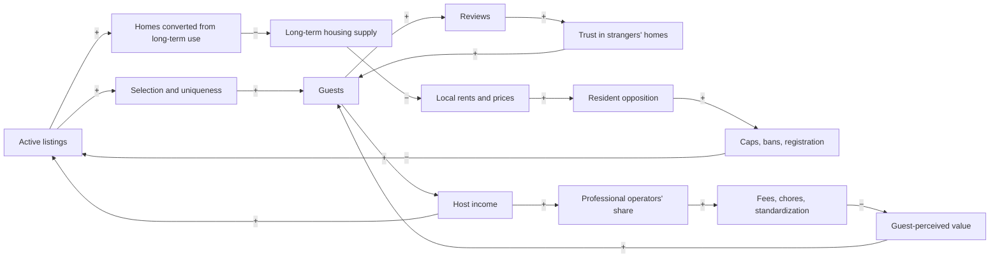
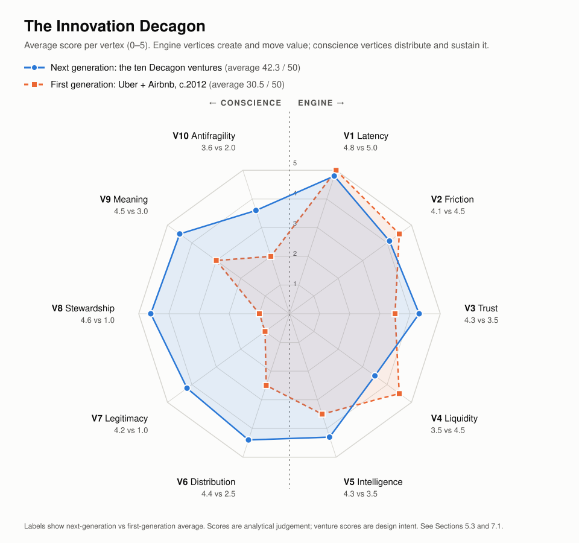
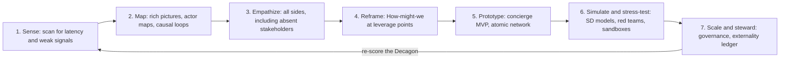
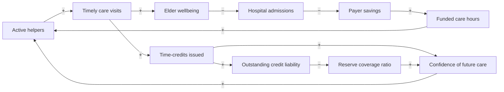
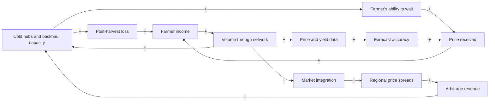
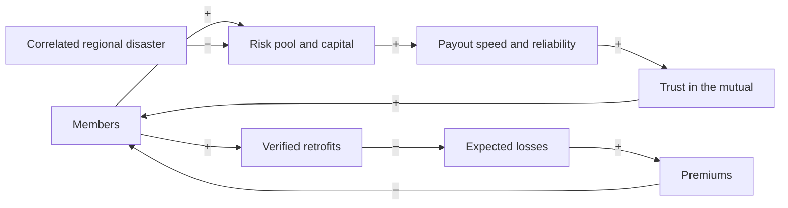
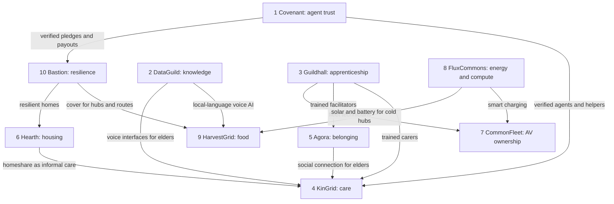

# The Innovation Decagon

## Uber, Airbnb, and a Systems Framework for the Next Ten Disruptions

*A theory-building essay and practical framework drawing on systems theory, system dynamics, cybernetics, design thinking, digital transformation and artificial intelligence.*

Working paper · October 2026

---

## Executive summary

**The thesis in one sentence.** Uber and Airbnb did not invent cars or homes; they invented *legibility*. They made idle capacity visible, trustworthy and transactable at the moment of need. The next generation of disruptive ventures will do the same for capacities that are only now becoming latent or newly valuable, such as care time, grid flexibility, apprentice potential, idle land, tacit knowledge and trust itself. To last, they will have to take back the costs that the first generation pushed onto cities, workers and neighbours.

**What this document does:**

1. **Benchmarks** Uber and Airbnb across 21 dimensions. Six "shared genes" explain their success, and twelve differences explain why the two businesses behave differently.
2. **Models them as systems.** It uses causal loop diagrams, stock-and-flow logic, Senge's system archetypes, Meadows' leverage points, Ashby's law of requisite variety and Beer's Viable System Model.
3. **Theorizes and philosophizes.** It reads the two companies through Coase, Hayek, Schumpeter, Christensen, Polanyi, Heidegger, Illich, Ostrom, Zuboff, Rawls and the African ethic of *Ubuntu*. The conclusion is that they are *latency compilers*: they turned invisible slack into a market. They also *commodified fictitious commodities* (labour and land) at a finer grain than ever before, which is why society pushed back.
4. **Projects their futures** (2026–2040). It uses three-horizon analysis, the panarchy adaptive cycle and a 2×2 scenario matrix (*Walled Gardens, Agent Bazaar, Civic Platforms, Protocol Commons*). The main forecast is that **in the agentic era, aggregators of demand lose power and aggregators of trust gain it.**
5. **Builds the Innovation Decagon.** This is a ten-vertex framework for designing disruptive ventures. Five "engine" vertices create and move value: *Latency, Friction, Trust, Liquidity, Intelligence*. Five "conscience" vertices distribute and sustain it: *Distribution, Legitimacy, Stewardship, Meaning, Antifragility*. The framework comes with a 50-point scoring rubric, a seven-stage *Systemic Design Spiral* process, a canvas and ten design principles.
6. **Proposes a Decagon of Ventures.** These are ten disruptive startup concepts, each aimed at a *new* problem of the late 2020s, each inheriting Uber/Airbnb DNA and each *inverting* one of their failures:

| # | Venture | New problem it solves | Latent capacity it unlocks |
|---|---|---|---|
| 1 | **Covenant** | Nobody can trust, authorize or hold liable the AI agents that now shop and book for us | Scattered trust signals; insurer underwriting capacity |
| 2 | **DataGuild** | AI needs expert, consented human data, and creators get nothing | Tacit expertise; under-represented languages |
| 3 | **Guildhall** | AI is erasing the entry-level "first rung" of careers | Juniors' time, retirees' mentorship, SMEs' unmet work |
| 4 | **KinGrid** | The care deficit of ageing societies | The "young-old", neighbours, time-credits |
| 5 | **Agora** | Loneliness, linked to about 871,000 deaths a year (WHO, 2025) | Idle venues in off-hours; idle evenings |
| 6 | **Hearth** | Housing scarcity amid under-occupied homes and land | Spare rooms, backyards, empty offices |
| 7 | **CommonFleet** | Robotaxis may displace the drivers who built ride-hailing | Drivers' operational skill; community capital |
| 8 | **FluxCommons** | AI's electricity hunger and a congested grid | Parked EVs, home batteries, compute waste-heat |
| 9 | **HarvestGrid** | Perishable food loss and climate heat stress (Africa-first) | Empty backhauls, solar cold rooms, warehouse receipts |
| 10 | **Bastion** | Insurers retreating from climate risk | Community spare capacity; satellite triggers; mutual traditions |

**The central design insight.** Uber and Airbnb maximized the engine vertices and neglected the conscience vertices. The regulatory, labour and housing backlash they now face is the conscience vertices arriving with interest. The ventures in this paper are designed in the opposite order. Ex-ante, they score higher on stewardship and distribution but *lower on liquidity and antifragility*. That gap is the **stewardship premium**. Paying it deliberately, rather than discovering it in court, is the strategic opportunity of the coming decade.

> **A heuristic, not a law:**
> *Durable value created ≈ Latent capacity × Legibility × Trust × Liquidity − Externalities exported*
> The first generation optimized the four multiplied terms and ignored the subtracted one. The next generation must design all five.

---

## How to read this document

| Part | Content | Use it if you want to… |
|---|---|---|
| I | The benchmark: anatomy of Uber and Airbnb | Understand the baseline in depth |
| II | The systems lens: loops, archetypes, leverage points, cybernetics | See *why* they worked and where they break |
| III | Theory and philosophy | Understand what they *mean* |
| IV | Futures of Uber and Airbnb, 2026–2040 | Anticipate where platforms are going |
| V | The Innovation Decagon framework | Design or evaluate a venture |
| VI | The Decagon of Ventures: ten startup concepts | Get concrete opportunities |
| VII | Portfolio synthesis, roadmap and closing philosophy | Act on it |
| Appendices | Canvas, scoring rubric, glossary, sources | Apply the framework yourself |

A note on evidence: company figures come from published results (cited in Appendix D). Scores and scenario judgements are the author's analytical judgement and are labelled as such. Every startup concept is a hypothesis to be tested, not a forecast.

---

# Part I: The Benchmark

## 1.1 Two companies, one moment

Airbnb began when Brian Chesky and Joe Gebbia rented air mattresses on their San Francisco floor to delegates at a 2007 design conference whose hotels had sold out. With Nathan Blecharczyk they formalized it in 2008 and joined Y Combinator in early 2009. Uber was conceived by Garrett Camp and Travis Kalanick in 2008–09 and launched as UberCab in San Francisco in 2010.

The timing was not a coincidence. Both companies are children of the same **enabling stack**, which appeared within roughly 24 months:

| Enabler (2006–2010) | What it made possible |
|---|---|
| Smartphone and App Store (2007–08) | A computer in every pocket, always on, always located |
| GPS in phones | Supply and demand visible on a live map |
| Cloud computing (AWS, 2006) | Global scale without data centres |
| Online payments (e.g., Braintree, Stripe) | Cashless, escrowed, frictionless settlement |
| Social identity and review culture (Facebook Connect, 2008) | Strangers with faces, histories and reputations |
| Zero-interest-rate capital | Investors willing to subsidize market creation for a decade |
| The Great Recession (2008–09) | Slack on both sides: people needed income, consumers needed cheaper options |

The recession matters philosophically. Crisis produces **slack**: unused rooms, unemployed hours, underused cars. Platforms are machines for converting slack into supply. The same conditions are recurring now. AI-displaced labour, ageing populations, post-pandemic empty offices, midday solar surplus and idle GPUs at night are the slack of the 2020s (see Part V).

## 1.2 The comprehensive similarity matrix

| # | Dimension | Uber | Airbnb | Shared principle |
|---|---|---|---|---|
| 1 | **Latent asset** | Private cars, parked ~95% of the time (Shoup), and drivers' idle hours | Spare rooms, second homes, empty homes while owners travel | *Excess capacity is inventory waiting to be made visible* |
| 2 | **Asset model** | Owns no cars (until the autonomous era) | Owns no homes | *Asset-light: other people's capital, platform's coordination* |
| 3 | **Market structure** | Riders ↔ drivers, later eaters ↔ restaurants ↔ couriers, shippers ↔ carriers, advertisers, AV fleets | Guests ↔ hosts, later experience hosts and service providers (chefs, photographers, therapists) | *Two-sided market evolving into a multi-sided platform* |
| 4 | **Revenue logic** | Take rate on gross bookings (FY2024: revenue ≈ 27% of gross bookings, all segments) | Service fees (FY2025: revenue ≈ 13% of gross booking value) | *Tax on the transaction, not ownership of the asset* |
| 5 | **Network effects** | Cross-side, **local** (city-level liquidity) | Cross-side, **global demand → local supply** | *More of one side attracts more of the other* |
| 6 | **Trust infrastructure** | Two-way ratings, ID and background checks, GPS trip trace, in-app payment, insurance, safety toolkit | Two-way reviews, ID verification, payment held until after check-in, AirCover guarantees, secure messaging | *Making strangers safe for each other* |
| 7 | **Pricing** | Algorithmic surge and upfront pricing; the platform sets the price | Hosts set prices with algorithmic "Smart Pricing" suggestions | *Algorithmic price discovery replaces fixed tariffs* |
| 8 | **Supply-side identity** | "Driver-partners" classified as independent contractors | "Hosts" as micro-entrepreneurs | *Providers are neither employees nor firms: a contested middle category* |
| 9 | **Regulatory posture** | Entered cities without permission; fought taxi regulators (e.g., London licence refusal 2017; California Prop 22, 2020) | Fought zoning and hotel-tax rules (e.g., NYC Local Law 18 enforced from 2023; Barcelona plans to end tourist-flat licences by 2028) | *"Regulatory entrepreneurship" (Pollman and Barry): growth first, legitimacy later* |
| 10 | **Legal self-definition** | "A technology company, not a transport company", rejected by the EU Court of Justice in *Elite Taxi* (2017) | "A marketplace, not a landlord or hotel" | *Claiming to be an intermediary to avoid sector rules* |
| 11 | **Externalities** | Added congestion (SFCTA, 2018, attributed about half of San Francisco's 2010–16 congestion growth to ride-hail); transit substitution; driver earnings pressure | Rent and price pressure (Barron, Kung and Proserpio, 2021: a 1% rise in listings → +0.018% rents, +0.026% prices); over-tourism; neighbourhood churn | *Private assets turned commercial, costs exported to the commons* |
| 12 | **Growth playbook** | City-by-city launches, heavy subsidies on both sides, local "launchers" | Craigslist cross-posting, founders photographing NYC listings by hand (2009), cereal-box survival funding | *"Do things that don't scale" to seed an atomic network* |
| 13 | **Experience design** | One tap, a car on the map, an ETA, no cash, no tip awkwardness | Design-led founders (RISD); storyboarded guest journeys; Chesky's "11-star experience" | *Experience design as a competitive weapon* |
| 14 | **Data and AI** | ETA prediction, matching, routing, fraud, ML platform (Michelangelo) | Search ranking, pricing, fraud, AI customer service | *Data flywheels: each transaction trains the next* |
| 15 | **Capital** | Tens of billions of private capital before the 2019 IPO | Large private rounds; IPO December 2020 | *Patient capital subsidizes market creation* |
| 16 | **Path to profit** | Losses for a decade; first full-year operating profit 2023; FY2025 free cash flow ≈ $9.8bn | GAAP profitable from 2022; FY2025 free cash flow ≈ $4.6bn | *Scale first, margin later (a ZIRP-era luxury)* |
| 17 | **Category expansion** | Eats, Freight, Uber One, advertising, Uber AI Solutions (data labelling), AV aggregation | Experiences (2016), relaunched Services and Experiences (2025), long stays, hotels, co-hosting | *Single use case → platform of platforms → "super-app" ambition* |
| 18 | **Crisis behaviour** | COVID: mobility collapsed, delivery boomed and kept the company alive | COVID: bookings collapsed, then shifted to domestic, rural and long stays | *Portfolio adaptability as resilience* |
| 19 | **Brand** | Became a verb ("to Uber"); 2017 culture crisis forced a CEO change | "Belong anywhere"; community and design identity | *Brand as a proxy for trust* |
| 20 | **Philosophy** | Access over ownership: "transportation as reliable as running water" | Access over ownership, plus belonging | *Rifkin's "Age of Access" made real* |
| 21 | **Scale (FY2025)** | $193bn gross bookings; 202m monthly active platform consumers (Q4); ~3.8bn trips in Q4 alone | $91.3bn gross booking value; $12.2bn revenue; 533m nights and seats booked | *Global infrastructure built on other people's assets* |

*Sources: company results for FY2024–FY2025 (Appendix D). Take-rate ratios are computed from reported revenue and bookings and are approximate.*

## 1.3 The six shared genes

Under the 21 surface similarities lie six deeper "genes". These are the transferable logic that Part V turns into a framework.

1. **Legibility.** Both made latent capacity *visible*. Before Uber, a car three streets away was invisible to you. Before Airbnb, a stranger's spare room in Lisbon did not exist as a market object. The map and the listing page are the founding technologies; everything else is optimization.
2. **Trust at a distance.** Both solved the "stranger danger" problem with reputation (two-way ratings), identity (verification), guarantees (insurance, escrow) and traceability (GPS, messaging logs). Rachel Botsman calls this the shift from *institutional* to *distributed* trust.
3. **Algorithmic coordination.** Both replaced a human coordinator (the dispatcher, the hotel front desk, the travel agent) with code. Coordination cost fell from minutes and phone calls to milliseconds.
4. **Liquidity engineering.** Both solved the chicken-and-egg problem by seeding small, dense "atomic networks" (one city, one event) and subsidizing the hard side until the market cleared on its own.
5. **Regulatory entrepreneurship.** Both treated existing rules as obstacles to be outgrown rather than constraints to be designed around. They grew faster than law could respond, then used their users as a political constituency.
6. **Experience minimalism.** Both made a complex service feel like a single gesture. Every element of friction was treated as a design defect.

## 1.4 The differences that matter

Similar genes produce different phenotypes when the environment differs. These twelve differences explain why the two companies behave so differently, and they are design variables for any new venture.

| Variable | Uber | Airbnb | Strategic consequence |
|---|---|---|---|
| **Purchase frequency** | High (weekly or daily) | Low (a few times a year) | Uber builds habit; Airbnb must rebuild intent on every trip |
| **Ticket size** | Small | Large | Airbnb tolerates more friction per transaction |
| **Supply heterogeneity** | Commoditized (a car is a car) | Unique (every home differs) | Uber sets the price; Airbnb lets hosts set it |
| **Network-effect geography** | Local: a London driver doesn't help a Lagos rider | Global demand, local supply | Uber's moat is city-by-city and contestable; Airbnb's is harder to copy |
| **Network-effect saturation** | Saturates once pickup times reach a few minutes | Keeps growing with selection | Uber faces durable competition (e.g., Lyft, Bolt, Didi) |
| **Disintermediation risk** | Low (you won't call the same driver again) | High (repeat guests can book direct) | Airbnb invests heavily in guarantees to keep the transaction on-platform |
| **Automation exposure** | Very high: the driver can be replaced by software | Very low: the home cannot be automated away | Uber's future is AV aggregation; Airbnb's is human hospitality plus AI |
| **Multi-homing** | Drivers and riders run several apps at once | Hosts list on several sites | Both face margin pressure from switchable supply |
| **Regulatory locus** | Transport and labour law (state or national) | Zoning and housing (municipal) | Uber fights labour classification; Airbnb fights city councils |
| **Contested commodity** | Labour time | Land and home | Different sides of Polanyi's "fictitious commodities" (Part III) |
| **Emotional content** | Utility: get me there | Meaning: belong, experience, story | Airbnb can sell identity; Uber sells reliability |
| **Christensen classification** | *Not* classically disruptive: it started in the mainstream with premium black cars (Christensen, 2015) | Closer to *new-market* disruption: early users were budget travellers who would not have booked hotels | "Disruptive" in everyday speech ≠ disruptive in theory |

**The lesson for founders:** do not copy a company; copy its *genes*, then work out which *environmental variables* your market sets. A care-network venture is high-frequency like Uber, but its supply is heterogeneous and its emotional content is high like Airbnb. It therefore needs Uber's dispatch with Airbnb's trust and warmth.

## 1.5 The benchmark scoreboard (FY2025)

| Metric | Uber | Airbnb |
|---|---|---|
| Gross bookings / gross booking value | ≈ $193bn | ≈ $91.3bn |
| Revenue | ≈ $44.0bn (FY2024; on $162.8bn gross bookings) | ≈ $12.2bn (+10%) |
| Free cash flow | ≈ $9.8bn | ≈ $4.6bn |
| Usage | 202m monthly active platform consumers (Q4 2025); ~3.8bn trips in Q4 | 533m nights and seats booked |
| Newest growth vectors | Autonomous-vehicle aggregation (deals with 20–30+ AV companies), advertising, Uber One, AI data services | Services and Experiences, "Reserve Now, Pay Later", AI-native app and AI customer service |

*Figures as reported in Q4/FY2025 results (February 2026); see Appendix D.*

---

# Part II: The Systems Lens

> "A system is an interconnected set of elements that is coherently organized in a way that achieves something." (Donella Meadows)
>
> "The purpose of a system is what it does." (Stafford Beer)

## 2.1 Platforms as complex adaptive systems

General systems theory (von Bertalanffy) treats an organization as an *open system*: it exchanges energy, information and matter with its environment, and its behaviour comes from structure, not from the intentions of its parts. Uber and Airbnb are open systems of an unusual kind. Their elements are mostly *outside* the firm (drivers, hosts, riders, guests, cities, regulators, insurers, neighbours), and the firm controls only the **rules and information flows** that connect them.

Beer's dictum, **POSIWID** ("the purpose of a system is what it does"), gives a useful audit:

| | Stated purpose | What the system does (POSIWID) |
|---|---|---|
| **Uber** | "Move the way you want" | Converts underused cars and labour time into on-demand mobility and delivery. It transfers vehicle capital, depreciation and utilization risk to drivers while keeping pricing power centrally. |
| **Airbnb** | "Belong anywhere" | Converts residential housing stock into flexible hospitality inventory. It gives hosts income and travellers variety, and it moves housing from long-term residents to short-term visitors in high-demand areas. |

Neither description is a moral verdict. Both are *structural*. The gap between stated and actual purpose is where the system's future conflicts lie.

## 2.2 Stocks and flows

System dynamics (Forrester; Sterman) models a system as **stocks** (accumulations) changed by **flows** (rates), governed by **feedback**.

| | Key stocks | Inflows | Outflows |
|---|---|---|---|
| **Uber** | Active drivers; active riders; reputation/trust; cash; regulatory goodwill | Onboarding, promotions, referrals | Driver churn, rider churn, scandals, bans |
| **Airbnb** | Active listings; guests; reviews (trust capital); host community goodwill; *the city's long-term housing stock* | New hosts, conversions of homes, marketing | Host exits, regulation, delistings, *housing withdrawn from residents* |

Note the last stock in Airbnb's row. It is **not on Airbnb's balance sheet, but it is in Airbnb's system**. A large part of the history of platform regulation is the story of stocks that the firm affects but does not account for.

## 2.3 Causal loop diagrams

Notation: an arrow marked **+** means "moves in the same direction"; **−** means "moves in the opposite direction". A loop with an even number of **−** links is **reinforcing (R)**; with an odd number it is **balancing (B)**.

### Uber's core loop structure

- **R1, the liquidity flywheel** (David Sacks' napkin sketch): riders → requests → driver earnings → drivers → density → shorter pickup times → more riders.
- **R2, the learning loop:** requests → data → better matching and pricing → shorter waits → more riders.
- **B1, driver saturation:** drivers → density → idle time per driver → lower hourly earnings → fewer drivers. This loop is why fare increases don't permanently raise driver pay. Hall, Horton and Knoepfle found that after Uber raised fares, drivers' hourly earnings rose only briefly, because more drivers entered and utilization fell. The balancing loop absorbed the change.
- **B2, the political loop:** growth → congestion and visible externalities → regulatory pushback → caps, licensing and classification rules → fewer drivers.
- **The subsidy pathway** is a *Shifting the Burden* structure (Section 2.4). Subsidies produce liquidity quickly but delay the fundamental fix of real unit economics.

### Airbnb's core loop structure

- **R1, the supply–demand flywheel:** listings → selection → guests → host income → more listings.
- **R2, the trust loop:** guests → reviews → trust → more guests. This loop is Airbnb's deepest asset, because reviews of unique homes cannot be copied by a competitor.
- **B1, the housing backlash:** listings → conversions → less long-term housing → higher rents → resident opposition → regulation → fewer listings. This is *Limits to Growth* with a *Tragedy of the Commons* inside it.
- **B2, the authenticity erosion:** success attracts professional operators → more fees and standardization → the home starts to feel like a worse hotel → lower perceived value. The thing that made Airbnb special is diluted by its own success.

## 2.4 System archetypes

Peter Senge and Daniel Kim catalogued a small number of recurring structures (*archetypes*) that generate familiar failures. Both companies display almost the full set.

| Archetype | Structure | Uber | Airbnb | Lesson for the next generation |
|---|---|---|---|---|
| **Limits to Growth** | Growth loop meets a constraint | Curb space, congestion, driver supply | Housing tolerance of cities | *Identify the limiting resource before scaling* |
| **Tragedy of the Commons** | Individually rational use depletes a shared resource | Streets, curbs and transit ridership are commons | Neighbourhood quiet, housing affordability and local identity are commons | *Price or govern the commons from day one* |
| **Shifting the Burden** | A symptomatic fix (subsidy) weakens the fundamental fix | A decade of subsidized rides delayed real unit economics | Regulatory ambiguity used as a substitute for compliant design | *Use subsidies only to reach a self-sustaining density, with an exit plan* |
| **Success to the Successful** | Winners get the resources to win more | Ride-hail duopolies; exits from China (2016) and Southeast Asia (2018) | Market leadership in short-term rentals | *Winner-take-most invites antitrust and "enshittification"* |
| **Fixes that Fail** | A fix creates delayed side effects | Surge pricing during emergencies (e.g., Sydney, 2014) → outrage → caps | Cleaning fees and opaque totals → guest anger → price-display changes | *Model the second-order reaction to every pricing rule* |
| **Escalation** | Rivals respond to each other's moves | Uber vs Lyft and Uber vs Didi subsidy wars | Promotion wars with online travel agencies | *Avoid symmetric arms races; compete on asymmetric advantages* |
| **Eroding Goals** | Standards slip under pressure | Driver earnings floors and safety standards eroded until regulation intervened | Host quality standards loosened during hyper-growth | *Hard-code non-negotiable standards into the platform's rules* |
| **Growth and Underinvestment** | Growth outruns capacity investment | Trust and safety and culture underinvestment → 2017 crisis | Safety and party-house incidents → global party ban (2020, permanent 2022) | *Invest in trust capacity ahead of demand* |

**Enshittification as a compound archetype.** Cory Doctorow's term describes a lifecycle: platforms are first good to users, then shift value to business customers, then extract from both. In systems terms it is *Success to the Successful* (lock-in) combined with *Eroding Goals* (quality standards slip once switching costs are high). The structural antidote is to keep exit open (data portability and interoperability) so the balancing loop of user departure stays strong.

## 2.5 Leverage points

Meadows ranked twelve places to intervene in a system, from least to most powerful. Mapping Uber and Airbnb onto her list explains why their impact was so large.

| Rank | Leverage point | What Uber/Airbnb did there | Leverage |
|---|---|---|---|
| 12 | Parameters (numbers, prices) | Surge pricing, fees, take rates | Low; balancing loops absorb it (Section 2.3, B1) |
| 11 | Buffers | A flexible driver pool buffers demand peaks | Low–medium |
| 10 | Stock-and-flow structure | Turned millions of private cars and rooms into a virtual fleet and hotel without owning them | Medium |
| 9 | Delays | Cut waiting from ~20 minutes (a phoned taxi) to ~4; cut lodging search from days to minutes | Medium |
| 8 | Balancing feedback | Ratings as fast quality correction; deactivation of poor performers | Medium |
| 7 | Reinforcing feedback | Network effects and data flywheels | High |
| **6** | **Information flows** | **The car on the map; the listing with photos and reviews. Making invisible supply visible.** | **Very high** |
| 5 | Rules | Regulatory entrepreneurship: rewrote de facto rules before de jure ones | Very high |
| 4 | Self-organization | Millions of micro-entrepreneurs organizing their own supply | Very high |
| 3 | Goals | Shifted the goal from *owning* a car or hotel room to *accessing* mobility and lodging | Very high |
| **2** | **Paradigm** | **"Strangers can be trusted"; "the city is a shared fleet"; "a home is also a hospitality asset."** | **Highest** |
| 1 | Transcending paradigms | Not reached; both remained inside the paradigm of extraction-based growth | – |

**Insight.** Meadows' own favourite example of an information-flow intervention was moving the electricity meter into the front hallway, which cut consumption simply by making it visible. Uber and Airbnb are that example at planetary scale. Their founding intervention was **rank 6 (information)** driven by a **rank 2 (paradigm)** shift. The later struggles all occurred at **ranks 5 and 3 (rules and goals)**, which they treated as obstacles rather than design material. The next generation's opportunity is to design deliberately at ranks 5, 4 and 3: rules, self-organization and goals.

## 2.6 Cybernetics: requisite variety and the viable system

**Ashby's Law of Requisite Variety** says that only variety can absorb variety: a controller must have at least as many possible responses as the disturbances it faces. Urban mobility demand is highly variable (rain, concerts, Friday nights, airports at 5 a.m.). The taxi system, with a fixed medallion count and fixed fares, had **too little variety**. Uber's elastic supply plus dynamic pricing had **requisite variety**. Hotels offer standardized rooms; travellers' needs (families, groups, long stays, pets, remote work, rural stays) are highly varied. Airbnb's heterogeneous supply matched that variety.

> **Disruption corollary (Ashby):** disruption happens where an incumbent's *regulated or structural variety* is lower than its environment's variety, and a newcomer can supply the missing variety cheaply.

This corollary is a search heuristic. Look for sectors where demand variety is rising (ageing, climate, AI) while incumbent response variety is fixed by regulation, capital structure or culture. Care homes, insurers, universities, utilities and housing developers are all candidates, and Part VI targets each of them.

**Beer's Viable System Model (VSM)** describes the five functions any system needs to remain viable:

| VSM system | Function | Uber | Airbnb | Typical failure |
|---|---|---|---|---|
| **S1: Operations** | Do the primary work | Drivers, couriers, trips | Hosts, stays, experiences | Burnout, churn |
| **S2: Coordination** | Damp oscillations between operations | Dispatch, surge, routing algorithms | Calendars, pricing tools, messaging | Algorithmic opacity |
| **S3: Control / audit (S3*)** | Optimize the whole; audit | Ratings, deactivation, trust and safety | Reviews, verification, AirCover | Under-resourcing (Section 2.4) |
| **S4: Intelligence** | Sense the environment and future | AV strategy, new verticals | AI app, services, regulation strategy | Blind spot for externalities |
| **S5: Policy / identity** | Define purpose and values | Culture reset after 2017 | "Belong anywhere" | Gap between identity and POSIWID |

The VSM points to a structural flaw. In both companies, the **providers (S1) have almost no voice in S5**, the system's identity and policy. In VSM terms, the system is not fully viable, because it suppresses the variety of its own operational units. Driver protests, host revolts over fees and regulatory intervention are the system's way of restoring the missing channel. A next-generation design would build that channel in (Part V, vertex 6).

## 2.7 A minimal system dynamics model of a ride-hailing market

For readers who want the mechanics, here is a compact formal model. It is illustrative, not calibrated.

**Stocks:** riders *R*, drivers *D*, platform cash *C*.

**Key relationships:**

- Trips per hour: *T = min( λ(R, w, p), μ·D )*, where *λ* is demand (rising in riders, falling in wait *w* and price *p*) and *μ* is trip capacity per driver.
- Pickup wait (the spatial **square-root law**): *w ≈ k / √(D_idle / A)*, which falls with the square root of idle-driver density over area *A*.
- Driver hourly earnings: *e = (1 − τ)·p·T / D*, where *τ* is the take rate.
- Driver dynamics: *dD/dt = onboarding(e − e*) − churn(e* − e)*, where *e** is drivers' reservation wage.
- Rider dynamics: *dR/dt = acquisition(subsidy, word of mouth) − churn(w, p)*.
- Cash: *dC/dt = τ·p·T − subsidy − fixed costs*.

**Behaviours this model produces:**

1. **Saturating network effects.** Because of the square-root law, doubling drivers cuts waiting time by only ~29% (1 − 1/√2). Once waits are short, more density adds little, so the network effect *saturates*. That is why a second or third competitor can survive in ride-hailing, but rarely in a social network.
2. **Earnings convergence.** With free entry, *e* converges to *e** whatever the fare. The parameter (price) is absorbed by the balancing loop (driver entry), which is Meadows' point about low-leverage parameters made concrete.
3. **Subsidy overshoot.** Subsidies inflate *R* and *D* above their self-sustaining levels. When subsidies are withdrawn, the system undershoots before finding equilibrium, the classic *overshoot and collapse* signature.
4. **Take-rate trap.** Raising *τ* lowers *e*, which (after a delay) lowers *D*, raises *w* and lowers *R*. The delay hides the damage, so take rates tend to creep up until a balancing loop (driver exit, regulation) forces correction.

The Airbnb equivalent replaces drivers with *listings* and adds the city's housing stock *H*: *dH/dt = −conversion(yield_STR − yield_LTR) + new construction*. Conversions are driven by the yield gap between short- and long-term renting. Regulation is a delayed function of rent pressure. The model generates the observed pattern: rapid growth, then a regulatory correction concentrated in the highest-demand cities.

---

# Part III: Theory and Philosophy, or What Uber and Airbnb Really Did

## 3.1 Economics: why the platform exists

**Coase (1937): the collapse of transaction costs.** Ronald Coase asked why firms exist if markets are efficient. His answer was that using the market has costs: searching, bargaining, contracting and enforcing. Firms exist where those costs exceed the cost of internal hierarchy. Uber and Airbnb pushed **transaction costs** so low that markets became possible where none had existed. Nobody had ever "rented" a stranger's car journey for six minutes or a stranger's sofa for one night, because the transaction costs were prohibitive. The platform is a **machine for making markets cheap**.

The platform is also a hybrid: an **algorithmic firm** that coordinates through code what a firm would coordinate through managers, while keeping providers formally outside its boundary. This hybrid status is the root of the employment-classification fights, because the platform exercises firm-like control (pricing, deactivation) over market-like participants.

**Williamson: asset specificity.** Cars and spare rooms have low *asset specificity*: they can be redeployed to many users without loss. That is why market governance works for them. The heuristic for founders: **platforms work best where the latent asset has low specificity and high idle time.** The Latency rubric in Appendix B builds this in.

**Hayek (1945): the knowledge problem, inverted.** Hayek argued that prices aggregate dispersed knowledge no planner could gather. Surge pricing looks like a Hayekian price signal: it tells drivers where they are needed. But there is an inversion. The platform *does* gather the dispersed knowledge, every trip and every search, and shares only a filtered price with participants. The result is a **Hayekian market operated by an all-seeing planner**. Rosenblat and Stark (2016) documented the resulting information asymmetry in "algorithmic management". The platform knows the whole market; the driver sees one fare. **Information asymmetry is the hidden source of platform power**, and a next-generation design principle is to give participants the information they need to bargain.

**Rochet and Tirole (2003): two-sided markets.** Platforms choose a *price structure*, not just a price level: which side pays and which is subsidized. Uber subsidized both sides in the launch years; Airbnb charges both. The next-generation question is subtler: **which side, including third parties such as cities and neighbours, bears the externality, and should it be paid?**

## 3.2 Innovation theory: disruption, properly understood

**Schumpeter's creative destruction.** Both companies are Schumpeterian: new combinations of existing resources (cars, homes, phones, payments) that destroyed incumbent rents (taxi medallion values collapsed in several US cities; hotels lost pricing power during peak events).

**Christensen's disruption theory, applied strictly.** In *What Is Disruptive Innovation?* (HBR, 2015), Clayton Christensen and co-authors argued that **Uber is not a disruptive innovation in the technical sense**. It did not start with a low-end foothold (customers over-served by incumbents) or a new-market foothold (non-consumers). It started in the mainstream with a product often *better* than taxis. Airbnb is closer to the theory: its first customers were budget travellers and conference overflow who would not have stayed in hotels at all, a **new-market foothold**. It then moved upmarket.

**Why this matters for founders.** The popular use of "disruption" (any big change) hides the mechanism that makes disruption *hard to fight*: **asymmetric motivation**. Incumbents rationally ignore footholds that look unattractive to them. The ten ventures in Part VI are each classified by their foothold. The strongest begin with **non-consumption**, people currently served by nothing: uninsured traders, smallholders without cold storage, lonely people without a "third place", juniors with no first rung.

## 3.3 Political economy: Polanyi and the double movement

Karl Polanyi's *The Great Transformation* (1944) is perhaps the most important book for understanding platforms, though it predates them by sixty years. Polanyi argued that market society depends on treating three things as commodities that were *not produced for sale*: **labour** (human life), **land** (nature and place) and **money**. He called them *fictitious commodities*. When markets commodify them too aggressively, society protects itself through regulation, unions, zoning and welfare. Polanyi called this the **double movement**.

Read through Polanyi:

- **Uber commodified labour at a finer grain than ever before**: the minute, the trip, the delivery. The double movement followed: California's AB5 and Prop 22 battle, the UK Supreme Court's *Uber v Aslam* (2021) worker ruling, and the EU Platform Work Directive (Directive (EU) 2024/2831), with its rebuttable presumption of employment and rules on algorithmic management, due for transposition by **2 December 2026**.
- **Airbnb commodified land and home at a finer grain than ever before**: the night. The double movement followed: registration laws, night caps, NYC's Local Law 18 and Barcelona's plan to phase out tourist-apartment licences by 2028.

> **The Polanyi Prediction:** *Any platform that commodifies a fictitious commodity, whether labour, land, money, or (we should now add) attention, data, care and identity, will trigger a double movement. The only choice is whether to design for it in advance or to fight it afterwards.*

This prediction is the single most important input to the framework in Part V. The next generation of opportunities (care, data, housing, energy, identity) are *all* fictitious or quasi-fictitious commodities. Those ventures must be **pre-embedded**: designed from the start with the protections society would otherwise impose.

## 3.4 Philosophy of technology: standing-reserve, conviviality and the self

**Heidegger: the world as standing-reserve.** In *The Question Concerning Technology* (1954), Heidegger argued that modern technology "enframes" (*Gestell*) the world, revealing everything as **standing-reserve** (*Bestand*): a resource on call, waiting to be optimized. A river becomes a power supply; a forest becomes timber stock. Uber and Airbnb extended enframing into private life. The parked car and the spare bedroom were revealed as standing-reserve, inventory on call. The home became a yield.

The danger for the next generation is clear. Applied carelessly, the same logic would reveal **elders' time, neighbours' batteries, citizens' data and children's attention** as standing-reserve. Heidegger's counter-concept is *poiesis*, a revealing that brings forth rather than extracts. A useful design question follows: *does this platform reveal the capacity as inventory or as a relationship?*

**Illich: tools for conviviality.** Ivan Illich (1973) distinguished **convivial tools**, which enlarge people's autonomy and creativity, from **manipulative tools**, which make people dependent and managed. A bicycle is convivial; a traffic jam is not. By Illich's test, a platform is convivial if providers can understand, influence and leave it, and manipulative if it manages them through opaque algorithms and lock-in. Section 5.7's principles are an attempt to operationalize conviviality.

**Foucault and Han: the rated self.** Five-star ratings are a soft panopticon (Foucault). Every interaction is observed, scored and stored, and a driver below the threshold can be deactivated. Byung-Chul Han's *The Burnout Society* adds that late-modern power works through **self-exploitation**: the gig worker is told they are an "entrepreneur of the self" and so drives themselves harder than any boss would. Next-generation trust systems should be **developmental rather than punitive**: feedback that helps people improve, appeal rights, and scores that decay so people can recover from a bad week.

## 3.5 Trust: from institutions to distributed to delegated

Rachel Botsman describes three eras of trust. **Local** trust lived in villages. **Institutional** trust lived in banks, brands and governments. **Distributed** trust lives in networks, reviews and platforms. Uber and Airbnb were the great pioneers of distributed trust, making it rational to get into a stranger's car or sleep in a stranger's home.

A fourth era is now beginning: **delegated trust**. We will increasingly trust *AI agents* to act for us, and others must decide whether to trust *our* agents. This is the trust problem of the late 2020s, and it is unsolved. Whoever provides identity, mandate, reputation and recourse for agents will hold a position as central as Visa's in card payments. Visa itself began as a member-owned association designed by Dee Hock as a "chaordic" organization, neither centralized nor anarchic. That governance model is directly relevant (see Venture 1, Covenant).

## 3.6 The commons and its governance

Elinor Ostrom showed, against the "tragedy of the commons" thesis, that communities often govern shared resources sustainably when certain **design principles** hold: clear boundaries, rules fitted to local conditions, participation of those affected, monitoring by accountable monitors, graduated sanctions, cheap conflict resolution, recognition by outside authorities, and nested governance.

Uber and Airbnb sit on commons (streets, housing, neighbourhood life) without governing them. **Platform cooperativism** (Trebor Scholz) and real examples point to alternatives. The Drivers Cooperative in New York (2021) is driver-owned. **Namma Yatri** in Bengaluru, built on the open Beckn/ONDC protocol, charges drivers a flat subscription instead of a per-ride commission. The future platform does not have to be a cooperative, but it does have to **answer Ostrom's questions**.

Jeremy Rifkin's *Zero Marginal Cost Society* and Yochai Benkler's commons-based peer production suggest why this matters more now. As AI pushes the marginal cost of coordination, translation, design and analysis toward zero, the *scarce* things become trust, legitimacy, physical capacity and human meaning. Platforms that try to extract rents from coordination alone will find those rents competed away by AI agents. Platforms that steward scarce trust and physical capacity will endure.

## 3.7 Surveillance and extraction

Shoshana Zuboff (*surveillance capitalism*) and Nick Srnicek (*platform capitalism*) argue that platforms are primarily **data-extraction apparatuses**: the service is the bait and behavioural data is the catch. Both companies collect deep behavioural data, Uber on location and movement and Airbnb on travel, identity and taste. The critique sets a design constraint: **data rights must be clear, and the value of data should flow partly back to those who generate it** (Venture 2, DataGuild, is built on this).

## 3.8 Justice: the veil-of-ignorance test

John Rawls asked what rules people would choose if they did not know their place in society. This yields a simple, powerful **platform-design test**:

> **The Veil-of-Ignorance Test:** *Would you accept this platform's rules if you did not know whether you would be the rider or the driver, the guest, the host or the neighbour, the shareholder or the city?*

Uber's early rules (opaque pay, unilateral deactivation, risk borne by drivers) and Airbnb's early rules (externalities borne by neighbours) would struggle to pass. Each venture in Part VI is designed to pass it.

## 3.9 Ubuntu: belonging as an operating principle

Airbnb's slogan "belong anywhere" is a commercial echo of an older idea. The Southern African ethic of **Ubuntu**, *umuntu ngumuntu ngabantu* ("a person is a person through other persons"), holds that identity and wellbeing are relational. Similar relational ethics appear across Africa. The Yoruba concept of *Ọmọlúàbí* describes a person of good character whose conduct honours the community. Rotating savings associations (*esusu*, *ajo*) and community labour exchanges are centuries-old **platforms of mutual trust** that worked without apps.

These traditions matter because the ventures with the best fit to the problems of the 2020s (care, loneliness, climate resilience, food security) are **relational, not transactional**. The first platform era optimized for *transactions between strangers*. The next era must also support *relationships among neighbours*. Ubuntu is not decoration. It specifies a different objective function: **maximize relational wellbeing, subject to economic sustainability**, instead of maximizing transactions subject to legal constraints.

## 3.10 Synthesis: latency, liberation and enclosure

Pulling the threads together:

1. **Platforms are latency compilers.** Capacity is *latent* when it is (a) invisible, (b) untrusted, (c) untransactable, or (d) uncoordinated. A platform compiles latency into liquidity by solving all four at once: the map or listing, the trust stack, payments and contracts, and algorithmic coordination.
2. **The paradox of liberation.** Platforms *liberate* latent capacity, since a spare room can now earn, and simultaneously *capture* the value of that liberation through take rates, data and lock-in. Historically this resembles the English **enclosures**, where common land was "improved" and privatized at once.
3. **The double movement is a design input.** Society will protect fictitious commodities. Designing for that protection in advance is cheaper than fighting it in courts and city halls.
4. **Scarcity is migrating.** AI is making coordination cheap. Trust, legitimacy, physical capacity, care and meaning are becoming scarce, and that is where the next platforms will create, and must steward, value.

> **The founding maxim of the next era:** *Liberate latent capacity without enclosing it.*

---

# Part IV: The Future Potential of Uber and Airbnb (2026–2040)

## 4.1 The adaptive cycle: where each company stands

Ecologists C.S. Holling and Lance Gunderson describe complex systems as moving through an **adaptive cycle** (*panarchy*). **Exploitation (r)** is rapid growth into open niches. **Conservation (K)** is efficiency, connectedness and rigidity. **Release (Ω)** is creative destruction. **Reorganization (α)** is novelty and recombination.

| Phase | Uber | Airbnb |
|---|---|---|
| r: exploitation (2009–2016) | City-by-city land grab | Global supply explosion |
| K: conservation (2017–2025) | Discipline, profitability, multi-vertical efficiency | Profitability, brand, regulatory accommodation |
| **Ω: release (2025–2032, emerging)** | **Autonomy releases the driver-based structure that built the company** | **Agentic AI releases the search-and-browse structure that built demand aggregation** |
| α: reorganization (2030s) | Uber as a utilization engine for autonomous capital *or* a commoditized dispatcher | Airbnb as a trust-and-identity layer for human hospitality *or* a supply feed for AI agents |

Systems in a mature K phase are efficient but fragile: highly connected and optimized for current conditions. **Both companies are entering the release phase of their founding structure**, and their futures depend on how they reorganize.

## 4.2 Uber: three horizons

| Horizon | Time | Opportunities |
|---|---|---|
| **H1: extend the core** | 2026–2028 | Mobility and delivery growth; Uber One membership; advertising; grocery and retail; Uber for Business; financial services for earners |
| **H2: build the emerging** | 2027–2032 | **Autonomous-vehicle aggregation.** Uber has struck deals with 20–30+ AV companies across robotaxi, delivery and freight. Robotaxi rides are offered through the Uber app in cities including Phoenix, Austin, Atlanta and Abu Dhabi, and a Lucid–Nuro robotaxi programme targets 20,000+ vehicles over six years. **Uber AI Solutions** (data labelling and AI-training work by its gig network, launched 2024). Autonomous freight; drone delivery |
| **H3: create the transformational** | 2030+ | A **city mobility operating system** integrating transit, micromobility, AVs and air taxis. A **"physical-world API"** that AI agents call to move people and goods. Fleet financing; EV and AV fleets as grid batteries |

**The strategic tension: aggregator or dispatcher?** In the AV era, the scarce resource is no longer drivers but **demand density and fleet utilization**. A robotaxi is expensive capital that must never sit idle, which is an ironic reversal of Uber's founding insight about idle cars. Uber's bet is that fleet owners will want the largest pool of demand to maximize utilization, so Uber becomes the "Booking.com of robotaxis". The counter-scenario is vertical integration: Waymo's rapid growth (around 500,000 paid rides a week by early 2026, with a stated target of 1 million) and Tesla's own robotaxi service show that AV makers may sell directly. The systems view suggests **both will co-exist by city**. Where an AV operator has density, it goes direct; where it lacks density, it rents Uber's demand.

**The human question.** Millions of drivers worldwide earn a living through ride-hail and delivery. The release phase threatens their livelihoods. How that transition is handled is a Polanyi double movement waiting to happen, and Venture 7 (CommonFleet) is designed around it.

## 4.3 Airbnb: three horizons

| Horizon | Time | Opportunities |
|---|---|---|
| **H1: extend the core** | 2026–2028 | Core stays; "Reserve Now, Pay Later"; co-hosting network; boutique hotels; long stays; growth in under-penetrated markets |
| **H2: build the emerging** | 2027–2032 | **AI-native app.** Its AI customer-service agent now resolves about a third of issues without a human in North America, and an AI concierge is planned for end-to-end trip planning. **Services and Experiences** (relaunched 2025: chefs, photographers, wellness) make Airbnb an "everyday" app. Identity and trust as a platform |
| **H3: create the transformational** | 2030+ | A **living platform**: housing-as-a-service, co-living, nomad infrastructure. A **portable trust passport** for the agent economy. Community and civic hosting (e.g., Airbnb.org for disaster housing) |

**The strategic tension: agentic disintermediation.** If travellers ask a general-purpose AI assistant to "find me a quiet two-bedroom near the beach in Lisbon under €200," the assistant becomes the aggregator of demand, and every lodging platform becomes a supply feed ranked by the agent. Booking.com and Expedia were among the first travel apps inside ChatGPT (October 2025), while Airbnb chose to prioritize its own AI-native app.

Airbnb's defensible assets in that world are the things an agent **cannot easily reproduce**:

- unique supply;
- millions of verified reviews;
- identity verification of hosts and guests;
- payment escrow and guarantees (AirCover);
- a community of hosts.

In short, its defensible asset is **the trust layer**.

> **Forecast:** *In the agentic era, aggregators of demand lose power and aggregators of trust gain it.*

## 4.4 Convergence

Uber and Airbnb are converging on the same five strategic assets:

1. **A "life logistics" super-app**: moving, staying, eating, services.
2. **Membership and subscription**: recurring relationships instead of one-off transactions.
3. **Advertising**: monetizing first-party intent data.
4. **AI agents as the front door**: conversational booking and support.
5. **Identity and trust**: verified people, verified providers and guarantees.

The fifth is the most important. Both companies spent fifteen years building **the world's largest repositories of stranger-to-stranger trust data**. In a world where AI-generated fraud and synthetic identities are becoming cheap, that trust is worth more than the matching algorithms that produced it.

## 4.5 Scenario matrix: the platform world in 2035

Two critical uncertainties drive the future:

- **Who mediates demand?** Humans using apps, or AI agents acting for humans.
- **How is the platform economy governed?** Extractive and laissez-faire, or embedded and commons-governed (Polanyi's double movement successfully absorbed).

| | **Human-mediated demand** | **Agent-mediated demand** |
|---|---|---|
| **Extractive governance** | **A. Walled Gardens.** Super-apps dominate; take rates creep; enshittification; regulatory whack-a-mole. Uber and Airbnb thrive financially but face continuous political conflict. | **B. Agent Bazaar.** AI assistants owned by a few tech giants intermediate everything. Platforms become API supply feeds competing on price; margins compress; value moves to whoever owns the agent. |
| **Embedded governance** | **C. Civic Platforms.** Cities license platforms, mandate data sharing (e.g., mobility data standards), cap externalities, enforce worker standards. Slower growth, high legitimacy. | **D. Protocol Commons.** Open protocols for identity, payments, trust and discovery (in the spirit of Beckn/ONDC, verifiable credentials and agent-to-agent standards). Agents negotiate across interoperable networks; value accrues to whoever provides verified trust and quality supply; cooperatives and public digital infrastructure flourish. |

**Signposts to watch:**

| Signpost | Points toward |
|---|---|
| Share of bookings initiated by AI agents rises fast | B or D |
| Open agent-payment and agent-identity standards gain adoption (e.g., agent payment protocols from major payment and AI firms, 2025 onward) | D |
| EU Platform Work Directive transposed strictly across member states | C or D |
| Platforms block AI agents or demand exclusivity | A |
| City data-sharing mandates and short-term-rental caps spread | C |
| Digital public infrastructure (UPI, Pix, ONDC, EU Digital Identity Wallet) extends to services marketplaces | D |

**Strategic implication for new ventures:** *build for Protocol Commons (D) while surviving the Agent Bazaar (B).* Be agent-native, interoperable and trust-rich. Do not depend on owning the user interface, because the interface may belong to someone's AI agent.

## 4.6 What the futures teach the next generation

1. **The founding structure always gets released.** Design for the release phase of your own model from the beginning (Antifragility, vertex 10).
2. **Trust compounds; matching commoditizes.** Invest in the trust layer more than the matching layer.
3. **Automation flips the scarce input.** When labour becomes software, capital utilization becomes the game. Ask early *who will own the robots*.
4. **Agents are the new users.** Every venture must be legible to and transactable by AI agents.
5. **The double movement is coming either way.** Design for embedded legitimacy.

---

# Part V: The Innovation Decagon Framework

## 5.1 From benchmark to blueprint

Parts I–IV yield two lists. The **six shared genes** (legibility, trust at a distance, algorithmic coordination, liquidity engineering, regulatory entrepreneurship, experience minimalism) explain *why* Uber and Airbnb won. The **systemic failures** (exported externalities, captured value, suppressed provider voice, the double movement, fragility to automation and agents) explain *where they are vulnerable*.

The Innovation Decagon combines both into **ten vertices**, each a *design obligation* that a disruptive venture must meet. They form two pentagons:

- **The Engine (vertices 1–5)** creates and moves value. These are the vertices Uber and Airbnb mastered.
- **The Conscience (vertices 6–10)** distributes and sustains value. These are the vertices they neglected, and where the double movement struck.

*Figure 1. The ten vertices of the Innovation Decagon, scored 0–5. The first-generation profile is the average of Uber and Airbnb at launch (c. 2012). The next-generation profile is the average design-intent score of the ten ventures in Part VI. Full scores are in Sections 5.3 and 7.1.*

## 5.2 The ten vertices

### The Engine

| # | Vertex | Core question | Uber benchmark | Airbnb benchmark | Typical metrics |
|---|---|---|---|---|---|
| **V1** | **Latency** | What capacity is idle, invisible, untrusted or uncoordinated, and how much of it exists? | Cars parked ~95% of the time | Spare rooms and empty homes | Utilization gap; size of the latent pool; growth of the pool |
| **V2** | **Friction** | Which transaction costs (search, trust, bargaining, contracting, enforcement, coordination) collapse, and by how much? | From phone-and-wait to one tap | From classifieds and wire transfers to instant booking | Time-to-transaction; cost-to-transact as % of value |
| **V3** | **Trust** | How do strangers, and now AI agents, trust each other? Identity, reputation, guarantees, escrow, recourse? | Ratings, background checks, GPS trace | Reviews, ID verification, AirCover | Incident rate; dispute-resolution time; "trust leap" distance |
| **V4** | **Liquidity** | What is the atomic network? Is the network effect local, global or clustered? When does it saturate? What is the multi-homing risk? | One city; local; saturates at short waits | One city of demand, global pull; does not saturate easily | Fill rate; time-to-match; atomic-network size; retention by cohort |
| **V5** | **Intelligence** | What data and AI loops improve matching, pricing, prediction and personalization? Is the venture **agent-ready** (legible to AI agents)? | ETA and pricing ML | Search ranking, AI service agent | Model lift per cohort; automation rate; agent-transaction share |

### The Conscience

| # | Vertex | Core question | Uber benchmark | Airbnb benchmark | Typical metrics |
|---|---|---|---|---|---|
| **V6** | **Distribution** | Who captures the surplus? Do providers share in upside (equity, not only earnings)? Is the take rate *legitimate*? Do providers have voice? | Opaque pay; no provider voice in governance | Hosts set prices; fee controversies | Provider share of value; income stability; provider voice mechanisms |
| **V7** | **Legitimacy** | Is there a licence to operate? Is the strategy co-regulation rather than arbitrage? Is data shared with public authorities? | Arbitrage first, legitimacy later | Arbitrage first; now registration-compliant in many cities | Jurisdictions with clear legal status; regulator relationship quality |
| **V8** | **Stewardship** | What are the second-order effects on commons (streets, housing, grid, climate, community)? Are they *modelled, measured and internalized*? | Congestion, transit substitution | Housing and over-tourism | An **externality ledger** (e.g., housing units added or removed, emissions, congestion); Ostrom-principle coverage |
| **V9** | **Meaning** | Does the venture enhance dignity, agency, belonging and accessibility for *every* participant, including non-users? Does it pass the veil-of-ignorance test? | Strong rider experience; weak driver dignity | Strong guest and host experience | Two-sided NPS; provider dignity index; accessibility compliance |
| **V10** | **Antifragility** | Does the venture gain from shocks (pandemic, regulation, automation, AI agents)? Is it modular and optionality-rich? Has it planned for the release phase of its own model? | Delivery saved it in COVID; AV transition uncertain | Pivoted to local and long stays in COVID; agentic threat | Revenue concentration; stress-test survival; adaptation lead time |

## 5.3 Scoring the benchmarks

Each vertex is scored **0–5** using the rubric in Appendix B, giving a maximum of **50**. The scores below are the author's analytical judgement.

| Vertex | Uber c.2012 | Uber 2026 | Airbnb c.2012 | Airbnb 2026 |
|---|---|---|---|---|
| V1 Latency | 5 | 5 | 5 | 5 |
| V2 Friction | 5 | 5 | 4 | 4 |
| V3 Trust | 3 | 4 | 4 | 5 |
| V4 Liquidity | 5 | 5 | 4 | 4 |
| V5 Intelligence | 4 | 5 | 3 | 4 |
| **Engine subtotal (/25)** | **22** | **24** | **20** | **22** |
| V6 Distribution | 2 | 2 | 3 | 3 |
| V7 Legitimacy | 1 | 3 | 1 | 2 |
| V8 Stewardship | 1 | 2 | 1 | 2 |
| V9 Meaning | 2 | 3 | 4 | 4 |
| V10 Antifragility | 2 | 4 | 2 | 4 |
| **Conscience subtotal (/25)** | **8** | **14** | **11** | **15** |
| **Total (/50)** | **30** | **38** | **31** | **37** |

**The imbalanced decagon.** Both companies launched with near-perfect engines (20–22 of 25) and weak consciences (8–11 of 25). Fourteen years of regulatory conflict, lawsuits and reputational crises raised their conscience scores. The improvement was *forced from outside* by the double movement, not designed from inside. The framework's proposition is that **designing the conscience in from day one is cheaper, faster to legitimacy and more defensible** than having it imposed.

## 5.4 The Systemic Design Spiral: the process

The Decagon is *what* to design for. The **Systemic Design Spiral** is *how*. It combines design thinking (the Design Council's Double Diamond; IDEO and Stanford d.school), Checkland's Soft Systems Methodology, system dynamics and lean experimentation. It is a spiral rather than a line because every turn re-scores the Decagon with new evidence.

| Stage | Purpose | Methods and tools | Decagon vertices informed | Output |
|---|---|---|---|---|
| **1. Sense** | Find where latent capacity and unmet need are accumulating | STEEP horizon scanning; weak-signal tracking; the **Latency Audit** (invisible? untrusted? untransactable? uncoordinated?); Ashby variety-gap analysis | V1, V10 | A shortlist of latency pools |
| **2. Map** | Understand the system before intervening | Checkland's rich pictures and CATWOE; stakeholder and actor maps; **causal loop diagrams**; the iceberg model (events → patterns → structures → mental models) | V4, V8 | System map with candidate loops and commons |
| **3. Empathize** | Understand needs, fears and dignity of every actor | Ethnography, shadowing, jobs-to-be-done interviews; **absent-stakeholder interviews** (neighbours, regulators, future generations, non-users); journey maps for *both* sides | V3, V6, V9 | Personas, journey maps, pain/gain maps |
| **4. Reframe** | Turn insight into a high-leverage opportunity | "How might we…" questions placed on Meadows' leverage points; Christensen foothold analysis (non-consumption first); veil-of-ignorance test | V2, V7 | A reframed problem statement and value hypothesis |
| **5. Prototype** | Test the core loop at the smallest viable scale | **Concierge MVP** (Airbnb's founders photographing listings by hand); Wizard-of-Oz AI (humans behind the AI); service blueprints; one **atomic network** | V2, V3, V4 | Evidence that one loop turns on its own |
| **6. Simulate and stress-test** | See consequences before scaling them | **System dynamics models** of reinforcing and balancing loops; agent-based simulation; red-teaming (fraud, abuse, prompt injection); pre-mortems; **regulatory sandboxes**; an externality ledger prototype | V5, V7, V8, V10 | Scaling plan with guardrails |
| **7. Scale and steward** | Grow while keeping the conscience strong | Governance design (Ostrom principles, provider councils, data trusts); public data-sharing agreements; continuous Decagon re-scoring | V6–V10 | Durable, legitimate growth |

## 5.5 The digital and AI opportunity stack: 2008 vs 2026

Uber and Airbnb rode the **2008 stack**. The next generation rides a new one. Every venture in Part VI is built on at least four of these layers.

| 2008 enabler | 2026 successor | What becomes possible |
|---|---|---|
| Smartphone | **Agentic AI** (large language models with tool use, memory, planning) | *Agents as users*: software that searches, negotiates, books and supports on behalf of people. Every marketplace gets a second kind of user. |
| GPS / location | **Ubiquitous sensing**: IoT, smart meters, EV telematics, wearables, satellites, earth observation | Physical capacity (battery charge, cold-room temperature, river level, an elder's activity) becomes *machine-readable in real time* |
| Social login and reviews | **Verifiable credentials and digital identity wallets** (e.g., the EU Digital Identity Wallet under eIDAS 2.0, due to be offered by member states by end-2026) | *Portable trust*: credentials and reputations that travel across platforms, privacy-preserving with zero-knowledge proofs |
| Card and online payments | **Instant and programmable money**: real-time rails (UPI, Pix, mobile money), regulated stablecoins (e.g., the US GENIUS Act, 2025), agent payment protocols | Micro-settlement, automatic parametric payouts, royalties streamed per use, payments initiated by agents under signed mandates |
| Cloud computing | **AI compute everywhere**, from hyperscale to the edge, plus confidential computing | Distributed, privacy-preserving AI; compute as a flexible load on the grid |
| Proprietary APIs | **Open protocols and digital public infrastructure** (Beckn/ONDC, agent-to-agent and model-context protocols, open banking) | Interoperable networks where no single platform owns the user |
| Human drivers and hosts | **Autonomy and robotics** (AVs, drones, warehouse robots) | Labour-free supply, so *capital utilization* becomes the game |
| Spreadsheets and dashboards | **Digital twins and simulation** | Model a city, grid or care system *before* deploying into it |
| Cheap capital (ZIRP) | **Expensive capital** (higher interest rates) | Ventures must be capital-efficient, cash-generating earlier, and less dependent on subsidy wars |
| Recession slack | **New slack**: AI-displaced entry-level labour; healthy retirees; post-pandemic empty offices; midday solar surplus; idle GPUs at night; under-occupied homes | The latent pools of Part VI |

**The new design rule: agent-native by default.** Every next-generation platform should treat AI agents as first-class users. That means machine-readable inventory, verifiable claims, programmatic negotiation within human-set mandates, and clear liability rules for agent actions. A platform that can only be used through its own app risks being left out when demand starts arriving through agents.

**Digital transformation, reframed.** Uber and Airbnb did not undergo digital transformation. They were born digital and *forced it on* taxi companies and hotels. The ventures in Part VI will likewise force transformation on insurers, care agencies, utilities, universities, housing developers and food wholesalers. For incumbents, the right response is to **become a participant in the protocol** before a newcomer becomes its owner.

## 5.6 The latency map: where market gaps are now

The table below scores twelve latency pools on four criteria (1–5):

- **Severity**: how serious the problem is.
- **Latency**: how much idle capacity exists.
- **Tech readiness**: how ready the enabling technology is.
- **Incumbent inability**: how structurally unable incumbents are to respond (low variety, asymmetric motivation).

The product is an *opportunity index* (maximum 625). These are judgement scores to prioritize exploration, not measurements.

| Latency pool | Problem | Severity | Latency | Tech readiness | Incumbent inability | Index | Venture |
|---|---|---|---|---|---|---|---|
| Trust signals for AI agents | Agentic commerce without accountability | 5 | 4 | 4 | 5 | 400 | Covenant |
| Tacit expertise and consented data | AI data scarcity and consent crisis | 4 | 5 | 4 | 4 | 320 | DataGuild |
| Junior talent and retired experts | AI erasing the first career rung | 5 | 5 | 4 | 4 | 400 | Guildhall |
| Care time of the "young-old" and neighbours | Care deficit in ageing societies | 5 | 4 | 4 | 4 | 320 | KinGrid |
| Idle venues and evenings | Loneliness epidemic | 4 | 5 | 4 | 4 | 320 | Agora |
| Spare rooms, backyards, empty offices | Housing scarcity | 5 | 4 | 3 | 4 | 240 | Hearth |
| Drivers' skills and community capital | Automation displacement | 4 | 4 | 3 | 4 | 192 | CommonFleet |
| EVs, batteries, compute heat | Grid stress from electrification and AI | 5 | 5 | 4 | 3 | 300 | FluxCommons |
| Backhauls, cold rooms, receipts | Food loss and climate heat stress | 5 | 4 | 4 | 4 | 320 | HarvestGrid |
| Community spare capacity and satellite data | Climate protection gap | 5 | 4 | 4 | 5 | 400 | Bastion |
| Diaspora capital and trust | Fraud in long-distance building and investing | 4 | 4 | 4 | 3 | 192 | (seed list, §7.4) |
| Products' remaining useful life | Waste and repair barriers | 3 | 5 | 3 | 3 | 135 | (seed list, §7.4) |

## 5.7 Ten design principles (the "decalogue")

1. **Make latency legible, not extractable.** Reveal capacity as a relationship to be honoured, not inventory to be strip-mined (Heidegger's test).
2. **Price the externality at the moment of the transaction.** If a booking removes a home from the housing stock, or a trip adds congestion, the price should say so.
3. **Share the upside, not just the wage.** Give providers equity, dividends, royalties or ownership pathways, not only per-task pay.
4. **Design for the double movement.** Build in the protections society would otherwise impose: classification clarity, data rights, caps and safety floors.
5. **Treat trust as infrastructure, not as a feature.** Identity, reputation, guarantees and recourse are the platform; matching is a commodity.
6. **Build for agents and humans.** Be legible to AI agents while protecting humans from manipulation by them.
7. **Start with an atomic network you can serve by hand.** Do things that don't scale until one loop turns on its own.
8. **Model the loops before you scale them.** Every reinforcing loop has a balancing loop waiting; find it in simulation, not in court.
9. **Measure dignity.** What gets measured gets designed. Measure provider dignity, belonging and agency alongside GMV.
10. **Keep the exits open.** Data portability, interoperability and transparent rules keep the platform honest and keep enshittification in check.

---

# Part VI: The Decagon of Ventures

Ten disruptive startup concepts, each designed with the Innovation Decagon. They are arranged in four layers, from the most abstract (trust and intelligence) to the most physical (planetary resilience):

| Layer | Ventures | What is latent |
|---|---|---|
| **A. Trust and intelligence** | 1 Covenant · 2 DataGuild | Trust signals, knowledge, data |
| **B. Human capacity** | 3 Guildhall · 4 KinGrid · 5 Agora | Time, skill, care, companionship |
| **C. Physical capacity** | 6 Hearth · 7 CommonFleet · 8 FluxCommons | Space, vehicles, energy, compute |
| **D. Planetary resilience** | 9 HarvestGrid · 10 Bastion | Food systems, community resilience |

Every venture follows the same template: **thesis → new problem → latent capacity → inherited DNA and inversion → mechanism → digital and AI stack → system dynamics → design thinking → business model → disruption logic → risks → first 100 days → Decagon score.** Scores are *design-intent* scores (what the concept is designed to achieve), not achieved results. They should be discounted for execution risk.

---

## Layer A: Trust and Intelligence

### Venture 1: COVENANT, the trust, identity and liability layer for AI agents

> **Thesis.** As AI agents begin to shop, book, negotiate and pay on our behalf, the economy needs for machines what Uber's ratings and Airbnb's AirCover gave strangers: identity, authority, reputation, guarantees and recourse. Covenant is "Know Your Agent" infrastructure, a neutral trust network that lets any merchant say *yes* to a stranger's AI agent in milliseconds.

| Layer | Foothold | Inherits from | Inverts |
|---|---|---|---|
| A: Trust | New-market (no agent-trust market exists yet) | Uber ratings; Airbnb guarantees and escrow | Trust locked inside one platform → **portable, cross-platform trust** for non-human actors |

**The new problem (why now)**

- Agentic commerce is arriving. In 2025 major AI and payments firms launched agent checkout and payment protocols (for example, OpenAI and Stripe's Agentic Commerce Protocol, Google's Agent Payments Protocol, and card-network agent programmes).
- Automated traffic already exceeds human traffic on the web. Imperva's 2025 Bad Bot Report estimated 51% of web traffic in 2024 was automated, much of it malicious. Merchants cannot tell a legitimate shopping agent from a scraper, a fraud bot or a hijacked agent.
- Liability is undefined. If an agent books the wrong non-refundable flight, or a prompt-injection attack makes it overspend, who pays: the user, the agent developer, the model provider or the merchant?
- Mandates are unverifiable. A merchant cannot check that "this agent is allowed to spend up to €300 on refundable hotels in Lisbon for Mrs Okafor".

**The latent capacity.** Trust signals already exist but are scattered: identity verification (banks, telcos, governments, platforms), payment histories, review records, and insurers' risk-pricing capacity. Insurers are willing to underwrite agent risk but have no data. Covenant compiles this scattered trust into a portable, machine-readable form.

**How it works**

1. **Agent passport.** Each agent gets a cryptographic identity bound to a verified principal (person or organization) through verifiable credentials. It declares its operator, model provenance and capabilities.
2. **Signed mandates.** The human principal issues scoped, time-limited, revocable permissions, e.g. "spend ≤ $300, refundable only, these categories". Merchants verify them automatically.
3. **Behavioural reputation.** Cross-platform reliability scores record mandate compliance, dispute rates and resistance to adversarial tests. Covenant runs continuous red-team probes against certified agents.
4. **Guarantees and liability cover.** Certified agents are bonded. Covenant and insurer partners underwrite an "agent errors and omissions" cover, the AirCover of agents. Disputes are resolved AI-first, with human appeal.
5. **Merchant gateway.** One API call returns *verified principal? valid mandate? risk score? guaranteed?* in milliseconds. Merchants display "Agent-ready" status and accept agent traffic without CAPTCHAs.
6. **Neutral governance.** A member-owned foundation sets the rules and a company operates the network, the way Visa began as a member-owned association. Merchants, agent developers, consumer advocates and insurers sit on the governing council.

**Digital and AI stack.** W3C verifiable credentials and decentralized identifiers; passkeys; zero-knowledge proofs (prove "authorized adult with valid mandate" without revealing identity); interoperability with agent protocols (model-context, agent-to-agent and agent-payment standards); anomaly detection; automated red-team harnesses; insurance pricing models.

**System dynamics**

- **R1, the acceptance loop:** more merchants accept Covenant → agents need passports to transact → more agent data → better risk scores → lower guarantee premiums → more merchants accept.
- **R2, the underwriting learning loop:** more claims data → more accurate pricing → cheaper cover → more certified agents.
- **B1, adversarial adaptation (Goodhart's law):** as scores matter, attackers game them → scores degrade → continuous red-teaming and decaying, behaviour-based scores are required.
- **B2, platform enclosure:** large AI firms may build closed trust systems for their own agents → neutral governance and interoperability are the counter-strategy.
- **Leverage point:** rank 6 (information flows) and rank 5 (rules). Covenant writes the rules of agent commerce.

**Design thinking**

- *Personas:* **Amaka**, owner of a 20-room boutique hotel in Lagos whose booking engine is overwhelmed by bot traffic. **Daniel**, 72, whose daughter set up an agent to pay his bills and who fears being scammed. **Priya**, a developer building a travel agent who cannot get merchants to accept it.
- *How might we* let a merchant safely say yes to a stranger's robot in 50 milliseconds?
- *Moment of truth:* the first time an agent makes a mistake and the user is made whole within hours.

**Business model.** Per-verification micro-fees (fractions of a cent, at very high volume); share of guarantee premiums; certification fees for agent developers; enterprise subscriptions for merchants and banks.

**Who is forced to transform.** Fraud-prevention vendors, card-network dispute systems, identity-verification providers and CAPTCHA-style bot defences.

| Risk | Safeguard |
|---|---|
| Standards war, with large firms building rival systems | Open standards; neutral foundation; interoperability with every major protocol |
| Surveillance: tracking every agent action | Privacy by design; zero-knowledge proofs; data minimization; independent audits |
| Exclusion of people without formal ID | Multiple identity routes (community vouching, telco, bank) |
| Regulatory overlap (e.g., EU AI Act transparency duties, payments regulation) | Co-design with regulators; sandbox participation |

**First 100 days.** Choose one vertical: **agent-made bookings for independent hotels and short-term rentals**, where no-shows and fraud are costly. Issue mandates and guarantees for the first 1,000 agent bookings and review each one manually (concierge MVP). Sign one insurer partner and three agent developers.

**Decagon score: 41/50.** V1 4 · V2 5 · V3 5 · V4 3 · V5 5 · V6 4 · V7 4 · V8 4 · V9 3 · V10 4

---

### Venture 2: DATAGUILD, a cooperative that licenses human knowledge to AI on fair terms

> **Thesis.** Uber unlocked idle cars. DataGuild unlocks idle *knowledge*: the tacit expertise, consented data and under-represented languages of professionals and communities. It licenses them to AI developers and returns **ownership and royalties**, not just piece-rate gig pay, to the people who teach the machines.

| Layer | Foothold | Inherits from | Inverts |
|---|---|---|---|
| A: Intelligence | New-market (under-represented languages and domains); low-end vs. labelling vendors | Uber's on-demand task matching (including Uber AI Solutions); Airbnb hosts monetizing what they own | Contributors as disposable labour → **contributors as member-owners earning recurring royalties** |

**The new problem (why now)**

- **The data wall.** Researchers (e.g., Epoch AI) estimate that the stock of high-quality public human text could be largely used up by AI training between roughly 2026 and 2032. Further gains increasingly depend on expert, curated, consented data and on expert evaluation.
- **Model collapse.** Training on AI-generated data degrades models over generations (Shumailov et al., *Nature*, 2024). That makes *verified human* data more valuable, not less.
- **The consent crisis.** Litigation over unconsented training (e.g., *New York Times v. OpenAI*; the US$1.5bn *Bartz v. Anthropic* class settlement in 2025) shows the legal and moral cost of the extract-first model.
- **Linguistic exclusion.** Thousands of languages, including many of Africa's 2,000+, are barely represented in AI systems. Their speakers will be underserved by AI unless their data is contributed on fair terms.

**The latent capacity.** Professionals' tacit knowledge (nurses, midwives, engineers, farmers, artisans, lawyers); retirees' decades of expertise; speakers of under-represented languages; personal data sitting unused in silos (health records, transaction histories), which individuals have rights to but no way to pool.

**How it works**

1. **Guilds.** Members join domain guilds (e.g., Clinical Practice, African Agriculture, Yorùbá–Hausa–Igbo Language, Construction Trades), each with an elected council.
2. **Contribution modes.** Members contribute in three ways: *tasks* (evaluating model outputs, writing expert demonstrations, red-teaming); *datasets* (consented records from personal data stores); and *knowledge interviews* (an AI interviewer draws out tacit know-how, which the member reviews and approves).
3. **The data trust.** A legal trust with fiduciary duty to members holds the licensing rights. Licences are use-limited, auditable and time-bound, with no outright sale.
4. **Compute-to-data.** Where possible, buyers' models train *on* the data inside secure enclaves, so raw data never leaves the trust.
5. **Provenance and valuation.** Every contribution is fingerprinted. Royalties are distributed by contribution value, estimated with data-valuation methods (e.g., Shapley-style approximations) and peer-reviewed quality scores.
6. **Governance.** One member, one vote on licensing policy (Ostrom's principle of participation). Guild councils can veto uses that conflict with members' values.

**Digital and AI stack.** Personal data stores; federated learning; differential privacy; confidential computing; AI interviewers for knowledge capture; automated quality assurance plus peer review; data-provenance standards; royalty ledgers paid through instant payment rails.

**System dynamics**

- **R1, the quality loop:** better experts → higher-value licences → higher royalties → more and better experts join.
- **R2, the bargaining-power loop:** more members → stronger collective bargaining → better terms → more members (the union dynamic applied to data).
- **B1, synthetic substitution:** better synthetic data → lower demand for human data. This is weakened by model collapse and by the need for human *evaluation*.
- **B2, quality dilution:** rapid growth → low-quality contributions → buyer distrust → peer review and reputation tiers required.
- **Leverage point:** rank 5 (rules: property and consent rights over data) and rank 4 (self-organization).

**Design thinking**

- *Personas:* **Mama Funmilayo**, a retired midwife in Ibadan with 35 years of tacit knowledge of obstetric emergencies. **Dr Priya**, a radiologist who wants to improve AI diagnostics without giving away her life's work. **Kofi**, a Twi-speaking student who notices that voice assistants don't understand him.
- *How might* expertise earn like an asset rather than a shift?
- *Moment of truth:* the first royalty payment that arrives months after the work, because a model is still using it.

**Business model.** A modest platform fee (target 10–15% of licence revenue, well below typical gig take rates); enterprise licensing contracts; expert evaluation-as-a-service for AI safety testing; government contracts for public-interest language datasets.

**Who is forced to transform.** Data-labelling vendors, data brokers, and AI developers' data-acquisition practices.

| Risk | Safeguard |
|---|---|
| Privacy breach | Compute-to-data; differential privacy; no raw-data export; independent audits |
| Buyer monopsony (few large AI buyers) | Diversify to enterprises, governments and research; collective bargaining |
| Valuation disputes | Transparent formulas; member-elected valuation committee; appeal process |
| Legal uncertainty on training rights | Explicit licences that hold up under any copyright outcome |

**First 100 days.** Launch one guild, a **West African Languages and Agriculture Guild**: 500 speakers and farmers produce evaluation and instruction datasets in Yorùbá, Hausa and Igbo. Sign licences with three buyers, pay the first royalties within the quarter, and publish the full royalty formula.

**Decagon score: 41/50.** V1 5 · V2 4 · V3 4 · V4 3 · V5 5 · V6 5 · V7 4 · V8 4 · V9 4 · V10 3

---

## Layer B: Human Capacity

### Venture 3: GUILDHALL, apprenticeships-as-a-service to rebuild the first rung

> **Thesis.** AI is automating the entry-level tasks through which juniors traditionally learned their professions. Guildhall turns the unmet needs of small businesses into **paid, mentored, AI-augmented apprenticeship projects**: "Airbnb for experience", where the product is not completed tasks but *growing capability*.

| Layer | Foothold | Inherits from | Inverts |
|---|---|---|---|
| B: Human capacity | New-market (SMEs that never hire consultants); low-end vs. agencies | Uber's task dispatch; Airbnb Experiences (hosts teaching skills); two-way reputation | Workers as interchangeable task-completers → **apprentices as appreciating assets with portable, verified portfolios** |

**The new problem (why now)**

- **The broken first rung.** Early evidence suggests AI is reducing entry-level hiring in exposed occupations. A 2025 Stanford Digital Economy Lab study (Brynjolfsson, Chandar and Chen) found a relative employment decline of about 13% for 22–25-year-olds in the most AI-exposed jobs since late 2022.
- **The apprenticeship paradox.** If juniors cannot get junior jobs, where will tomorrow's seniors come from? The career ladder is losing its bottom rungs.
- **Youth bulge.** Africa has the world's youngest population, and youth unemployment and under-employment are among the region's defining challenges. Globally, roughly one in five young people is not in employment, education or training (ILO).
- **SME digital deficit.** Millions of small businesses need websites, digital operations, data and AI adoption but cannot afford consultancies.
- **Expertise retirement.** Retiring baby-boomer professionals take tacit knowledge with them.

**The latent capacity.** Juniors' time and energy; retired and semi-retired experts' mentoring capacity; SMEs' backlog of unmet projects; and AI copilots that let a supervised junior work like a mid-level professional.

**How it works**

1. **Problems, not tasks.** SMEs post business problems ("we need online ordering and inventory tracking"). An AI scoping agent turns them into a project brief with deliverables, budget, *and learning objectives*.
2. **Pods.** Each project gets a pod of 3–4 apprentices, 1 paid mentor (often a retired or semi-retired professional) and AI copilots.
3. **Learning sprints.** Work proceeds in structured sprints. An AI tutor gives instant feedback; the mentor reviews quality and coaches judgement.
4. **Proof of work.** Completed projects become **verifiable credentials**: client-validated, mentor-attested portfolios mapped to skills frameworks such as ESCO and O*NET.
5. **Earnings and ownership.** Apprentices earn stipends; mentors earn fees; SMEs pay below agency rates. Pods that win ongoing maintenance contracts share them, a small "guild equity".
6. **Graduation.** Apprentices graduate into employment (placement fees), freelancing or new pods, and later become mentors themselves.

**Digital and AI stack.** AI scoping and estimation agents; AI tutors; a skills graph; verifiable credentials; project management with learning analytics; work-sample assessment models; matching of apprentices, mentors and projects.

**System dynamics**

- **R1, the reputation loop:** successful projects → SME referrals → more projects → more apprentices trained → stronger pods.
- **R2, the alumni loop:** graduates become mentors and employers → more capacity and demand.
- **B1, the quality risk:** junior errors → SME dissatisfaction → fewer projects. Mentor ratios and staged responsibility contain it.
- **B2, the exploitation drift:** SMEs may treat pods as cheap labour (*Eroding Goals*). Hard-coded learning ratios and wage floors are the safeguard.
- **Leverage point:** rank 3 (goals). It redefines the purpose of junior work from *output* to *learning*, the original purpose of apprenticeship.

**Design thinking**

- *Personas:* **Tunde**, 23, a graduate in Lagos with 140 applications and no offers. **Margaret**, 66, a retired CFO in Manchester who misses meaningful work. **Chidi**, owner of a three-branch pharmacy who needs digital inventory.
- *How might* a first job be replaced by a first portfolio of real outcomes?
- *Moment of truth:* Tunde's credential gets him hired, and the employer can see exactly what he built.

**Business model.** Project fees from SMEs (about a 20% platform share, split with mentors); employer placement fees; outcome-based contracts with workforce funds and training levies (e.g., apprenticeship or industrial-training levies); corporate "talent pipeline" subscriptions.

**Who is forced to transform.** Universities and bootcamps (credential monopoly), staffing agencies, small consultancies and corporate graduate programmes.

| Risk | Safeguard |
|---|---|
| Exploitation of apprentices | Wage floors; learning-time ratios; apprentice council with veto rights |
| Poor project quality | Mentor sign-off; staged responsibility; satisfaction guarantee |
| Credential inflation | Credentials tied to verified client outcomes, not course completion |
| Legal status of apprentices | Work with apprenticeship regulators; formal trainee contracts |

**First 100 days.** Ten pods in one city (e.g., Lagos or Manchester), in one domain (AI-enabled digital operations for SMEs), on 12-week cycles. Measure SME satisfaction, apprentice skill gain and placement within 90 days.

**Decagon score: 41/50.** V1 5 · V2 4 · V3 4 · V4 3 · V5 4 · V6 4 · V7 4 · V8 4 · V9 5 · V10 4

---

### Venture 4: KINGRID, an intergenerational care capacity network

> **Thesis.** The care deficit is the defining shortage of ageing societies. KinGrid turns the latent care time of the "young-old", neighbours and students into a trusted, AI-coordinated care network: Uber's dispatch with Airbnb's warmth. It is backed by **time-credits that pay forward into your own old age**.

| Layer | Foothold | Inherits from | Inverts |
|---|---|---|---|
| B: Human capacity | Low-end vs. home-care agencies; new-market for families using no formal care | Uber's on-demand dispatch; Airbnb's profiles, reviews and verification | Anonymous one-off transactions → **persistent circles of care**, with two currencies (money and time) |

**The new problem (why now)**

- **Demographic ageing.** By 2030, one in six people worldwide will be aged 60 or over (WHO).
- **Workforce shortage.** WHO projects a global health-worker shortfall of around 10–11 million by 2030; long-term care is among the hardest roles to fill.
- **Family carer burnout.** Unpaid family carers, disproportionately women, carry most care, often at the cost of their own health and careers.
- **Eroding extended families.** In Africa and elsewhere, urban and international migration is weakening the extended-family care that once supported elders. Diaspora children worry about parents thousands of miles away.
- **Loneliness** among older people compounds health decline (see Venture 5).

**The latent capacity.** Healthy, recently retired people (roughly 60–75) with time and a desire for purpose; neighbours; students; and proven *time-banking* models such as Japan's *Fureai Kippu* care-credit system (since the 1990s) and the time-provision scheme (*Zeitvorsorge*) in St. Gallen, Switzerland.

**How it works**

1. **A care circle per elder.** Family, neighbours, professional carers and volunteers form a circle, coordinated by an AI care coordinator and overseen by a human care manager.
2. **Ambient sensing, with consent.** Smart plugs, medication dispensers, wearables and a daily voice check-in let the AI notice needs early: a missed meal, unusual inactivity, a lonely voice.
3. **Right-helper dispatch.** The system routes each need to the right level of care: a neighbour for a check-in visit, a trained helper for shopping, a professional carer for personal care, a clinician for health concerns.
4. **Two currencies.** Helpers are paid in money *or* **time-credits** they can redeem for their own future care or transfer to a parent in another city. The credits are backed by a reserve and a municipal or insurer guarantee.
5. **Care ladder.** Helpers progress from companion to helper to certified care assistant through micro-credentials, with a training pathway linked to Guildhall.
6. **Safeguarding.** Background checks, two-way reviews, incident escalation, and clinical oversight for anything medical.
7. **Payers.** Families (subscriptions), insurers and health systems (prevention reduces hospital admissions), and municipalities (outcome-based contracts).

**System dynamics**

- **R1, the prevention loop:** more helpers → timely visits → better wellbeing → fewer hospital admissions → payer savings → more funded care hours → more helpers.
- **R2, the reciprocity loop:** visits → credits → confidence of being cared for oneself → more helpers.
- **B1, the credit-liability loop:** credits issued → outstanding liability → falling reserve coverage → falling confidence. This is a *stock* risk like an unfunded pension. If participation shrinks, credits cannot be honoured (a "demographic Ponzi"). Reserves, guarantees and caps on unredeemed credits are mandatory.
- **B2, surveillance discomfort:** too much sensing → loss of dignity → opt-outs. Minimum-necessary sensing, under the elder's control.
- **Leverage point:** rank 9 (delays: catching needs days earlier) and rank 3 (goals: care as mutual obligation, not a commodity).

**Design thinking**

- *Personas:* **Mama Ronke**, 78, in Abeokuta, whose daughter **Kemi** lives in London and worries constantly. **Harold**, 81, a widower in Leeds. **Grace**, 64, a recently retired teacher who wants purpose.
- *How might* caring for someone today become insurance for being cared for tomorrow?
- *Moment of truth:* Kemi gets a voice note from the neighbour who just visited her mother, with a photo of them laughing over tea.

**Business model.** Family subscriptions; platform share of paid care (target ~15%); outcome-based contracts with municipalities and health systems; insurer partnerships (long-term-care products that pay in time-credits); diaspora "care-from-abroad" plans.

**Who is forced to transform.** Home-care agencies with high overheads, long-term-care insurers, and municipal adult-social-care departments.

| Risk | Safeguard |
|---|---|
| Abuse or neglect of vulnerable adults | Background checks; tiered roles; clinical oversight; incident escalation; independent safeguarding board |
| Credit liability not honoured | Funded reserve; municipal or insurer guarantee; actuarial oversight |
| Labour classification | Clear separation between volunteer, credit and employed tiers |
| Digital exclusion of elders | Voice-first, no-screen interfaces; family or neighbour proxies |

**First 100 days.** One neighbourhood, 50 elders, 150 helpers. Coordination starts manually (Wizard-of-Oz AI). Measure wellbeing, avoided admissions and helper retention. Run a parallel diaspora pilot: 30 families abroad, parents in one Nigerian city.

**Decagon score: 44/50.** V1 5 · V2 4 · V3 5 · V4 4 · V5 4 · V6 4 · V7 4 · V8 5 · V9 5 · V10 4

---

### Venture 5: AGORA, third places on demand

> **Thesis.** Loneliness is now a measurable public-health crisis. Agora converts **idle spaces** (restaurants on quiet weeknights, empty offices, community halls, libraries, places of worship) and **idle evenings** into small, recurring, AI-curated gatherings, funded in part by health systems through social prescribing. Its success metric is *connection*, not engagement.

| Layer | Foothold | Inherits from | Inverts |
|---|---|---|---|
| B: Human capacity | New-market (people unserved by dating apps, Meetup or social media) | Airbnb Experiences; Uber's matching | Optimizing one-off consumption → **optimizing repeated encounters that become friendships**; success = users need the app less |

**The new problem (why now)**

- The WHO Commission on Social Connection (June 2025) estimated that **about one in six people worldwide is lonely** and that loneliness is linked to **roughly 871,000 deaths a year**, about 100 every hour. Rates are highest among adolescents and young adults and in low-income countries.
- **Third places** (Ray Oldenburg's term for the cafés, pubs, barbershops and halls between home and work) are eroding, and remote work has removed the office as a social anchor.
- Commercial space is under-used: many cities have elevated office vacancy, and restaurants have predictable dead hours early in the week.
- Social media promises connection but is optimized for attention.

**The latent capacity.** Venue "dead hours"; people's willingness to meet when the format is safe and structured; trained facilitators (a Guildhall pathway); and research suggesting friendship needs **repeated time together** (Jeffrey Hall's 2019 study estimated roughly 50 hours to move from acquaintance to casual friend and about 200 hours to close friend).

**How it works**

1. **Onboarding conversation.** An AI conversation captures interests, availability, social energy and values. No swiping or profile photos.
2. **Cohort matching.** Small groups of 6–8 are matched for compatibility *and* some diversity (to build Putnam's "bridging" social capital), and meet **six times** at the same time and place.
3. **Venue inventory.** Venues list idle slots; Agora fills them; venues earn on food and drink plus a space fee.
4. **Facilitation.** A trained host runs the first sessions with light structure (shared tasks, conversation prompts, skills swaps), then gradually steps back.
5. **Social prescribing.** Clinicians and link workers refer patients. Outcomes are measured with validated loneliness scales, and health payers fund places.
6. **Graduation.** Successful groups become self-organizing clubs. The platform's job is to make itself unnecessary for them.

**Digital and AI stack.** Conversational onboarding; group-compatibility algorithms; venue scheduling and dynamic space pricing; safety verification; outcome measurement; facilitator support tools.

**System dynamics**

- **R1, the belonging loop:** good gatherings → friendships → retention and referrals → more cohorts.
- **R2, the venue loop:** filled dead hours → venue revenue → more venues → more convenient slots.
- **B1, graduation by design:** successful users leave. The business model must therefore earn from venues, health payers and employers, *not from attention*. That is a deliberate inversion of the attention economy.
- **B2, safety incidents:** a bad incident → loss of trust. Verification, facilitators and public venues contain it.
- **Leverage point:** rank 3 (goals: measure connection, not time-on-app).

**Design thinking**

- *Personas:* **Ifeoma**, 29, who moved from Enugu to Toronto for work and knows no one. **Brian**, 70, recently widowed. **Lola**, owner of a restaurant that is empty on Tuesdays.
- *How might* a city's empty hours become its warmest rooms?
- *Moment of truth:* week five, when the group makes plans *without* the app.

**Business model.** Modest per-cohort fees (subsidized for referred patients); venue revenue share; social-prescribing and public-health contracts; employer wellbeing contracts; university contracts for student wellbeing.

**Who is forced to transform.** Social-media companies' claims about connection, event platforms, and hospitality businesses' off-peak models.

| Risk | Safeguard |
|---|---|
| Safety | ID verification; public venues; trained facilitators; reporting and exclusion |
| Low willingness to pay | Third-party payers (health, employers, municipalities) |
| Outcome claims unproven | Pre/post measurement with validated scales; independent evaluation |
| Cultural fit | Local facilitators; culturally specific formats (e.g., faith, food and sport) |

**First 100 days.** 20 venues and 300 participants in one city, run as six-week cohorts. Measure loneliness before and after, venue revenue, and whether groups continue meeting after graduation.

**Decagon score: 41/50.** V1 5 · V2 4 · V3 4 · V4 4 · V5 4 · V6 4 · V7 4 · V8 4 · V9 5 · V10 3

---

## Layer C: Physical Capacity

### Venture 6: HEARTH, the housing capacity unlocker

> **Thesis.** Airbnb turned homes into hotels. Hearth turns under-used homes, land and buildings **back into homes**. It combines vetted intergenerational homeshare, AI-permitted backyard homes (accessory dwelling units, ADUs) and small-building conversions, financed and managed as a service. It is the platform that *adds* housing supply instead of removing it.

| Layer | Foothold | Inherits from | Inverts |
|---|---|---|---|
| C: Physical capacity | New-market (homeowners who would never act as developers) | Airbnb's host model and trust stack; Uber's on-demand crew dispatch | Converting long-term housing into short-term inventory → **adding long-term housing**, so the city's balancing loop becomes a reinforcing *alliance* |

**The new problem (why now)**

- Housing affordability is a political emergency in many countries, from London, Toronto and California to Lagos and Nairobi. Nigeria's housing deficit is commonly estimated in the tens of millions of units.
- **Under-occupancy coexists with scarcity.** Many older owners live in homes with spare bedrooms they would share or develop if it were safe, simple and financed. Many urban lots could legally host a second small home.
- Where permitting has been simplified, backyard homes have boomed. California's ADU reforms helped take permits from a few hundred a year in the mid-2010s to tens of thousands a year. This shows the latent capacity is real.
- Older homeowners are often isolated and struggle with maintenance, while young workers (nurses, teachers, apprentices) are priced out of the cities that need them.

**The latent capacity.** Spare rooms; backyard and side-lot land; under-used upper floors and small commercial buildings; homeowners' equity; and the willingness of older and younger people to share living space when trust is high.

**How it works.** Hearth offers three products on one trust and finance stack:

1. **Homeshare.** It matches older homeowners with vetted younger tenants who pay reduced rent in exchange for agreed help (companionship, shopping, chores). Contracts, background checks, mediation and check-ins are included.
2. **Backyard homes.**
   - (a) An AI site-feasibility check reads the parcel, the zoning code and setbacks and returns "you can build a 45 m² home here" in minutes.
   - (b) Generative design proposes floor plans.
   - (c) Permit applications are automated.
   - (d) Prefabricated or modular units are installed.
   - (e) **Rent-backed financing** means the homeowner pays nothing upfront; Hearth takes a share of rent until the unit is paid off.
   - (f) Hearth manages the long-term tenancy.
3. **Conversions.** Groups of small owners of under-used upper floors and small commercial buildings are aggregated into conversion programmes for micro-apartments.

**Digital and AI stack.** GIS and parcel data; code-reading AI for zoning and building rules; generative architectural design; e-permitting integrations; modular-construction supply chain; fintech for rent-backed loans and securitization; tenant matching with trust profiles.

**System dynamics**

- **R1, the supply loop:** more units → more rental income → more capital for financing → more units.
- **R2, the regulatory alliance loop:** cities see housing added → pass pro-housing rules (by-right backyard homes, faster permits) → faster delivery → more units. This is the *opposite* of Airbnb's backlash loop. Hearth turns the city from an adversary into an ally.
- **B1, neighbourhood resistance:** visible density → opposition. Design quality, neighbour engagement and modest scale contain it.
- **B2, cost of capital:** high interest rates → financing costs → slower delivery. Partnerships with pension funds and public lenders help.
- **Leverage point:** rank 6 (information flows: instant feasibility makes latent land visible) and rank 5 (rules: working with cities on permitting).

**Design thinking**

- *Personas:* **Eleanor**, 74, alone in a four-bedroom house, worried about maintenance and loneliness. **Sam**, 26, a nurse priced out of the city. **Mr Adeyemi**, who owns land in Ibadan, has two sons in the diaspora and doesn't know whom to trust to build.
- *How might* every under-used square metre become someone's home?
- *Moment of truth:* Eleanor sees the feasibility report and realizes she can help someone like her grandson without a penny upfront.

**Business model.** Development fees; financing spread; long-term property management fees (around 8–10% of rent); homeshare matching and support fees; municipal partnership contracts.

**Who is forced to transform.** Traditional homebuilders, letting agents, mortgage products and municipal planning departments.

| Risk | Safeguard |
|---|---|
| Construction and cost overruns | Modular standard designs; fixed-price contracts; vetted builders |
| Interest-rate exposure | Long-term institutional capital; public-lender partnerships |
| Homeshare safeguarding | Vetting, contracts, mediation, regular check-ins |
| Tenant–landlord conflict | Professional management; clear lease standards; dispute resolution |

**First 100 days.** Launch homeshare in one city, which needs little capital and builds the trust stack. In parallel, run a 10-unit backyard-home pilot in a jurisdiction with by-right ADU laws. Publish an **externality ledger** showing housing units added.

**Decagon score: 41/50.** V1 5 · V2 4 · V3 4 · V4 3 · V5 4 · V6 4 · V7 5 · V8 5 · V9 4 · V10 3

---

### Venture 7: COMMONFLEET, driver and community co-ownership of autonomous fleets

> **Thesis.** Uber's own future, the robotaxi, threatens the livelihoods of the drivers who built ride-hailing. CommonFleet lets **drivers, communities and local savers co-own autonomous vehicles** that earn on Uber, other ride-hail networks and transit agencies. It applies *Airbnb's* ownership model (owners hold the asset, the platform aggregates demand) to *Uber's* autonomous future, turning displacement into ownership.

| Layer | Foothold | Inherits from | Inverts |
|---|---|---|---|
| C: Physical capacity | New-market (asset ownership for non-capitalists); disrupts vertically integrated fleet ownership | Airbnb hosts owning assets; Uber's demand aggregation and multi-partner AV strategy | Labour displaced by capital → **labour becoming capital** |

**The new problem (why now)**

- Autonomy is scaling. Waymo reached around 500,000 paid rides a week by early 2026 and targets 1 million. Uber has deals with 20–30+ AV companies, and Tesla operates a robotaxi service.
- Millions of people worldwide earn a living driving ride-hail, delivery, taxi and trucks. Without a transition path, autonomy concentrates mobility capital in a few firms while eroding a major source of working-class income.
- Fleet operations can be separated from AV software. Waymo partnered with fleet manager Moove (2024) for fleet operations in Phoenix and Miami. Uber's model already involves third-party fleet owners and operators. **Ownership and operations are therefore up for grabs.**
- Cities want local economic benefit, data access and equity from AV deployment.

**The latent capacity.** Drivers' operational skill and local knowledge (charging, cleaning, inspection, customer assistance, remote support); community capital (credit unions, cooperatives, diaspora savings, local pension funds); and under-used depot land (old fuel stations, parking lots).

**How it works**

1. **Fleet co-op or special-purpose vehicle per city.** Members buy shares with savings or earn **sweat equity** by working in fleet operations. Drivers get priority and favourable terms.
2. **Acquire vehicles.** Buy or lease AVs from OEM and AV-software partners. The software is licensed; the vehicles are member-owned.
3. **Multi-home the demand.** Deploy across Uber, other networks and transit microtransit contracts to maximize utilization.
4. **Local operations hubs.** Former drivers become fleet technicians, cleaners, charging operators, remote assistants and customer-care staff, the jobs that remain after autonomy.
5. **Dividends.** Profits are distributed to members, part reinvested, and part placed in a community benefit fund.
6. **Data commons.** Fleet data is co-owned and shared with the city for planning.
7. **Transition path.** Start *now* with human-driven EV co-op fleets (as driver co-ops such as The Drivers Cooperative in New York have done) and convert vehicles to autonomy as regulation allows.

**Digital and AI stack.** Fleet-management AI (utilization optimization, predictive maintenance, smart charging against grid prices, linked to FluxCommons); multi-platform dispatch integrations; regulated fractional-ownership registries; remote-assistance tooling; safety telemetry.

**System dynamics**

- **R1, the ownership loop:** dividends → member savings → more vehicles bought → more dividends.
- **R2, the utilization loop:** multi-homing → higher utilization → better returns → cheaper capital → larger fleet.
- **B1, technology obsolescence:** AV hardware depreciates quickly, a *stock* risk. Leasing structures and refresh reserves avoid stranded assets.
- **B2, platform gatekeeping:** AV software providers or networks may refuse third-party ownership. Multiple partners, city procurement leverage and transit contracts reduce dependency.
- **Leverage point:** rank 5 (rules) and the ownership structure itself. Changing *who owns the stock* changes the distribution of everything the system produces.

**Design thinking**

- *Personas:* **Emeka**, 41, a ride-hail driver in Houston for nine years who reads every AV headline with dread. **Joy**, a transit director who needs affordable night-time service. **Ade**, a credit-union manager seeking local, real-asset investments.
- *How might* the people driving today own the cars that drive themselves tomorrow?
- *Moment of truth:* Emeka receives his first quarterly dividend from a car he no longer has to drive.

**Business model.** Fleet-management fee plus a share of profits; operations services; structuring and financing fees; municipal and transit contracts.

**Who is forced to transform.** Vertically integrated robotaxi operators, ride-hail networks' supply strategies, auto-finance companies and city AV policy.

| Risk | Safeguard |
|---|---|
| Capital intensity | Leasing; phased growth; blended finance with public and impact lenders |
| AV safety and liability | Partner only with certified AV stacks; full insurance; incident transparency |
| Securities regulation | Licensed structures; regulated crowdfunding or cooperative-share frameworks |
| Timing (AV rollout slower than expected) | Start with human-driven EV co-ops that are profitable now |

**First 100 days.** Launch a 50-vehicle human-driven EV co-op with 100 driver-members in one city; build the depot and operations capability; negotiate one AV partner pilot (10 vehicles) and one transit microtransit contract.

**Decagon score: 42/50.** V1 4 · V2 3 · V3 4 · V4 4 · V5 4 · V6 5 · V7 5 · V8 5 · V9 5 · V10 3

---

### Venture 8: FLUXCOMMONS, the neighbourhood energy and compute commons

> **Thesis.** The parked-car insight returns at the grid edge. EVs sit parked most of the day, home batteries sit idle, water heaters are thermal batteries, and AI compute is hungry for power. FluxCommons aggregates household flexibility and small **"compute boilers"** (servers that heat homes and water) into community virtual power plants. These sell flexibility to the grid and return earnings and heat to households.

| Layer | Foothold | Inherits from | Inverts |
|---|---|---|---|
| C: Physical capacity | Low-end vs. peaker plants and hyperscale data centres for interruptible workloads; new-market for households | Uber's real-time dispatch and surge pricing; Airbnb's hosting model (homes "host" compute) | Surge pricing as extraction → **surge as a reward to the neighbourhood**; negative externality → **positive externality** (decarbonization, reused heat) |

**The new problem (why now)**

- The IEA projects data-centre electricity demand will **more than double to around 945 TWh by 2030**, driven by AI. In the US, data centres are on course to account for almost half of electricity-demand growth to 2030.
- Grids face connection queues, local transformer congestion, and wasted renewable output (midday solar surplus, sometimes at negative prices).
- Heating must decarbonize, and households face high energy bills.
- In many African cities, unreliable grid supply means generators, diesel costs and lost productivity.

**The latent capacity.** EV batteries (smart charging and vehicle-to-grid); home batteries; heat pumps and water heaters as thermal storage; rooftop-solar surplus; and the **waste heat of computation**, since every kilowatt-hour a server uses becomes heat that could warm water.

**How it works**

1. **Enrol.** Households connect devices (smart charger, battery, heat-pump or water-heater controller) and optionally host a **compute boiler**, a sealed, liquid-cooled server that heats the hot-water tank.
2. **A home energy agent.** Each home gets an AI agent that balances comfort, bills and earnings within the household's rules, e.g. "car at 80% by 7 a.m.; never below 30%".
3. **Market bidding.** Aggregated flexibility is bid into wholesale, balancing and local network-flexibility markets.
4. **Green, interruptible compute.** Compute boilers run interruptible AI workloads (batch inference, rendering, scientific computing) when power is cheap and clean. The household gets free hot water; the compute customer gets cheap capacity.
5. **Community layer.** Neighbourhood energy co-ops pool flexibility to relieve local transformers and share revenues. In unreliable-grid contexts, the same layer runs peer-to-peer battery sharing on mini-grids.
6. **Revenue sharing.** Households, the community co-op and the platform each take an agreed share.

**Digital and AI stack.** Device protocols (e.g., OpenADR, OCPP, IEEE 2030.5); forecasting ML for load, solar and prices; market-bidding agents; confidential computing and secure enclaves for distributed workloads; edge orchestration; a digital twin of the distribution network.

**System dynamics**

- **R1, the aggregation loop:** more devices → more reliable flexibility → better market access and prices → higher household earnings → more enrolments.
- **R2, the decarbonization loop:** earnings → households finance batteries and heat pumps → more flexibility.
- **B1, flexibility price saturation:** as flexibility supply grows, its market price falls. Compute revenue provides a second, uncorrelated income stream.
- **B2, battery-wear concern:** fear of degradation → opt-outs. Warranty guarantees and conservative cycling help.
- **B3, seasonal heat mismatch:** compute heat is unwanted in hot summers. Shift compute to cooler seasons and climates, or use it for hot water only.
- **Leverage point:** rank 6 (information flows: real-time price signals reaching devices), rank 5 (rules: aggregator market access) and rank 4 (self-organization: community energy).

**Design thinking**

- *Personas:* **Kwame**, in Accra, with rooftop solar and an unreliable grid. **Sophie**, in Bristol, with an EV and a rising energy bill. **Leila**, CTO of an AI startup that needs cheap batch inference.
- *How might* every home become a tiny power plant *and* a warm data centre?
- *Moment of truth:* Sophie's monthly statement shows her EV *earned* more than it cost to charge, and her hot water was free.

**Business model.** Revenue share on flexibility (target 20–30%); compute margin; hardware financing; software licensing to utilities and network operators.

**Who is forced to transform.** Utilities, peaker-plant operators, hyperscale data-centre operators (for batch workloads) and heating-equipment makers.

| Risk | Safeguard |
|---|---|
| Security of distributed compute | Confidential computing; tamper-evident hardware; workload isolation |
| Household privacy | Local processing; aggregated reporting; data minimization |
| Hardware cost | Financing; utility co-funding; compute revenue pays down hardware |
| Regulatory barriers to aggregators | Work with regulators and network operators; join flexibility pilots |

**First 100 days.** 200 homes with EVs or batteries in one distribution-network area, enrolled in existing flexibility programmes; a 20-unit compute-boiler pilot with one batch-inference customer; and an Accra mini-grid battery-sharing pilot.

**Decagon score: 43/50.** V1 5 · V2 4 · V3 4 · V4 4 · V5 5 · V6 4 · V7 4 · V8 5 · V9 4 · V10 4

---

## Layer D: Planetary Resilience

### Venture 9: HARVESTGRID, climate-smart cold chain and market logistics for smallholders

> **Thesis.** Kobo360 made trucking "Uber-like" in Nigeria, and ColdHubs made cold storage pay-as-you-store. HarvestGrid fuses those models with **AI price intelligence and embedded finance** into an operating system for perishable food, so a tomato farmer in Kano can sell at Lagos prices instead of glut prices. *Cold storage is a technology for buying time, and time is bargaining power.*

| Layer | Foothold | Inherits from | Inverts |
|---|---|---|---|
| D: Planetary resilience | Low-end vs. informal middleman chains; new-market for smallholders excluded from modern supply chains | Uber Freight's load matching; Airbnb's "host" model (local entrepreneurs operate cold rooms) | Platforms that profit from volatility → **a platform that reduces volatility**; farmers co-own cold assets |

**The new problem (why now)**

- **Food loss.** FAO estimates suggest that up to about a third or more of food produced in sub-Saharan Africa is lost or wasted, with perishables hit hardest: losses of 40–50% for roots, tubers, fruits and vegetables are commonly cited, driven largely by the lack of cold chains. Estimates vary by crop and method; some household surveys find lower losses for staple grains. **The loss problem is sharpest for perishables.**
- **Climate heat stress** shortens shelf life and raises spoilage.
- **Forced sales.** Without storage, farmers must sell at harvest when prices are lowest, then buy back food when prices are highest.
- **Empty backhauls.** Trucks travel loaded one way and empty the other.
- **No credit.** Smallholders lack collateral, so they cannot invest in inputs.
- **Population pressure.** Africa's population is projected to approach 2.5 billion by 2050 (UN), multiplying demand for food.

**The latent capacity.** Empty truck return trips; idle or under-used cold rooms; abundant solar energy; stored produce as collateral (warehouse receipts); market price data scattered across thousands of markets; and local entrepreneurs ready to operate cold hubs.

**How it works**

1. **Farmer interface.** Voice and USSD in local languages (Hausa, Yorùbá, Igbo, Swahili and others) work on any phone. Farmers get harvest timing and **price forecasts per market**.
2. **Solar cold hubs.** Cold rooms at farm gates and markets are run by local "cold hosts" on a micro-franchise model. Farmers pay per crate per day.
3. **Logistics matching.** Loads are matched to trucks, with **backhaul priority**: trucks carrying goods north return south with produce. Reefer and insulated-crate options are available.
4. **Digital warehouse receipts.** Stored produce becomes collateral for instant, fairly priced input loans and advances.
5. **Off-take marketplace.** Aggregators, retailers, processors, institutional buyers and exporters can buy, including through forward contracts that lock in prices.
6. **Waste to value.** Produce near its end of life is routed to processors (drying, paste, animal feed) instead of rotting.

**System dynamics**

- **R1, the farmer-income loop:** hubs → less loss and more patience → better prices → higher income → more volume → more hubs.
- **R2, the data loop:** volume → price and yield data → better forecasts → better prices.
- **R3, the credit loop:** receipts → finance → inputs → productivity → volume.
- **B1, arbitrage closing:** volume → market integration → narrower regional price gaps → less arbitrage revenue to fund hubs. Narrower gaps are good for society, so the business must earn from *services* (storage, logistics, finance, data), never from spreads.
- **B2, infrastructure limits:** roads, security and power constrain growth. Route selection and solar-first hubs help.
- **B3, intermediary resistance:** existing traders may resist. Recruit them as cold hosts and aggregators.
- **Leverage point:** rank 9 (delays: storage buys time, ending forced sales) and rank 6 (information: price transparency).

**Design thinking**

- *Personas:* **Hajiya Amina**, a tomato farmer and trader near Kano who watches a third of her harvest rot in glut season. **Musa**, an owner-driver whose truck returns empty from Lagos. **Ngozi**, a restaurant supplier in Lagos who cannot get consistent quality.
- *How might* a perishable harvest gain the patience of a durable good?
- *Moment of truth:* Amina stores her tomatoes for nine days and sells at twice the harvest-week price.

**Business model.** Storage fees; logistics take rate (around 10–15%); financing spread; buyer subscriptions for price and supply data; carbon credits for avoided food-waste methane, where credible.

**Who is forced to transform.** Informal wholesale chains, agro-lenders, food retailers' sourcing and logistics companies.

| Risk | Safeguard |
|---|---|
| Insecurity on routes | Route-risk intelligence; local partnerships; insurance (link to Bastion) |
| Currency volatility and inflation | Local-currency revenues; hedged hardware financing |
| Capital discipline (the sector has seen high-profile struggles) | Asset-light where possible; micro-franchised hubs; unit economics proven per corridor |
| Adoption | Voice-first, local-language design; trusted local agents; women-led cooperatives |

**First 100 days.** Five hubs on the Kano–Lagos tomato corridor with 1,000 farmers, partnering with existing truckers for backhaul. Measure loss reduction, price uplift and loan repayment.

**Decagon score: 44/50.** V1 5 · V2 5 · V3 4 · V4 4 · V5 4 · V6 5 · V7 4 · V8 5 · V9 5 · V10 3

---

### Venture 10: BASTION, a parametric resilience mutual and community resource network

> **Thesis.** As insurers retreat from climate-exposed places, Bastion combines **parametric micro-insurance** (automatic payouts when a measured threshold is crossed), **peer mutualism** and a **pre-registered community resource network** of spare rooms, generators, boats, vehicles and skills. It is Airbnb.org's emergency housing combined with Uber-style dispatch, organized as a 21st-century friendly society.

| Layer | Foothold | Inherits from | Inverts |
|---|---|---|---|
| D: Planetary resilience | New-market (the uninsured); classic Christensen **non-consumption** | Airbnb.org's emergency housing; Uber dispatch; platform insurance products | Platform owned by shareholders and paid after lengthy claims → **member-owned mutual paying out automatically in days**, rewarding prevention |

**The new problem (why now)**

- **The protection gap.** Swiss Re estimates the global natural-catastrophe protection gap at about **US$424 billion (2025)**. Of roughly US$220bn in 2025 economic losses, only about half was insured, and in emerging markets **80–90% of catastrophe losses are typically uninsured**.
- **Insurer retreat.** In high-risk areas of wealthy countries, insurers are pulling back. In 2023, for example, State Farm stopped writing new homeowners' policies in California.
- **Disasters at scale.** Nigeria's 2022 floods displaced well over a million people and killed hundreds.
- **Heat as an income shock.** Extreme heat stops outdoor work, and informal workers lose income with no safety net. Parametric heat-income pilots for women informal workers in India (e.g., with SEWA, 2023–24) show automatic payouts are workable.
- **Slow claims.** Traditional claims take weeks or months, pushing families into debt or poverty traps.

**The latent capacity.** Community spare capacity in disasters (rooms, vehicles, boats, generators, tools, medical and construction skills); satellite and sensor data that make parametric triggers possible; centuries-old mutual-aid traditions (*esusu* and *ajo* rotating savings groups, burial societies, friendly societies); and **prevention capacity**, retrofits that cut losses.

**How it works**

1. **Membership.** Households, small businesses, farmers and informal workers join individually or as groups (ajo-style group policies). Premiums are paid in micro-amounts by mobile money.
2. **Parametric triggers.** Flood depth, rainfall, wind speed or heat index is measured by satellites and local sensors. When thresholds are crossed, **payouts arrive automatically within about 48 hours**.
3. **The pledge network.** Members pre-register resources such as a spare room, a boat, a generator, a truck or a nursing skill. During an event, AI dispatch matches needs to pledges, and contributors earn premium credits.
4. **Prevention rewards.** Retrofits such as raised plinths, roof straps, drainage and fire-safe zones are verified by photo and AI, and earn premium reductions.
5. **Capital stack.** Member premiums, then reinsurance and catastrophe bonds, then public backstops.
6. **Early-warning commons.** Bastion shares data with local governments and communities for early warning and planning.

**System dynamics**

- **R1, the mutual-trust loop:** members → pool → fast, reliable payouts → trust → more members.
- **R2, the prevention loop:** members → verified retrofits → lower expected losses → lower premiums → more members (and more retrofits).
- **B1, correlated risk:** a whole region hit at once depletes the pool. Reinsurance and catastrophe bonds absorb the tail.
- **B2, basis risk:** a trigger fires but a member wasn't harmed, or vice versa. Hybrid triggers, local sensors and a small loss-adjustment fund reduce it.
- **Leverage point:** rank 9 (delays: paying in days rather than months prevents poverty traps), rank 5 (rules: mutual governance) and rank 6 (information: risk transparency).

**Design thinking**

- *Personas:* **Blessing**, a market trader in Lokoja, where the Niger and Benue meet, flooded out in 2022. **Daniel and Maria**, Sonoma County homeowners dropped by their insurer. **Officer Bello**, a local emergency coordinator with no idea which residents have boats.
- *How might* a community's spare capacity become its first insurance?
- *Moment of truth:* the river crosses the threshold at 4 a.m., and by noon Blessing's phone shows the payout and the address of a dry room two streets away.

**Business model.** Mutual structure: surplus returned to members or reserves. A managing-agent fee to the platform company; technology licensing to governments, insurers and development agencies; reinsurance commissions; resilience-data services.

**Who is forced to transform.** Traditional indemnity insurers, disaster-relief agencies and microfinance institutions.

| Risk | Safeguard |
|---|---|
| Insurance regulation | Partner with licensed carriers; regulatory sandboxes; mutual licensing where available |
| Basis risk and perceived unfairness | Hybrid triggers; transparent trigger data; small discretionary fund |
| Capital adequacy | Reinsurance, catastrophe bonds, public backstops; conservative growth |
| Fraud in pledges or retrofits | Verification; reputation; spot audits |

**First 100 days.** Parametric flood cover for 2,000 market traders in one flood-prone Nigerian state, a pledge-network pilot with 500 households, and a heat-income cover pilot for outdoor workers.

**Decagon score: 45/50.** V1 5 · V2 4 · V3 5 · V4 3 · V5 4 · V6 5 · V7 4 · V8 5 · V9 5 · V10 5

---

# Part VII: Portfolio Synthesis, Roadmap and Closing Philosophy

## 7.1 The Decagon scoreboard

| Venture | V1 Lat | V2 Fri | V3 Tru | V4 Liq | V5 Int | **Engine** | V6 Dis | V7 Leg | V8 Ste | V9 Mea | V10 Ant | **Conscience** | **Total** |
|---|---|---|---|---|---|---|---|---|---|---|---|---|---|
| 1 Covenant | 4 | 5 | 5 | 3 | 5 | **22** | 4 | 4 | 4 | 3 | 4 | **19** | **41** |
| 2 DataGuild | 5 | 4 | 4 | 3 | 5 | **21** | 5 | 4 | 4 | 4 | 3 | **20** | **41** |
| 3 Guildhall | 5 | 4 | 4 | 3 | 4 | **20** | 4 | 4 | 4 | 5 | 4 | **21** | **41** |
| 4 KinGrid | 5 | 4 | 5 | 4 | 4 | **22** | 4 | 4 | 5 | 5 | 4 | **22** | **44** |
| 5 Agora | 5 | 4 | 4 | 4 | 4 | **21** | 4 | 4 | 4 | 5 | 3 | **20** | **41** |
| 6 Hearth | 5 | 4 | 4 | 3 | 4 | **20** | 4 | 5 | 5 | 4 | 3 | **21** | **41** |
| 7 CommonFleet | 4 | 3 | 4 | 4 | 4 | **19** | 5 | 5 | 5 | 5 | 3 | **23** | **42** |
| 8 FluxCommons | 5 | 4 | 4 | 4 | 5 | **22** | 4 | 4 | 5 | 4 | 4 | **21** | **43** |
| 9 HarvestGrid | 5 | 5 | 4 | 4 | 4 | **22** | 5 | 4 | 5 | 5 | 3 | **22** | **44** |
| 10 Bastion | 5 | 4 | 5 | 3 | 4 | **21** | 5 | 4 | 5 | 5 | 5 | **24** | **45** |
| **Ventures (average)** | 4.8 | 4.1 | 4.3 | 3.5 | 4.3 | **21.0** | 4.4 | 4.2 | 4.6 | 4.5 | 3.6 | **21.3** | **42.3** |
| *Uber + Airbnb c.2012 (average)* | 5.0 | 4.5 | 3.5 | 4.5 | 3.5 | *21.0* | 2.5 | 1.0 | 1.0 | 3.0 | 2.0 | *9.5* | *30.5* |

*Design-intent scores (analytical judgement). Discount for execution risk.*

**What the scoreboard reveals:**

1. **The engines are equally strong, but built differently.** Both generations average 21 of 25 on the engine. The ventures are *weaker* on Liquidity (3.5 vs 4.5) and Friction (4.1 vs 4.5), and *stronger* on Trust (4.3 vs 3.5) and Intelligence (4.3 vs 3.5). The next generation substitutes trust and AI for raw liquidity.
2. **The conscience more than doubles** (21.3 vs 9.5). This is the design choice the framework argues for.
3. **The stewardship premium is paid in liquidity and antifragility.** Governance, safeguarding and fair distribution slow the cold start (V4) and add regulatory and capital exposure (V10). This is the honest cost of the approach. It is best managed with *very* small atomic networks, third-party payers (health systems, municipalities, insurers) who value the conscience vertices, and patient, blended capital.
4. **The highest scorers (Bastion, KinGrid, HarvestGrid) start from non-consumption.** They serve people currently served by nothing, Christensen's strongest foothold, where incumbents have the weakest motivation to respond.

## 7.2 Feasibility and sequencing

| Venture | Capital intensity | Time to MVP | Regulatory complexity | Best first market | Wave |
|---|---|---|---|---|---|
| Covenant | Low | 3–6 months | Medium | Agent-made hotel and short-let bookings (US/EU) | **1** |
| DataGuild | Low | 3–6 months | Medium | West African languages and agriculture | **1** |
| Guildhall | Low | ~3 months | Low–Medium | SME digital operations (Lagos or Manchester) | **1** |
| Agora | Low | ~3 months | Low | One mid-sized city with social prescribing | **1** |
| KinGrid | Medium | ~6 months | High (safeguarding) | UK neighbourhood + Nigerian diaspora families | **2** |
| HarvestGrid | Medium | ~6 months | Medium | Kano–Lagos tomato corridor | **2** |
| Bastion | Medium (risk capital via reinsurance) | 9–12 months | High (insurance) | Flood-prone Nigerian state; heat cover pilot | **2** |
| Hearth | Low (homeshare) → High (building) | 3 → 12 months | High | Homeshare first; ADUs where by-right laws exist | **2→3** |
| FluxCommons | Medium–High | 6–9 months | High (market access) | Markets with flexibility programmes + Accra mini-grid | **3** |
| CommonFleet | High | 6–12 months (EV co-op first) | High | One US city with AV deployment | **3** |

**Sequencing logic.** Wave 1 builds the **shared infrastructure**: trust (Covenant), knowledge (DataGuild) and talent (Guildhall). Agora is included because it is cheap, fast and generates evidence for health payers. Wave 2 builds **human and food-system networks** on that infrastructure. Wave 3 deploys **capital-intensive physical networks** once trust, talent and payer relationships exist.

## 7.3 The decagon as an ecosystem

The ten ventures are not separate bets. They form an ecosystem in which each venture's output is another's input, a reinforcing structure at the portfolio level.

**Implication: build a venture studio, not a single startup.** A *Decagon Studio* would build shared services once: the trust stack, data trust, payments, safeguarding, regulatory affairs and a common externality ledger. It would then launch ventures on top of them. Recommended ownership and capital design:

- **Steward-ownership or a golden share** to lock in mission, so the conscience vertices survive an acquisition.
- **"Exit to community" pathways** that let providers and users accumulate ownership over time.
- **Blended capital:** grants and concessional capital for the stewardship premium, revenue-based financing for operating networks, and equity for software layers.
- **Outcome-based contracts** with governments, health systems and insurers that *pay* for conscience vertices (avoided admissions, housing added, losses avoided).

## 7.4 Ten more seeds beyond the Decagon

| Seed | One-line concept |
|---|---|
| **BuildBridge** | Verified diaspora home-building: vetted contractors, escrowed milestones, drone and photo progress verification, against the fraud that plagues "building at home from abroad" |
| **RepairCommons** | Repair, reuse and resale marketplace built on digital product passports (EU ecodesign rules), unlocking products' remaining useful life |
| **TrialMatch Union** | A patient data union that matches consenting patients to clinical trials and pays them for data and participation |
| **SchoolHours** | Idle school buildings in evenings, weekends and holidays for community learning, childcare and adult education |
| **KitchenCommons** | Idle commercial kitchens for community nutrition programmes and food startups |
| **SkillsPassport** | Verified, portable credentials for refugees and migrants, so their skills can be used on arrival |
| **OpenRide** | Open-protocol, low-commission mobility for informal transport (danfo, keke, okada, matatu) in the spirit of Namma Yatri |
| **LandLedger** | Satellite- and community-verified land-tenure records that reduce disputes and unlock credit |
| **HabitatShare** | Paying landowners for verified biodiversity stewardship (satellite plus environmental-DNA verification) |
| **PeerCare Minds** | Peer-support mental-health network with AI triage and clinical escalation |

## 7.5 Implementation roadmap

| Horizon | Milestones |
|---|---|
| **0–12 months** | Form the studio; build the shared trust stack (Covenant core) and data trust (DataGuild core). Launch Guildhall and Agora pilots. Publish the Decagon Canvas and the externality-ledger standard. Run system dynamics models for every Wave 2 venture. |
| **1–3 years** | Launch KinGrid, HarvestGrid, Bastion and Hearth homeshare. Secure the first outcome-based public contracts. Join regulatory sandboxes (insurance, energy, AI). Make Covenant interoperable with major agent protocols. |
| **3–7 years** | Launch FluxCommons and CommonFleet at city scale. Expand corridors and cities. Transition provider-members toward meaningful ownership. Publish independent impact evaluations. |
| **7–15 years** | A protocol-level ecosystem in the *Protocol Commons* scenario. Ventures become networks of networks, partly member-owned and interoperable with public digital infrastructure. |

## 7.6 Closing philosophy: from the sharing economy to the stewardship economy

The first platform era called itself the "sharing economy". It was more accurately an **access economy**. It shared access, not ownership; it monetized trust without returning it; and it commodified labour and land at the finest grain in history. Its achievements are real. Billions of journeys and nights were made possible, millions of people earned income, and the world learned to trust strangers at scale. Its costs are also real, and society has spent a decade reclaiming them through Polanyi's double movement.

The next era can be a **stewardship economy**.

| | Era 1: the access economy (2008–2025) | Era 2: the stewardship economy (2026–2040) |
|---|---|---|
| Unit of value | The transaction | The relationship and the outcome |
| User | A human with an app | A human *and* their AI agents |
| Trust | Distributed (reviews) | Delegated and verifiable (credentials, mandates, guarantees) |
| Growth logic | Blitzscale, subsidize, outgrow the law | Loop-aware scaling: model, simulate, embed |
| Externalities | Exported to cities, workers and neighbours | Measured in an externality ledger and internalized |
| Providers | Contractors with ratings | Members with voice, upside and ownership pathways |
| Governance | Founder and shareholder control | Stakeholder, cooperative and steward-ownership hybrids |
| Capital | Venture subsidy (ZIRP) | Patient, blended, outcome-based |
| Regulatory stance | Arbitrage | Co-regulation and pre-embedded protections |
| Philosophy | Access over ownership | **Liberation without enclosure** |

**Three philosophical commitments underlie the framework:**

1. **Kant: never merely as means.** A platform must treat every participant, provider and bystander as an end in themselves. The rating system, the algorithm and the take rate are all tested against that principle.
2. **Rawls: the veil of ignorance.** Design the rules you would accept without knowing whether you would be the rider or the driver, the guest or the neighbour, the elder or the carer, the farmer or the trader.
3. **Ubuntu: I am because we are.** The highest-value problems of this century, such as care, loneliness, food and climate, are relational. Platforms that understand they are building *relationships among people*, not only transactions between strangers, will create the most enduring value.

## 7.7 Ten aphorisms for builders

1. *Every idle thing is a sentence waiting for a grammar. A platform is that grammar.*
2. *Legibility is power; what you make visible, you make governable.*
3. *Trust compounds; matching commoditizes.*
4. *Every reinforcing loop carries a balancing loop. Find it in a model, not in a courtroom.*
5. *What you commodify, society will one day protect. Protect it first.*
6. *The scarce input flips: from labour to capital, from coordination to trust.*
7. *Design for the agent at the door, and for the human behind it.*
8. *A platform that shares the upside makes allies; one that only pays the wage makes adversaries.*
9. *Measure dignity, or you will design it out.*
10. *Liberate latent capacity without enclosing it.*

---

# Appendices

## Appendix A: The Decagon Canvas

Use one canvas per venture concept. Complete it before building, then revise it after every turn of the Systemic Design Spiral.

| Section | Prompt questions | Your answer |
|---|---|---|
| **Problem (why now)** | What new problem is emerging? What changed in technology, demography, climate or regulation? | |
| **V1 Latency** | What is idle, invisible, untrusted or uncoordinated? How big is the pool, and is it growing? | |
| **V2 Friction** | Which transaction costs collapse? From what to what? | |
| **V3 Trust** | Identity, reputation, guarantees, escrow, recourse: for humans *and* agents? | |
| **V4 Liquidity** | Atomic network? Local or global effects? Saturation point? Multi-homing risk? | |
| **V5 Intelligence** | Which data loops? Which AI capabilities? Is it agent-ready? | |
| **V6 Distribution** | Who captures surplus? Provider voice? Ownership pathway? Take rate and its legitimacy? | |
| **V7 Legitimacy** | Legal status? Regulators engaged? Data sharing with public authorities? | |
| **V8 Stewardship** | Which commons are affected? What is in the externality ledger? Which Ostrom principles apply? | |
| **V9 Meaning** | Dignity, belonging, agency, accessibility for every participant? Veil-of-ignorance test result? | |
| **V10 Antifragility** | Which shocks help or hurt? What is the release phase of this model, and the plan for it? | |
| **Key loops** | R loops? B loops? Leverage point? | |
| **Personas and HMW** | Who? What is the "How might we" question? What is the moment of truth? | |
| **Business model** | Who pays? For what? Which third-party payers value the conscience vertices? | |
| **Disruption logic** | Foothold (low-end, new-market, non-consumption)? Which incumbents are forced to transform? | |
| **First 100 days** | The smallest atomic network you can serve by hand? | |
| **Decagon score** | V1–V10 (0–5 each) = /50 | |

## Appendix B: Scoring rubric

Score each vertex 0–5. The anchors for 0, 1, 3 and 5 are below; use 2 and 4 for intermediate cases.

| Vertex | 0 | 1 | 3 | 5 |
|---|---|---|---|---|
| **V1 Latency** | No identifiable idle capacity | Small or shrinking pool | Large pool, partly visible already | Vast, growing, invisible pool with high idle time and low asset specificity |
| **V2 Friction** | No reduction in transaction cost | Marginal convenience | Major reduction in one cost (e.g., search) | Order-of-magnitude collapse across search, trust, contracting and coordination |
| **V3 Trust** | No trust mechanism | Basic ratings only | Identity, reputation and some guarantees | Full stack (identity, reputation, guarantees, escrow, recourse) for humans and agents |
| **V4 Liquidity** | No plausible path to a functioning market | Liquidity requires massive subsidy | A clear atomic network, slow expansion | Small atomic network, fast replication, durable network effects, low multi-homing |
| **V5 Intelligence** | No data loop | Static analytics | Data improves matching or pricing | Compounding AI loops across matching, pricing, prediction and support; agent-native |
| **V6 Distribution** | Value captured entirely by the platform | Opaque pay, no voice | Fair, transparent pay; some provider voice | Providers share upside (equity or royalties) and have formal governance voice |
| **V7 Legitimacy** | Illegal or open conflict | Operating in grey zones | Licensed in core markets | Co-designed rules; welcomed by regulators; public data partnerships |
| **V8 Stewardship** | Significant unmeasured negative externalities | Externalities acknowledged, not measured | Externalities measured and partly priced | Net-positive externality ledger; commons governance in place |
| **V9 Meaning** | Degrades dignity of some participants | Neutral; purely transactional | Good experience for main users | Enhances dignity, agency and belonging for all; passes the veil-of-ignorance test |
| **V10 Antifragility** | One shock would end it | Fragile to likely shocks | Survives likely shocks | Gains from shocks; modular; has planned the release phase of its own model |

## Appendix C: Glossary

| Term | Meaning |
|---|---|
| **Adaptive cycle (panarchy)** | Holling and Gunderson's model of systems moving through exploitation, conservation, release and reorganization |
| **Agent-native** | Designed so AI agents can discover, verify, transact and be held accountable |
| **Atomic network** | The smallest network that is self-sustaining (Andrew Chen) |
| **Balancing loop (B)** | A feedback loop that resists change and seeks equilibrium |
| **Basis risk** | In parametric insurance, the mismatch between the trigger and actual loss |
| **Double movement** | Polanyi: society's protective response to the commodification of labour, land and money |
| **Externality ledger** | A public account of a venture's second-order effects on commons (e.g., housing units, emissions) |
| **Fictitious commodity** | Polanyi: something treated as a commodity though not produced for sale (labour, land, money) |
| **Latency** | Capacity that exists but is invisible, untrusted, untransactable or uncoordinated |
| **Latency compiler** | A platform that converts latent capacity into transactable supply |
| **Leverage point** | Meadows: a place in a system where a small shift produces large change |
| **Parametric insurance** | Insurance that pays automatically when a measured index (e.g., rainfall) crosses a threshold |
| **POSIWID** | "The purpose of a system is what it does" (Stafford Beer) |
| **Reinforcing loop (R)** | A feedback loop that amplifies change (growth or collapse) |
| **Requisite variety** | Ashby: a controller needs at least as much variety as the disturbances it faces |
| **Standing-reserve** | Heidegger: the world revealed as resources on call |
| **Stewardship premium** | The liquidity and speed a venture gives up by designing in governance, safety and fair distribution |
| **Verifiable credential** | A cryptographically signed, privacy-preserving digital claim (identity, skill, permission) |
| **Viable System Model** | Beer's model of the five functions any viable system needs |

## Appendix D: Sources and further reading

**Company and market data**

- Uber Technologies, *Uber Announces Results for Fourth Quarter and Full Year 2025* (4 Feb 2026): [Business Wire](https://www.businesswire.com/news/home/20260204947622/en/); FY2025 annual report: [SEC](https://www.sec.gov/Archives/edgar/data/1543151/000155278126000148/e26089_uber-ars.pdf)
- Airbnb Q4 and FY2025 results (12 Feb 2026), as reported in: [Finviz/Zacks](https://finviz.com/news/310911/airbnb-q4-earnings-miss-estimates-revenues-rise-yy-shares-up), [Short Term Rentalz](https://shorttermrentalz.com/features/airbnb-q4-2025-earnings-call/). Verify against Airbnb's shareholder letter at investors.airbnb.com.
- TechCrunch, *Uber's autonomous vehicle deal tracker* (Aug 2026): [link](https://techcrunch.com/2026/08/01/ubers-autonomous-vehicle-deal-tracker/); Transport Topics on Uber–Lucid–Nuro: [link](https://www.ttnews.com/articles/uber-partners-lucid-nuro)
- Bloomberg, *Waymo Co-CEO Outlines Path to 1 Million Weekly Trips in 2026* (Feb 2026): [link](https://www.bloomberg.com/news/articles/2026-02-11/waymo-co-ceo-outlines-path-to-1-million-weekly-trips-in-2026); Claims Journal: [link](https://amp.claimsjournal.com/news/national/2026/02/12/335668.htm)
- CX Today, *AI Agents Handle 30% of Airbnb Customer Support Tickets*: [link](https://cxtoday.com/ai-agents-handle-30-of-airbnb-customer-support-tickets-as-company-expands-automation); Constellation Research, *Airbnb: A look at its AI strategy*: [link](https://www.constellationr.com/insights/news/airbnb-look-its-ai-strategy)
- TechCrunch, *Uber is building a fleet of gig workers to label data for AI models* (Nov 2024): [link](https://techcrunch.com/2024/11/26/uber-is-building-a-fleet-of-gig-workers-to-label-data-for-ai-models)

**Problem evidence**

- WHO, *Social connection linked to improved health and reduced risk of early death* (30 Jun 2025): [link](https://www.who.int/news/item/30-06-2025-social-connection-linked-to-improved-heath-and-reduced-risk-of-early-death)
- IEA, *Energy and AI* (Apr 2025): [link](https://www.iea.org/news/ai-is-set-to-drive-surging-electricity-demand-from-data-centres-while-offering-the-potential-to-transform-how-the-energy-sector-works)
- Swiss Re Institute, 2025 natural catastrophe losses: [link](https://www.swissre.com/press-release/Wildfires-storms-floods-contribute-to-record-92-of-global-insured-losses-in-2025-says-Swiss-Re-Institute/7b39b1a5-b878-4a55-a5ff-bf5aa561a675); protection gap: [Insurance Business](https://www.insurancebusinessmag.com/reinsurance/news/breaking-news/global-natural-catastrophe-protection-gap-hits-us424-billion--swiss-re-577930.aspx)
- World Bank, *Is post-harvest loss significant in sub-Saharan Africa?*: [link](https://www.worldbank.org/en/programs/africa-myths-and-facts/publication/is-post-harvest-loss-significant-in-sub-saharan-africa); IIR, *Reducing post-harvest food losses in sub-Saharan Africa*: [link](https://iifiir.org/en/news/reducing-post-harvest-food-losses-in-sub-saharan-africa)
- Littler, *EU Platform Work Directive: uncertainty ahead of implementation deadline* (Directive (EU) 2024/2831): [link](https://www.littler.com/news-analysis/asap/eu-platform-work-directive-uncertainty-ahead-implementation-deadline)
- Barron, K., Kung, E. and Proserpio, D. (2021). The Effect of Home-Sharing on House Prices and Rents: Evidence from Airbnb. *Marketing Science* 40(1).
- San Francisco County Transportation Authority (2018). *TNCs and Congestion.*
- Brynjolfsson, E., Chandar, B. and Chen, R. (2025). *Canaries in the Coal Mine? Six Facts about the Recent Employment Effects of Artificial Intelligence.* Stanford Digital Economy Lab.
- Shumailov, I. et al. (2024). AI models collapse when trained on recursively generated data. *Nature* 631.
- Villalobos, P. et al. (2024). Will we run out of data? Limits of LLM scaling based on human-generated data. Epoch AI.
- Hall, J. (2019). How many hours does it take to make a friend? *Journal of Social and Personal Relationships* 36(4).
- Hall, J., Horton, J. and Knoepfle, D. *Labor Market Equilibration: Evidence from Uber* (working paper).
- Imperva (2025). *Bad Bot Report.*

**Systems theory, design and innovation**

- Ashby, W.R. (1956). *An Introduction to Cybernetics.*
- Beer, S. (1972). *Brain of the Firm.*
- von Bertalanffy, L. (1968). *General System Theory.*
- Checkland, P. (1981). *Systems Thinking, Systems Practice.*
- Forrester, J. (1961). *Industrial Dynamics.* Sterman, J. (2000). *Business Dynamics.*
- Gunderson, L. and Holling, C.S. (2002). *Panarchy.*
- Meadows, D. (1999). *Leverage Points: Places to Intervene in a System;* (2008) *Thinking in Systems.*
- Senge, P. (1990). *The Fifth Discipline.* Kim, D. (1994). *Systems Archetypes.*
- Design Council (2005). *The Double Diamond.* Brown, T. (2009). *Change by Design.*
- Christensen, C., Raynor, M. and McDonald, R. (2015). What Is Disruptive Innovation? *Harvard Business Review*, December.
- Chen, A. (2021). *The Cold Start Problem.*
- Parker, G., Van Alstyne, M. and Choudary, S. (2016). *Platform Revolution.*
- Rochet, J.-C. and Tirole, J. (2003). Platform Competition in Two-Sided Markets. *JEEA* 1(4).
- Taleb, N.N. (2012). *Antifragile.*

**Economics, political economy and philosophy**

- Benkler, Y. (2006). *The Wealth of Networks.*
- Botsman, R. and Rogers, R. (2010). *What's Mine Is Yours;* Botsman, R. (2017). *Who Can You Trust?*
- Coase, R. (1937). The Nature of the Firm. *Economica.*
- Doctorow, C. (2025). *Enshittification.*
- Han, B.-C. (2015). *The Burnout Society.*
- Hayek, F. (1945). The Use of Knowledge in Society. *American Economic Review.*
- Heidegger, M. (1954). *The Question Concerning Technology.*
- Hock, D. (1999). *Birth of the Chaordic Age.*
- Illich, I. (1973). *Tools for Conviviality.*
- Oldenburg, R. (1989). *The Great Good Place.*
- Ostrom, E. (1990). *Governing the Commons.*
- Polanyi, K. (1944). *The Great Transformation.*
- Pollman, E. and Barry, J. (2017). Regulatory Entrepreneurship. *Southern California Law Review* 90.
- Rawls, J. (1971). *A Theory of Justice.*
- Rifkin, J. (2000). *The Age of Access;* (2014) *The Zero Marginal Cost Society.*
- Rosenblat, A. and Stark, L. (2016). Algorithmic Labor and Information Asymmetries: A Case Study of Uber's Drivers. *International Journal of Communication* 10.
- Scholz, T. (2016). *Platform Cooperativism.*
- Shoup, D. (2005). *The High Cost of Free Parking.*
- Srnicek, N. (2016). *Platform Capitalism.*
- Zuboff, S. (2019). *The Age of Surveillance Capitalism.*

---

*This working paper is a framework for exploration. Venture concepts are hypotheses to be tested with real users, regulators and communities, not investment advice.*
