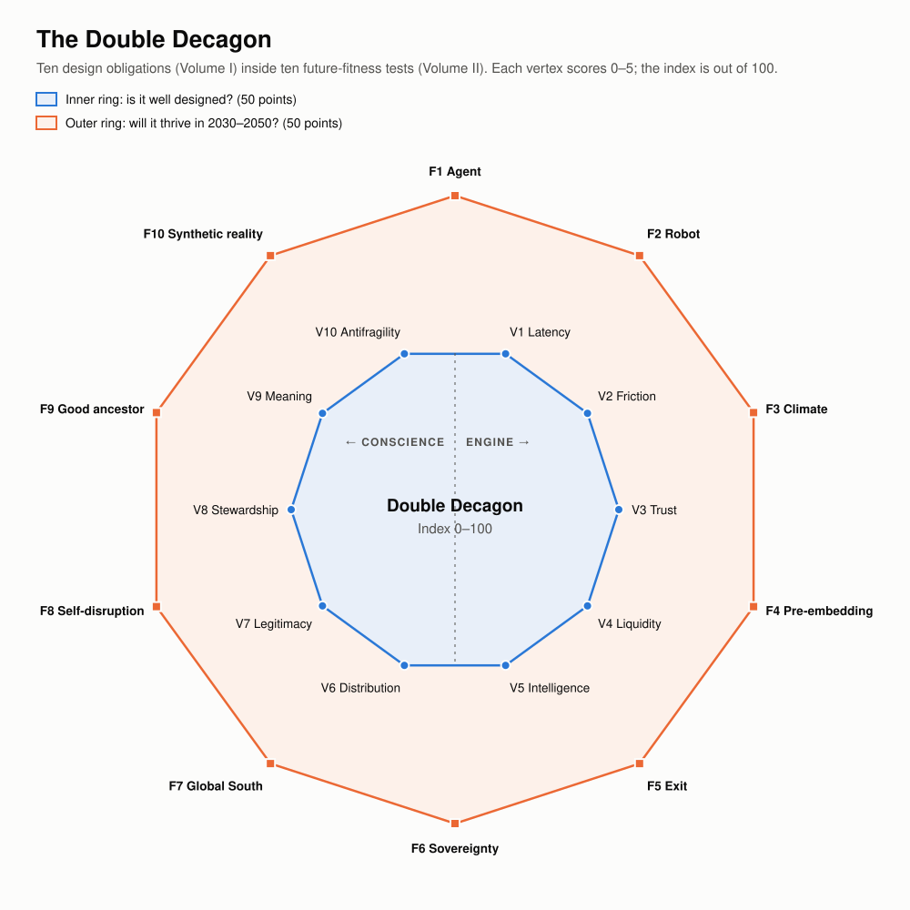
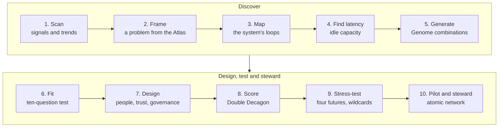
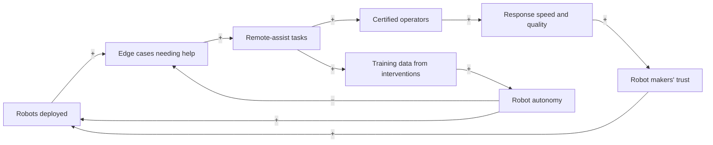
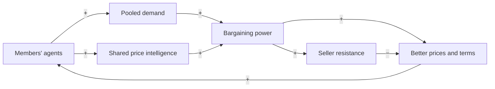
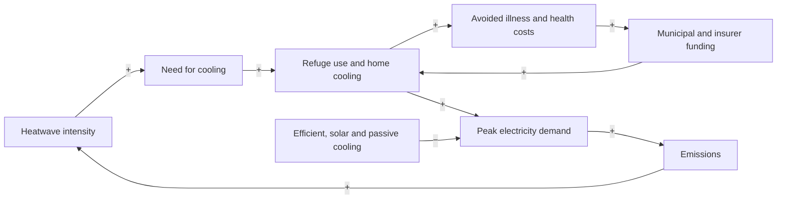
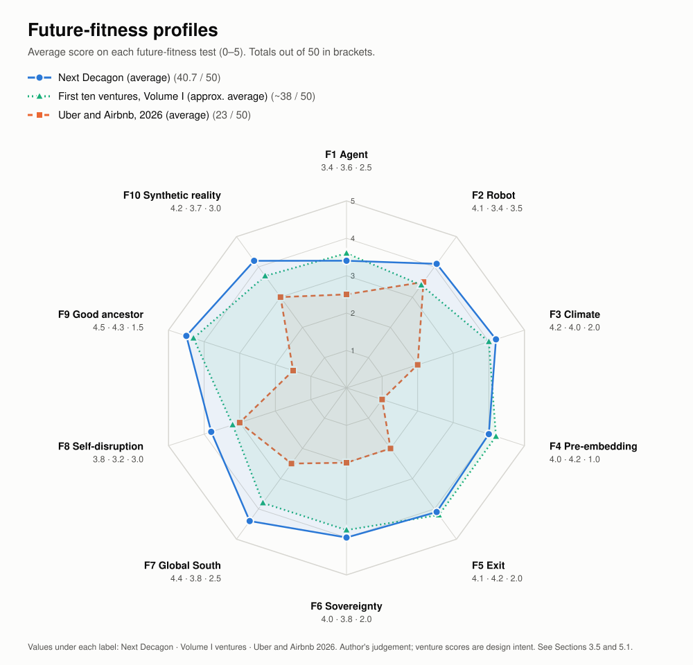

# The Next Decagon

## A Framework for Future Disruptive Innovation, 2030–2050

*Volume II of The Innovation Decagon. It uses Uber, Airbnb, the sixteen-sector application map and the first ten Decagon ventures as baselines and benchmarks, and builds a second-generation framework and ten new disruptive startup concepts for the problems of 2030–2050.*

Working paper · October 2026

---

## Executive summary

**Why a second volume.** Volume I studied the first platform era (Uber and Airbnb), turned its lessons into the Innovation Decagon (ten design obligations), mapped where the Uber and Airbnb models work across sixteen sectors, and proposed ten ventures with their futures. Those ventures address problems that are visible *today*. Volume II looks further: at the problems that will define **2030–2050**, and at the new kind of framework needed to find, design and test disruptions for them.

**The central argument.** The first platform era was built for a world of human users, cheap capital, stable climate and global platforms. The next era will be shaped by **AI agents and robots as economic actors, a hotter and more volatile climate, circular materials, sovereign and interoperable digital infrastructure, and a scarcity of verifiable truth**. A venture can score well on Volume I's Decagon and still fail in that world. So Volume II adds a second ring of tests and a way to generate ideas systematically.

**What Volume II provides:**

1. **Baselines and benchmarks** (Part 1): twelve laws of platform disruption distilled from Volume I, and a calibrated benchmark set: Uber, Airbnb and the first ten ventures.
2. **The future landscape** (Part 2): ten shifts from the platform era to the 2030–2050 era, and a **Future Problem Atlas** of twenty emerging problems with evidence.
3. **The framework: the Double Decagon** (Part 3), made of four instruments:
   - **The Disruption Genome**: a six-gene grammar for *generating* venture ideas (problem × latent capacity × platform archetype × technology wave × governance form × foothold).
   - **Ten platform archetypes**: Uber and Airbnb extended to ten distinct "machines", from on-demand dispatch to agent-native exchanges and robot-capital cooperatives.
   - **The Future-Fitness Decagon**: ten tests of whether a venture will survive 2030–2050, from the *agent test* and *robot test* to the *good-ancestor test* and *synthetic-reality test*.
   - **The Double Decagon Index**: a 100-point score combining Volume I's design obligations (50) with future fitness (50), calibrated against the benchmarks.
   It also sets out the **Foresight-to-Venture Pipeline** (a ten-step process) and the theory behind it.
4. **The Next Decagon of ventures** (Part 4): ten new disruptive startup concepts, each generated with the Genome and scored on the Double Decagon:

| # | Venture | New problem it solves | Archetype |
|---|---|---|---|
| 1 | **RemoteHands** | Robots spread faster than they become fully autonomous, and need human help at the edge cases | On-demand dispatch + worker cooperative |
| 2 | **AgentUnion** | Consumers' AI agents face corporate pricing algorithms alone | Agent-native exchange + consumer cooperative |
| 3 | **GroundTruth** | Synthetic media makes it hard to know what really happened | On-demand dispatch + protocol commons |
| 4 | **CoolHaven** | Extreme heat is becoming the deadliest climate hazard | Idle-asset marketplace + pooled access |
| 5 | **SecondCell** | A wave of retired EV batteries, while 730 million people lack electricity | Idle-asset marketplace + pooled access + passport protocol |
| 6 | **PartsGrid** | Machines sit idle for want of parts; local makers sit underused | Idle-asset + skills marketplace + open part libraries |
| 7 | **SurgeNet** | Crisis capacity (labs, clinicians, rooms) is never ready when needed | Idle-asset marketplace + mutual + dispatch |
| 8 | **WildLedger** | Money for nature rarely reaches the communities who protect it | Data trust + protocol + verifier dispatch |
| 9 | **BuildBridge** | Fraud and failure when families build from abroad | Skills marketplace + escrow + verifier dispatch |
| 10 | **AquaGrid** | Fast-growing cities can't deliver safe, fairly priced water | Dispatch + idle-asset marketplace + mutual |

5. **Portfolio, missions and futures** (Part 5): the scoreboard against the benchmarks, four missions that organize the ventures, links with Volume I's ventures, sequencing, a backcast from 2050, and a closing philosophy: **from "move fast and break things" to "move wisely and mend things."**

**The headline benchmark result.** On the 100-point Double Decagon Index, Uber and Airbnb score about **40–43 at launch** and about **60–61 today**. The first Decagon ventures average about **80** by design intent, and the Next Decagon about **83**. The biggest gap between the platform leaders and the new ventures lies in the future-fitness ring, especially the tests for pre-embedded protections, intergenerational value and climate resilience.

---

## How to read this volume

| Part | Content | Use it if you want to… |
|---|---|---|
| 1 | Baselines and benchmarks | Understand what Volume I established and how it calibrates Volume II |
| 2 | The future landscape and the Future Problem Atlas | See which new problems will matter in 2030–2050 |
| 3 | The framework: the Double Decagon, the Disruption Genome, ten archetypes, the pipeline and the theory | Generate, design and test future ventures |
| 4 | The Next Decagon: ten venture concepts | Get concrete future opportunities |
| 5 | Portfolio, missions, futures and closing philosophy | Act on it |
| Appendices | Genome worksheet, Future-Fitness rubric, scoring sheet, sources | Apply the framework yourself |

*Scores and judgements are the author's analysis. Venture concepts are hypotheses to be tested, not forecasts or investment advice.*

---

# Part 1: Baselines and Benchmarks

## 1.1 The benchmark set

Volume II uses four benchmarks from Volume I as reference points.

| Benchmark | What it represents | Where in Volume I |
|---|---|---|
| **Uber** (c.2012 and 2026) | The on-demand dispatch model; the first platform era's engine at its strongest | Parts I–IV |
| **Airbnb** (c.2012 and 2026) | The idle-asset marketplace model; trust between strangers at global scale | Parts I–IV |
| **The sixteen-sector map** | Where the Uber and Airbnb models work today, from freight and farming to finance and construction | Part VI |
| **The first ten Decagon ventures** | Stewardship-era ventures for today's visible problems (Covenant, DataGuild, Guildhall, KinGrid, Agora, Hearth, CommonFleet, FluxCommons, HarvestGrid, Bastion) | Parts VII–VIII |

Their scores on Volume I's Innovation Decagon (out of 50):

| Benchmark | Engine (/25) | Conscience (/25) | Decagon (/50) |
|---|---|---|---|
| Uber c.2012 | 22 | 8 | 30 |
| Uber 2026 | 24 | 14 | 38 |
| Airbnb c.2012 | 20 | 11 | 31 |
| Airbnb 2026 | 22 | 15 | 37 |
| First ten ventures (average) | 21.0 | 21.3 | 42.3 |

## 1.2 Twelve laws of platform disruption

Volume I's analysis can be distilled into twelve laws. They are empirical regularities, not physical laws, but every new venture should be checked against them.

| # | Law | Statement | Source in Volume I |
|---|---|---|---|
| 1 | **The latency law** | Value comes from making latent capacity visible, trusted, transactable and coordinated | Part III, "latency compilers" |
| 2 | **The trust law** | Trust compounds; matching commoditizes | Parts III–IV |
| 3 | **The saturation law** | Local network effects saturate once the service is "good enough" (the square-root law of pickup times) | Part II, the system dynamics model |
| 4 | **The limits law** | Every reinforcing loop has a balancing loop waiting | Part II, archetypes |
| 5 | **The Polanyi law** | What you commodify, society will one day protect | Part III |
| 6 | **The leverage law** | Prices are low leverage; information, rules, goals and paradigms are high leverage | Part II, Meadows |
| 7 | **The variety law** | Disruption happens where incumbents' variety is lower than their environment's | Part II, Ashby |
| 8 | **The release law** | The founding structure of every successful platform is eventually released | Part IV, adaptive cycle |
| 9 | **The automation flip** | When labour becomes software, the game becomes capital utilization, and ownership decides who wins | Parts IV, VII (CommonFleet) |
| 10 | **The agent law** | AI agents will become users; whoever holds verifiable trust holds power | Part IV |
| 11 | **The leakage law** | Recurring relationships leak off-platform unless the platform keeps adding value | Part VI, failed "Uber for X" startups |
| 12 | **The golden-age law** | Broad prosperity from a technology arrives only with an institutional settlement | Part IV, Perez |

## 1.3 What the benchmarks cannot tell us

Benchmarks describe the past. Uber and Airbnb were optimized for the **2008 stack**: smartphones, GPS, cloud, social identity, cheap capital and recession slack. Five features of 2030–2050 are outside their experience:

1. **Non-human economic actors.** AI agents will buy and sell; robots will supply labour. Neither company was designed for that, though both are adapting.
2. **Climate volatility as a constant.** Heat, flood and drought become operating conditions, not rare events.
3. **Material limits.** Batteries, minerals, water and land become constraints that markets must price and circulate.
4. **Sovereignty and fragmentation.** Data localization, digital public infrastructure and regional blocs replace a single global internet market.
5. **A crisis of verifiable truth.** Synthetic media and synthetic identities make "seeing is believing" obsolete.

So Volume II keeps Volume I's Decagon as the *inner* ring of assessment and adds an *outer* ring of future-fitness tests (Part 3).

---

# Part 2: The Future Landscape, 2030–2050

## 2.1 Ten shifts

| # | From (platform era, 2008–2025) | To (stewardship era, 2030–2050) | Implication for founders |
|---|---|---|---|
| 1 | Human users with apps | **AI agents and robots as economic actors** | Design for agents as buyers and robots as suppliers |
| 2 | Labour scarcity met by gig work | **Automation in the North, youth bulge in the South** | Connect the world's youngest workforce to the world's machines |
| 3 | Access over ownership | **Stewardship with ownership** | Share upside; build ownership pathways |
| 4 | Global platforms | **Sovereign, interoperable protocols** | Work with digital public infrastructure and local rules |
| 5 | Growth at any cost | **Regeneration within planetary limits** | Stay inside Raworth's "doughnut": above the social foundation, below the ecological ceiling |
| 6 | Information abundance | **Verification scarcity** | Sell verified truth, not attention |
| 7 | Stable climate assumptions | **The adaptation economy** | Heat, water and disaster resilience become core markets |
| 8 | Linear materials | **Circular materials with digital passports** | Every battery and part becomes traceable and reusable |
| 9 | Ageing and youth as separate problems | **Demographic complementarity** | Pair ageing societies' needs with young societies' talent |
| 10 | Centralized infrastructure | **Distributed infrastructure** | Energy, water, manufacturing and care move to the neighbourhood |

## 2.2 The Future Problem Atlas

The Atlas lists twenty problems that are new, or are becoming much larger, in 2030–2050. They are grouped into the ten problem domains used by the Disruption Genome (Part 3). Volume I's ventures address some of them; the Next Decagon addresses others.

| Domain | Emerging problem | Evidence and signals | Latent capacity | Addressed by |
|---|---|---|---|---|
| **D1 Intelligence and agency** | Robots need human help at edge cases | About 4.66 million industrial robots operating in 2024 (IFR); home humanoids launching with remote human operators | Young, connected workforces; VR and low-latency networks | RemoteHands |
| | Consumers' agents face algorithmic pricing alone | AI agents could orchestrate $3–5 trillion of goods commerce by 2030 (McKinsey); US competition authorities have challenged algorithmic price-setting (e.g., the 2024 RealPage case) | Fragmented demand that could bargain collectively | AgentUnion |
| | Agents act without accountability | Agent payment protocols launched 2025 | Scattered trust signals | Covenant (Vol I) |
| **D2 Work and livelihoods** | The broken first career rung | Falling entry-level employment in AI-exposed jobs (Stanford, 2025) | Juniors, retired mentors, SME needs | Guildhall (Vol I) |
| | Displacement by autonomy | Waymo ~500,000 paid rides a week (2026) | Drivers' operational skills | CommonFleet (Vol I), RemoteHands |
| **D3 Care, health and longevity** | Care deficit of ageing societies | 2.1 billion people aged 60+ by 2050 (WHO) | The "young-old"; neighbours | KinGrid (Vol I) |
| | Crisis capacity never ready | Antimicrobial resistance projected to cause 39 million deaths 2025–2050 (GRAM, *Lancet*); WHO Pandemic Agreement adopted 2025 | Idle labs, PCR machines, retired clinicians, rooms | SurgeNet |
| **D4 Climate adaptation** | Extreme heat | Heat-related deaths among over-65s up 167% in 2023 vs the 1990s (Lancet Countdown 2024); cooling energy demand could triple by 2050 (IEA) | Idle cool spaces; efficient cooling equipment | CoolHaven |
| | Uninsured disasters | $424bn protection gap (Swiss Re) | Community spare capacity; satellite triggers | Bastion (Vol I) |
| | Climate migration | Up to 216 million internal climate migrants by 2050 (World Bank, *Groundswell*) | Pledged homes, jobs and support | Bastion spin-off |
| **D5 Energy and materials** | Energy poverty | About 730 million people without electricity in 2024, roughly 600 million in sub-Saharan Africa (IEA) | Retired EV batteries; solar | SecondCell, FluxCommons (Vol I) |
| | Battery and mineral waste | Estimates of 100–300+ GWh a year of retired EV batteries by 2030; EU battery passports required from 2027 | Batteries with 70–80% capacity left | SecondCell |
| | Machines idle for want of parts | EU Right to Repair Directive (2024); fragile supply chains | Idle machine shops; informal industrial clusters | PartsGrid |
| **D6 Water and food** | Unsafe, costly urban water | About 2.2 billion people lacked safely managed drinking water (WHO/UNICEF, 2022 data) | Boreholes, storage, tankers, rooftops | AquaGrid |
| | Perishable food loss | Up to 40–50% loss for some perishables in sub-Saharan Africa (FAO estimates) | Cold rooms, backhauls | HarvestGrid (Vol I) |
| **D7 Cities, housing and mobility** | Housing deficits and fraud in self-build | Nigeria's deficit commonly estimated at 17–28 million homes; $685bn remittances to developing countries (2024) | Diaspora capital; artisans; trust | BuildBridge, Hearth (Vol I) |
| **D8 Nature and biodiversity** | Collapse of wildlife; mistrusted nature finance | 73% average decline in monitored wildlife populations since 1970 (WWF, 2024); global goal of 30% protection by 2030 | Community stewardship; local knowledge | WildLedger |
| **D9 Trust, identity and reality** | Synthetic-media fraud and disinformation | Generative-AI fraud could reach $40bn a year in the US by 2027 (Deloitte); a $25m deepfake video-call fraud (Hong Kong, 2024) | People on location; local reputations | GroundTruth |
| | Data taken without consent | Large training-data settlements and lawsuits | Tacit knowledge; languages | DataGuild (Vol I) |
| **D10 Belonging and civic life** | Loneliness and polarization | 871,000 deaths a year linked to loneliness (WHO) | Idle venues; idle evenings | Agora (Vol I) |

**Reading the Atlas.** Three patterns stand out. First, **Africa is at the centre** of many of these problems (energy access, water, housing, youth employment) and of the latent capacity to solve them. Second, **AI creates as many problems as it solves**: agent accountability, synthetic fraud, edge-case labour. Third, **adaptation is a market**: heat, water and crisis capacity are services people and governments will pay for.

---

# Part 3: The Framework: The Double Decagon

## 3.1 Architecture

Volume I's Innovation Decagon asks: *is this venture well designed?* Volume II adds two further questions: *how do we generate ventures systematically?* and *will they survive 2030–2050?* The answer is a framework of four instruments and one process.

| Instrument | Question it answers | Section |
|---|---|---|
| **The Disruption Genome** | How do we *generate* new venture ideas systematically? | 3.2 |
| **Ten platform archetypes** | Which kind of "machine" should we build? | 3.3 |
| **The Inner Decagon** (Volume I's ten design obligations) | Is the venture well designed? Does it create *and* distribute value? | 3.4 |
| **The Future-Fitness Decagon** (ten new tests) | Will it survive and thrive in 2030–2050? | 3.4 |
| **The Foresight-to-Venture Pipeline** (process) | In what order do we do all this? | 3.6 |

Together, the Inner Decagon and the Future-Fitness Decagon form the **Double Decagon**: two concentric rings of ten, scored out of 100.

*Figure 1. The Double Decagon. The inner ring holds the ten design obligations from Volume I (engine and conscience). The outer ring holds the ten future-fitness tests introduced in this volume. Each vertex is scored 0–5, for a total of 100.*

## 3.2 The Disruption Genome

W. Brian Arthur showed that new technologies are combinations of existing ones, and Stuart Kauffman called the set of combinations reachable from today the *adjacent possible*. The Disruption Genome applies that idea to ventures. Every venture can be described by **six genes**. Generating ventures becomes a matter of combining genes deliberately rather than waiting for inspiration.

| Gene | Question | Library (options) |
|---|---|---|
| **G1 Problem domain** | Which emerging problem? | D1 Intelligence and agency · D2 Work and livelihoods · D3 Care, health and longevity · D4 Climate adaptation · D5 Energy and materials · D6 Water and food · D7 Cities, housing and mobility · D8 Nature and biodiversity · D9 Trust, identity and reality · D10 Belonging and civic life |
| **G2 Latent capacity** | What is idle, invisible or untrusted? | L1 Idle time · L2 Idle skills and expertise · L3 Idle space · L4 Idle equipment and machines · L5 Idle vehicles and fleets · L6 Idle energy (storage, surplus) · L7 Idle compute · L8 Idle data and knowledge · L9 Idle capital (savings, diaspora) · L10 Idle trust (reputations, community vouching) · L11 Idle presence (people already on location) · L12 End-of-life value (waste, batteries, parts) · L13 Idle nature-stewardship capacity |
| **G3 Platform archetype** | Which machine? | A1–A10 (Section 3.3) |
| **G4 Technology wave** | What makes it possible now? | T-a Agentic AI · T-b Robotics and autonomy · T-c Verifiable identity and credentials · T-d Instant and programmable money · T-e Sensing and earth observation · T-f Digital twins and simulation · T-g Clean energy and storage · T-h Advanced connectivity (satellite-to-phone, 5G) · T-i Additive manufacturing and digital fabrication · T-j Spatial computing (VR and AR) |
| **G5 Governance form** | Who owns and governs it? | Investor-owned · Steward-owned (purpose trust or golden share) · Worker cooperative · Consumer or user cooperative · Mutual · Public–private–commons partnership · Protocol foundation · Community land or data trust |
| **G6 Foothold** | Where does it start, so incumbents won't follow? | Non-consumption · Low-end · New-market · Regulatory window (a new law creates demand) · Crisis window (a shock creates demand) · Global South leapfrog |

**A Genome code** summarizes a venture in one line, for example:

> **Uber (c.2012):** D7 mobility · L5 idle vehicles + L1 idle time · A1 dispatch · smartphone and GPS (the 2008 stack) · investor-owned · started in the mainstream (no classic foothold)
>
> **Airbnb (c.2009):** D7 housing · L3 idle space · A2 idle-asset marketplace · smartphone, online payments, social identity · investor-owned · new-market (people who would not have booked hotels)

**How to generate ideas with the Genome.**

1. Pick a problem from the Future Problem Atlas (G1).
2. List every latent capacity that could address it (G2). Aim for at least five.
3. For each capacity, ask which archetypes could unlock it (G3). This gives a matrix of candidate concepts.
4. Ask which technology waves make each candidate newly feasible (G4). Drop candidates no new wave enables; they were possible before, and someone has probably tried.
5. Choose the governance form that would pass the veil-of-ignorance test (G5).
6. Find a foothold incumbents will ignore (G6).
7. Run the survivors through the fit test (Volume I, Part VI) and the Double Decagon.

*Worked example.* Problem: extreme heat (D4). Latent capacities: idle cool spaces (L3), idle cooling equipment (L4), idle transport (L5), idle community presence (L11), idle energy storage (L6). Archetypes: idle-asset marketplace for cool rooms (A2), pooled cooling equipment (A4), dispatch of transport to refuges (A1), mutual heat-income cover (A6). Technology: hyperlocal heat forecasting (T-e), efficient cooling and storage (T-g). Governance: public–private–commons partnership. Foothold: crisis window (heatwaves) and non-consumption (people without air conditioning). Result: **CoolHaven** (Venture 4).

## 3.3 Ten platform archetypes

Uber and Airbnb are two archetypes. Volume I's Part VI added the skills marketplace, pooled access and the relationship platform. The 2030–2050 landscape needs five more.

| # | Archetype | Mechanism | Benchmark example | Best for |
|---|---|---|---|---|
| **A1** | **On-demand dispatch** | The platform assigns the nearest suitable provider in real time and sets the price | Uber | Urgent, location-bound, standardized services |
| **A2** | **Idle-asset marketplace** | Owners list unique assets; customers search, choose and book | Airbnb | Heterogeneous assets that sit unused |
| **A3** | **Skills marketplace** | Providers with profiles and reviews; scheduled work | Urban Company, Upwork | Skilled services where the provider matters |
| **A4** | **Pooled access** | The platform manages a shared pool (fleet, lockers, swap stations) | Bike and scooter sharing, battery swapping | Standardized assets used briefly by many |
| **A5** | **Relationship platform** | Ongoing circles or subscriptions with scheduling, payments and guarantees | KinGrid (Vol I) | Recurring relationships that would otherwise leak |
| **A6** | **Mutual** | Members pool risk or resources and share surplus | Bastion (Vol I); friendly societies | Risk, insurance and crisis capacity |
| **A7** | **Data or knowledge trust** | A fiduciary holds rights to members' data and licenses it on their behalf | DataGuild (Vol I) | Data, knowledge and creative work |
| **A8** | **Protocol commons** | Open standards let many providers and apps interoperate; no single owner of the user | Beckn/ONDC; Namma Yatri | Markets where lock-in is the main risk |
| **A9** | **Agent-native exchange** | AI agents representing buyers and sellers negotiate under human-set mandates | AgentUnion (this volume) | High-volume, comparable transactions in the agentic era |
| **A10** | **Ownership cooperative** | Members collectively own productive capital (vehicles, robots, machines) and share returns | CommonFleet (Vol I) | Capital-intensive assets that automate work |

**Choosing between them.** Volume I's decision guide (Part VI) covers A1–A5. For A6–A10, add three questions:

- *Is the main value shared risk or shared readiness?* → **A6 Mutual**.
- *Is the main asset data, knowledge or trust that people should control?* → **A7 Data trust** or **A8 Protocol commons**.
- *Will AI agents or robots do most of the transacting or working?* → **A9 Agent-native exchange** (if agents transact) or **A10 Ownership cooperative** (if robots work).

Most of the Next Decagon ventures combine two or three archetypes, just as Uber now combines dispatch (rides) with an idle-asset marketplace (AV fleets).

## 3.4 The Double Decagon

### The inner ring: Volume I's ten design obligations

| # | Vertex | Core question |
|---|---|---|
| V1 | Latency | What capacity is idle, invisible, untrusted or uncoordinated? |
| V2 | Friction | Which transaction costs collapse? |
| V3 | Trust | How do strangers, and agents, trust each other? |
| V4 | Liquidity | What is the atomic network? When do network effects saturate? |
| V5 | Intelligence | Which data and AI loops improve the service? Is it agent-ready? |
| V6 | Distribution | Who captures the surplus? Do providers share in the upside? |
| V7 | Legitimacy | Is there a licence to operate, built through co-regulation? |
| V8 | Stewardship | Are externalities modelled, measured and internalized? |
| V9 | Meaning | Does it enhance dignity, agency and belonging for everyone? |
| V10 | Antifragility | Does it gain from shocks? Has it planned for its own release phase? |

### The outer ring: the Future-Fitness Decagon

Each test is scored 0–5 using the rubric in Appendix B.

| # | Test | Question | Why it matters in 2030–2050 | Benchmark lesson |
|---|---|---|---|---|
| **F1** | **Agent test** | Does the venture work, and keep its value, when AI agents are the main buyers and sellers? | Demand will increasingly arrive through agents (Volume I, Part IV) | Airbnb's defence against agentic disintermediation is its trust layer |
| **F2** | **Robot test** | Does it survive, or benefit, when the supply side is automated? | Autonomy flips the scarce input from labour to capital | Uber must reinvent itself around AV fleets |
| **F3** | **Climate test** | Is it resilient to heat, flood and drought, and does it reduce climate risk? | Climate volatility becomes an operating condition | Both companies saw demand collapse in shocks |
| **F4** | **Pre-embedding test** | Are the protections society would demand already built in (fair pay, housing limits, data rights)? | The Polanyi double movement arrives either way | Both companies' protections were forced on them |
| **F5** | **Exit test** | Can users and providers leave with their data and reputation? Is value shared, so enshittification is resisted? | Lock-in invites regulation and decay | Take-rate creep and fee controversies |
| **F6** | **Sovereignty test** | Does it work with local data rules, public digital infrastructure and local ownership? | The internet fragments into sovereign and regional systems | Exits from China and Southeast Asia |
| **F7** | **Global South test** | Does it work offline, with mobile money, in informal economies and at low cost? | Most growth in population and need is in the Global South | Uber adapted to cash in many markets |
| **F8** | **Self-disruption test** | Has it planned the release phase of its own model, and does it have options to reinvent itself? | Every founding structure is eventually released | Uber's driver model; Airbnb's search model |
| **F9** | **Good-ancestor test** | Will people in 2050 be glad it was built? Does it pass Raworth's doughnut: above the social foundation, below the ecological ceiling? | Long-term costs (housing, climate, data) compound | Housing externalities of short-term rentals |
| **F10** | **Synthetic-reality test** | Is it robust to deepfakes, synthetic identities and AI-generated fraud? | Synthetic fraud is growing fast | Review fraud and fake listings |

### The Double Decagon Index

**Index = Inner Decagon (0–50) + Future-Fitness Decagon (0–50) = 0–100.**

| Band | Score | Meaning |
|---|---|---|
| **Future-defining** | 85–100 | Well designed and robust to every major 2030–2050 force |
| **Future-fit** | 70–84 | Strong, with identifiable weaknesses to manage |
| **Adaptable** | 50–69 | Viable today but must change significantly to thrive in 2030–2050 |
| **Fragile** | below 50 | Likely to be disrupted or regulated into decline |

## 3.5 Calibrating the index against the benchmarks

Scoring the benchmarks on the outer ring shows how the platform leaders would fare in the next era.

| Test | Uber c.2012 | Uber 2026 | Airbnb c.2012 | Airbnb 2026 | First ten ventures (approx. average) |
|---|---|---|---|---|---|
| F1 Agent | 1 | 3 | 1 | 2 | 3.6 |
| F2 Robot | 1 | 3 | 3 | 4 | 3.4 |
| F3 Climate | 1 | 2 | 1 | 2 | 4.0 |
| F4 Pre-embedding | 0 | 1 | 0 | 1 | 4.2 |
| F5 Exit | 1 | 2 | 1 | 2 | 4.2 |
| F6 Sovereignty | 1 | 2 | 1 | 2 | 3.8 |
| F7 Global South | 1 | 3 | 1 | 2 | 3.8 |
| F8 Self-disruption | 1 | 3 | 1 | 3 | 3.2 |
| F9 Good ancestor | 1 | 1 | 1 | 2 | 4.3 |
| F10 Synthetic reality | 2 | 3 | 2 | 3 | 3.7 |
| **Future-Fitness (/50)** | **10** | **23** | **12** | **23** | **~38** |
| Inner Decagon (/50, from Volume I) | 30 | 38 | 31 | 37 | 42.3 |
| **Double Decagon Index (/100)** | **40** | **61** | **43** | **60** | **~80** |

**What calibration shows.**

1. **Both platform leaders were "fragile" at launch and are "adaptable" today.** Their improvement came mostly from pressure: regulation, lawsuits and crises.
2. **Airbnb scores higher than Uber on the robot test** because homes cannot be automated away, but lower on the Global South test.
3. **The weakest tests for both are F4 (pre-embedding) and F9 (good ancestor).** These are precisely the tests where the double movement and long-term externalities bite.
4. **The first ten ventures are "future-fit" by design** but weakest on self-disruption (F8) and robots (F2). Those are lessons the Next Decagon tries to apply.

*All scores are the author's judgement. Venture scores reflect design intent and should be discounted for execution risk.*

## 3.6 The Foresight-to-Venture Pipeline

The process has ten steps, from scanning the future to stewarding a live venture. It extends Volume I's Systemic Design Spiral with a foresight front-end and a future-fitness back-end.

| Step | Activity | Tools | Output |
|---|---|---|---|
| **1. Scan** | Track signals across technology, demography, climate, regulation and culture | STEEP scanning; weak signals; the ten shifts (Section 2.1) | A signals log |
| **2. Frame** | Choose and deepen a problem | Future Problem Atlas; Causal Layered Analysis (litany → systems → worldview → metaphor) | A problem frame at four depths |
| **3. Map** | Understand the system | Causal loop diagrams; stock-and-flow models; Meadows' leverage points | A system map with loops and leverage points |
| **4. Find latency** | Identify idle or untrusted capacity | The thirteen latency classes (G2); the Latency Audit from Volume I | A latency inventory |
| **5. Generate** | Combine genes into candidate ventures | The Disruption Genome matrix | 10–30 candidate concepts |
| **6. Fit** | Filter candidates | The ten-question fit test (Volume I, Part VI); the leakage law | A shortlist |
| **7. Design** | Design for people, trust and governance | Ethnography, personas, "How might we"; trust stack; Ostrom's principles; veil-of-ignorance test | Service blueprint; governance design |
| **8. Score** | Score both rings | The Double Decagon Index | Scores and weaknesses |
| **9. Stress-test** | Test against futures | Dator's four futures; wildcards; release-phase planning; pre-mortem | A resilience plan |
| **10. Pilot and steward** | Launch the smallest atomic network by hand; measure; govern; then return to step 1 and re-score | Concierge MVP; externality ledger; re-scoring | Evidence; the next cycle |

## 3.7 The theory of future disruption

Volume I drew on Coase, Hayek, Christensen, Polanyi, Meadows, Ashby, Beer, Ostrom and others. Volume II adds five ideas that matter specifically for 2030–2050.

**1. The disruption of disruption.** AI is collapsing the cost of building software. A competent copy of most apps can now be built quickly and cheaply, so *software alone* is no longer a moat. In the next era, durable advantage moves to what AI cannot copy: **verified trust, ownership structures that align participants, legitimacy with regulators and communities, physical networks, and accumulated relationships**. This is why the Next Decagon ventures are built around trust layers, cooperatives, mutuals and physical capacity rather than clever apps.

**2. Doughnut economics.** Kate Raworth's *Doughnut Economics* (2017) defines a safe and just space between a **social foundation** (no one falls short on life's essentials) and an **ecological ceiling** (planetary boundaries). Ventures should be "regenerative and distributive by design". The good-ancestor test (F9) operationalizes this: a venture that lifts people above the foundation while pushing the economy through the ceiling fails.

**3. Mission-oriented innovation.** Mariana Mazzucato argues that the biggest innovations come from bold public **missions** (like the Moon landing) that direct public and private investment toward a societal goal. The Next Decagon is organized into four missions (Part 5), so governments, development banks and philanthropies can co-invest alongside founders.

**4. Polycentric governance.** Elinor Ostrom showed that complex resources are best governed by many overlapping centres of decision-making, not by a single owner or a single state. Protocol commons (A8), mutuals (A6) and cooperatives (A10) are polycentric by design. In a fragmented, sovereign world, polycentric platforms travel better than centralized ones (the sovereignty test, F6).

**5. Antifragility.** Nassim Taleb distinguishes the fragile (harmed by shocks), the robust (unaffected) and the antifragile (strengthened by shocks). Several Next Decagon ventures are deliberately antifragile: their demand *rises* in crises (CoolHaven in heatwaves, SurgeNet in outbreaks, GroundTruth during disinformation surges). Their challenge is the opposite of most startups: staying funded and ready during calm periods.

**A philosophical note: from breaking to mending.** The first platform era's motto was "move fast and break things." Some of what it broke deserved breaking: taxi cartels and opaque pricing. Some did not: neighbourhood housing, labour protections and shared truth. The ethics of care (Joan Tronto) describes four phases of care: *caring about* (noticing a need), *taking care of* (accepting responsibility), *care-giving* (doing the work) and *care-receiving* (checking that care landed). Those phases map naturally onto the Foresight-to-Venture Pipeline: scan and frame, design, pilot, re-score. The proposal of this volume is a new motto: **move wisely and mend things.**

---

# Part 4: The Next Decagon: Ten Ventures for 2030–2050

Each venture was generated with the Disruption Genome, filtered with the fit test, and scored on the Double Decagon. Each follows the same template:

- **Genome code**
- **The new problem**
- **Benchmarks**: what it borrows from Uber, Airbnb, the sixteen-sector map and Volume I, and what it inverts
- **How it works**
- **System dynamics**
- **Design thinking**
- **Business and ownership model**
- **Future potential**
- **Risks and safeguards**
- **First 100 days**
- **Double Decagon score**

---

## Venture 1: REMOTEHANDS, the human layer of global automation

> **Thesis.** Robots and autonomous vehicles are spreading faster than they become fully autonomous. The gap is filled by people who supervise, assist and teach them remotely, often invisibly and on poor terms. RemoteHands is an Uber-style dispatch network for remote robot assistance, built first in the regions with the most young people. It turns Africa's youth bulge into the trusted human layer of global automation, with fair pay, safety standards and worker ownership.

| Gene | Value |
|---|---|
| Problem domain | D2 Work and livelihoods; D1 Intelligence and agency |
| Latent capacity | L2 idle skills (young, educated, under-employed people); L11 idle presence (connected workers in every time zone) |
| Archetype | A1 on-demand dispatch + A10 ownership cooperative |
| Technology waves | T-b robotics and autonomy; T-j spatial computing (VR teleoperation); T-h advanced connectivity |
| Governance | Worker cooperative with a steward-owned operating company |
| Foothold | Global South leapfrog; new-market (robot makers with no reliable remote-assist workforce) |

**The new problem**

- Robots are multiplying: about 4.66 million industrial robots were operating worldwide in 2024, after 542,000 new installations (IFR).
- Robots need help at the edges. Autonomous-vehicle operators use remote assistance when vehicles get stuck. The first home humanoid robots (e.g., 1X's Neo, offered for 2026) rely on remote human operators using VR headsets for tasks the robot cannot yet do alone.
- This work is often hidden "ghost work" (Gray and Suri, 2019): low-paid, unprotected, and undisclosed to the people whose homes the robots enter.
- Ageing societies need robotic help; young societies need jobs. Nobody is connecting the two on fair terms.

**Benchmarks: borrowed and inverted**

- **From Uber:** real-time dispatch. "Nearest available" becomes *lowest-latency, right-skill, right-language* operator.
- **From Uber AI Solutions** (Volume I): a flexible workforce doing AI-related tasks.
- **From Airbnb:** verified profiles, reviews and guarantees, here for operators.
- **Extends** the sixteen-sector map's "work and talent" sector (Volume I, Part VI) and **links** to Guildhall (training) and CommonFleet (remote operations for AV fleets).
- **Inverts:** invisible ghost work becomes a *visible, certified, worker-owned profession*.

**How it works**

1. **Academy.** Operators train and certify in VR simulators by robot type and task: warehouse picking, home assistance, AV remote guidance and inspection drones.
2. **Integration.** Robot makers and fleet operators connect via an API. When a robot's confidence falls below a threshold, it requests help.
3. **Dispatch.** The request goes to the best available certified operator, matched on skill, latency, language, time zone and the customer's privacy settings.
4. **Assist.** The operator guides or teleoperates the robot. Every intervention is logged and can become training data under fair data terms, with royalties to the operator (as in Volume I's DataGuild).
5. **Privacy and safety.** Video is blurred by default, operators work only in consented time windows and geofenced areas, actions are audited, and safety-critical tasks require dual control.
6. **Career ladder.** Operator → senior operator → trainer → fleet supervisor → robot-behaviour designer.
7. **Hubs.** Power-secure, connectivity-secure work hubs in African cities, using solar and storage (FluxCommons, SecondCell).
8. **Ownership.** Operators earn cooperative shares and receive dividends and data royalties.

**System dynamics**

- **R1, the reliability loop:** more robots → more edge cases → more tasks → more certified operators → faster, better help → robot makers trust the model → more robots deployed.
- **R2, the deployment loop:** interventions → training data → more capable robots → more robots deployed in new settings → new kinds of edge case.
- **B1, automation success:** better autonomy → fewer edge cases per robot. Demand per robot falls, so RemoteHands must keep moving operators up the skill ladder (supervision, training, new robot types). Its *self-disruption plan* is built in (future-fitness test F8).
- **B2, connectivity limits:** latency and outages cap which tasks can be done remotely; hubs and task-tiering contain this.
- **Leverage point:** information flows (making hidden work visible) and rules (labour standards for remote robot work, in the spirit of the Fairwork principles).

**Design thinking**

- *Personas:* **Zainab**, 24, a computer-science graduate in Kano with no job after two years of applications. **Henrik**, operations lead at a European warehouse-robotics firm whose robots stall on unusual parcels. **Doris**, 81, in Manchester, whose home robot sometimes freezes mid-task.
- *How might* the world's youngest workforce become the trusted hands of the world's robots?
- *Moment of truth:* Zainab guides a robot in Manchester through making tea safely, is paid within the hour, and the robot learns the task.

**Business and ownership model.** Per-minute assistance fees and response-time subscriptions (paid by robot makers and fleets); training-data royalties; certification fees (paid by employers and governments); a platform take of at most 20%, with the remainder to operators; cooperative dividends.

**Future potential**

| Horizon | What it becomes |
|---|---|
| 2030 | 10,000 certified operators in three African cities, serving warehouse, AV and home-robot clients |
| 2035 | The global standard for certified remote robot work, with portable credentials and labour standards |
| 2040–2050 | "Robot shepherd" as a mainstream profession; a durable bridge between ageing and youthful societies |

| Risk | Safeguard |
|---|---|
| Privacy inside homes | Consent windows, blurring, geofencing, audit logs, customer-visible operator identity |
| A race to the bottom on pay | Wage floors, Fairwork-style standards, cooperative ownership |
| Safety incidents during teleoperation | Task tiers; dual control for risky tasks; certification and insurance |
| Robot makers building in-house teams | Multi-vendor neutrality; cost and quality advantages; certification as an industry standard |

**First 100 days.** Two robotics partners (warehouse picking and AV remote assistance); 200 certified operators in Lagos and Nairobi; a supervised pilot measuring response time, success rate and operator earnings.

**Double Decagon score: 81/100 (future-fit).** Inner Decagon 41/50 (V1 5 · V2 4 · V3 4 · V4 4 · V5 5 · V6 4 · V7 3 · V8 4 · V9 4 · V10 4). Future-Fitness 40/50 (F1 4 · F2 5 · F3 3 · F4 4 · F5 4 · F6 3 · F7 5 · F8 4 · F9 4 · F10 4).

---

## Venture 2: AGENTUNION, collective bargaining for personal AI agents

> **Thesis.** When every seller prices with algorithms and every consumer shops through an AI agent, each agent faces corporate pricing systems alone. AgentUnion lets millions of personal agents pool their demand, share verified price intelligence and negotiate collectively. It is a buyers' cooperative for the agentic age, and a structural counterweight to enshittification.

| Gene | Value |
|---|---|
| Problem domain | D1 Intelligence and agency |
| Latent capacity | Idle collective bargaining power of fragmented demand; L8 idle price data |
| Archetype | A9 agent-native exchange + A10 consumer cooperative |
| Technology waves | T-a agentic AI; T-d programmable money; T-c verifiable identity |
| Governance | Consumer cooperative (one member, one vote) |
| Foothold | New-market (no collective representation exists for agents) |

**The new problem**

- AI agents could orchestrate $3–5 trillion of global goods commerce by 2030 (McKinsey).
- Sellers increasingly set prices with algorithms. US competition authorities have challenged algorithmic price-setting, for example in the 2024 case against the rent-pricing software company RealPage, and regulators have studied "surveillance pricing" based on personal data.
- An individual agent negotiating for one person has little power against a seller's algorithm trained on millions of transactions. **The power asymmetry of the platform era (Volume I, Part III) is about to be automated.**

**Benchmarks: borrowed and inverted**

- **From Uber:** algorithmic, dynamic pricing, here turned around. AgentUnion is *demand-side* algorithmic power, not supply-side.
- **From Airbnb:** reviews as collective information, extended to collective negotiation.
- **From group buying** (e.g., team-buying models such as Pinduoduo's) and **from cooperatives** (credit unions, consumer co-ops).
- **Links** to Covenant (Volume I): AgentUnion agents carry Covenant mandates and reputations.
- **Inverts:** the platform era concentrated bargaining power in platforms; AgentUnion returns it to users.

**How it works**

1. **Join.** Members connect their personal agents, from any provider, via an open protocol.
2. **Pool intent.** Agents share anonymized, aggregated intent ("12,000 members renewing home insurance in March"; "40,000 members need a mobile-data plan"), protected by differential privacy.
3. **Negotiate.** AgentUnion's negotiating agents secure bulk prices, standard fair contracts and fair data terms (for example, no surveillance pricing).
4. **Price-transparency commons.** Members' agents contribute verified price data. Signs of algorithmic collusion or discriminatory pricing are flagged and reported to regulators.
5. **Fair-terms mark.** Sellers that meet AgentUnion's fair-terms standard are preferred by members' agents.
6. **Dividends.** Surplus is returned to members as patronage dividends, as in traditional co-ops.
7. **No seller money.** AgentUnion takes no fees from sellers, so it cannot be captured by them.

**System dynamics**

- **R1, the bargaining loop:** more members → more pooled demand → more bargaining power → better deals → more members.
- **R2, the intelligence loop:** more members → more price data → better negotiation.
- **B1, seller resistance:** bargaining power provokes boycotts or exclusion. Start with fragmented markets (insurance brokers, telecom resellers, energy retailers) where sellers compete for volume; use regulatory support where markets are concentrated.
- **B2, privacy fear and free-riding:** mitigated by aggregate-only data sharing and member-only deals.
- **Leverage point:** rules (recognizing collective bargaining by consumers' agents) and information flows (price transparency).

**Design thinking**

- *Personas:* **Chinedu**, 35, a small-business owner in Abuja paying too much for data, insurance and fuel cards. **Linda**, 68, a pensioner overwhelmed by renewal letters. **A mid-sized insurer** that would welcome 10,000 new customers at once.
- *How might* a million small buyers bargain like one big one?
- *Moment of truth:* Linda's home insurance renews 25% cheaper on fairer terms, negotiated overnight, with a plain-language summary from her agent.

**Business and ownership model.** Members pay a small annual fee or a share of first-year savings (e.g., 10–20%). There are no seller fees. Surplus returns as patronage dividends. Optional services include price-intelligence reports for regulators and consumer bodies.

**Future potential**

| Horizon | What it becomes |
|---|---|
| 2030 | Collective agent bargaining in insurance, telecom and energy in several countries; millions of members |
| 2035 | A recognized counterweight in agentic markets; fair-terms standards adopted by many sellers |
| 2040–2050 | "Consumer unions" institutionalized alongside trade unions, with rights and duties in law |

| Risk | Safeguard |
|---|---|
| Competition-law concerns (buyer cartels) | Design within competition law (consumer buying groups are generally lawful); legal review; transparency to regulators |
| Privacy | Aggregate, differentially private intent; no individual data shared with sellers |
| Seller boycotts | Start with fragmented sellers; regulatory engagement; member scale |
| Capture by a large AI provider | Open protocol; provider-neutral; member governance |

**First 100 days.** One country, two categories (mobile data and insurance renewals); 10,000 members; negotiated offers from three providers; publish the savings achieved.

**Double Decagon score: 81/100 (future-fit).** Inner Decagon 41/50 (V1 4 · V2 5 · V3 4 · V4 3 · V5 5 · V6 5 · V7 3 · V8 4 · V9 4 · V10 4). Future-Fitness 40/50 (F1 5 · F2 4 · F3 3 · F4 4 · F5 5 · F6 4 · F7 3 · F8 4 · F9 4 · F10 4).

---

## Venture 3: GROUNDTRUTH, the verified-reality network

> **Thesis.** As synthetic media becomes indistinguishable from reality, societies need a way to establish what actually happened, where and when. GroundTruth combines content provenance with an Uber-style network of verified local "witnesses" who can be dispatched to confirm events, damage, deliveries or building progress on the ground. It provides trust as a service for newsrooms, insurers, courts, aid agencies and AI agents.

| Gene | Value |
|---|---|
| Problem domain | D9 Trust, identity and reality |
| Latent capacity | L11 idle presence (people already on location); L10 idle trust (local reputations) |
| Archetype | A1 on-demand dispatch + A8 protocol commons |
| Technology waves | T-c verifiable credentials and content provenance; T-e earth observation; T-a AI forensics |
| Governance | Steward-owned company plus an open protocol foundation |
| Foothold | Non-consumption (affordable on-the-ground verification does not exist); crisis window (elections, disasters) |

**The new problem**

- Generative-AI-enabled fraud could reach $40bn a year in the US by 2027, up from $12.3bn in 2023 (Deloitte).
- In 2024, an employee in Hong Kong transferred about $25m after a video call with deepfaked executives.
- Insurers face AI-generated damage photos, newsrooms face fabricated disaster footage, and courts face doubts about every image.
- Detection alone is an arms race. **Verification needs a physical anchor: a trustworthy person, at the place, at the time.**

**Benchmarks: borrowed and inverted**

- **From Uber:** dispatch of the nearest verified provider, here the nearest verified witness.
- **From Airbnb:** identity verification, reviews and guarantees.
- **Extends** the sixteen-sector map's emergency and public-services sector, and **links** to Covenant (verifying agents), Bastion (verifying disaster triggers) and BuildBridge (verifying building stages).
- **Inverts:** the attention economy rewards whatever spreads; GroundTruth rewards whatever is *true*.

**How it works**

1. **Witness network.** Verified individuals (ID, references, training, reputation), drawn from trusted local roles such as teachers, pharmacists, community health workers and students.
2. **Request.** A client posts a verification task: "Is this bridge collapsed?", "Was this parcel delivered?", "Is this house at roof level?", "Is this flood damage real?"
3. **Dispatch.** At least two independent witnesses are assigned at random from those nearby, to prevent collusion.
4. **Capture.** A secure app records signed photos and video with content credentials (C2PA-style provenance), location, time and device attestation.
5. **Cross-check.** Records are compared with satellite imagery, sensor data and AI forensics.
6. **Truth record.** A verified record with a confidence score is issued, verifiable by anyone through the open protocol.
7. **Payment and reputation.** Witnesses are paid per task; accuracy builds reputation; dishonesty forfeits reputation and earnings.

**System dynamics**

- **R1, the credibility loop:** accurate records → client trust → more tasks → more witnesses → better coverage and speed.
- **B1, adversarial attack:** bribery or collusion. Random assignment, redundancy and reputation forfeiture contain it.
- **B2, witness safety:** risky locations (conflict, unrest) need risk tiers, refusal rights and anonymity.
- **Leverage point:** information flows, and a paradigm shift from "seeing is believing" to "*verifying* is believing".

**Design thinking**

- *Personas:* **Musa**, a claims manager in Abuja facing fake flood-damage photos. **Grace**, 27, a pharmacist in Makurdi who earns extra as a verified witness. **An election-desk editor** in Nairobi facing a flood of viral images.
- *How might* anyone, anywhere, know within an hour whether something really happened?
- *Moment of truth:* a viral "collapsed bridge" video is debunked within 40 minutes because two independent witnesses filmed the bridge standing, with verifiable credentials.

**Business and ownership model.** Per-verification fees; subscriptions for insurers, newsrooms, logistics firms and aid agencies; protocol licensing; a public-interest fund for elections and disasters. Witnesses receive the majority of task fees.

**Future potential**

| Horizon | What it becomes |
|---|---|
| 2030 | Insurance, delivery and construction verification in several countries; a disaster-verification service for aid agencies |
| 2035 | A standard verification layer for elections, courts and disaster response |
| 2040–2050 | The "notary of reality": the place AI agents, courts and citizens go to establish facts |

| Risk | Safeguard |
|---|---|
| Misuse for surveillance of individuals | Task screening against human-rights criteria; no tracking of private persons; independent ethics board |
| Witness safety | Risk tiers; refusal rights; anonymity; insurance |
| Collusion or bribery | Random assignment; redundancy; reputation forfeiture; audits |
| Legal admissibility | Work with courts and standards bodies on evidence rules |

**First 100 days.** Insurance-claim verification in Lagos with one insurer; 300 trained witnesses; 1,000 verifications; measure fraud detected and turnaround time.

**Double Decagon score: 80/100 (future-fit).** Inner Decagon 40/50 (V1 4 · V2 4 · V3 5 · V4 3 · V5 4 · V6 4 · V7 4 · V8 4 · V9 4 · V10 4). Future-Fitness 40/50 (F1 4 · F2 4 · F3 4 · F4 4 · F5 4 · F6 4 · F7 4 · F8 3 · F9 4 · F10 5).

---

## Venture 4: COOLHAVEN, the heat-resilience network

> **Thesis.** Extreme heat is becoming one of the deadliest climate hazards, and cooling is becoming an essential service. CoolHaven turns idle cool spaces (air-conditioned shops, banks, places of worship, offices, libraries) into a city-wide network of cooling refuges during heatwaves. Refuges are mapped and booked, and transport is dispatched for vulnerable people. CoolHaven also offers cooling-as-a-service for homes, clinics and schools: customers pay per unit of cooling instead of buying equipment.

| Gene | Value |
|---|---|
| Problem domain | D4 Climate adaptation |
| Latent capacity | L3 idle cool space; L4 idle and inefficient cooling equipment; L5 idle transport; L11 community presence |
| Archetype | A2 idle-asset marketplace + A4 pooled access + A1 dispatch + A6 mutual (with Bastion's heat cover) |
| Technology waves | T-e hyperlocal heat forecasting and sensors; T-g efficient cooling, solar and storage |
| Governance | Public–private–commons partnership |
| Foothold | Crisis window (heatwaves); non-consumption (people without air conditioning) |

**The new problem**

- Heat-related deaths among people over 65 rose by 167% in 2023 compared with the 1990s, far above the 65% expected from population ageing alone (Lancet Countdown, 2024).
- The IEA has projected that energy demand for space cooling could triple by 2050. Without efficiency, cooling worsens grid peaks and emissions.
- Those most at risk (older people living alone, outdoor workers, people in informal housing) are least likely to own air conditioning.

**Benchmarks: borrowed and inverted**

- **From Airbnb:** listing idle space, here cool rooms by the hour (extending the "space" sector of Volume I, Part VI).
- **From Airbnb.org:** opening private space to the public in emergencies.
- **From Uber:** dispatching transport to the people who need it most.
- **Links** to KinGrid (finding isolated elders), Bastion (heat-income cover for outdoor workers) and FluxCommons (pre-cooling with solar and storage).
- **Inverts:** cooling as a private luxury becomes cooling as a public-health commons.

**How it works**

1. **Forecast and alert.** Neighbourhood-level heat forecasts and heat-health warnings, delivered by SMS, voice and app.
2. **Cool-space hosts.** Businesses, faith sites, libraries and offices list cool capacity and hours. They earn fees, tax credits or recognition, and are insured.
3. **Vulnerable registry.** Older people (via KinGrid), outdoor workers, pregnant women and people with chronic illness receive alerts and reserved places.
4. **Transport.** Ride credits are dispatched to take people to refuges.
5. **Cooling-as-a-service.** Efficient fans, air conditioners and heat pumps are installed in homes, clinics and schools, paid per unit of cooling and maintained by trained technicians (Guildhall pathway). Solar and storage pre-cool buildings before the peak.
6. **Passive cooling.** Cool roofs, shading and ventilation retrofits are rewarded, because the cheapest cooling uses no electricity.
7. **Heat-income cover.** Outdoor workers get automatic payouts when heat thresholds stop work (with Bastion).

**System dynamics**

- **R1, the heat-health loop:** refuges and home cooling → avoided illness and costs → public and insurer funding → more cooling capacity.
- **R2, the cooling paradox (vicious loop):** more cooling → higher peak electricity demand → more emissions → more heat in the long run. CoolHaven must break this loop with efficient equipment, solar pre-cooling and passive retrofits.
- **B1, host fatigue:** hosts withdraw if costs or risks rise; fair compensation and insurance contain this.
- **Leverage point:** delays (hours of warning matter), rules (heat codes and cooling standards) and paradigm (cooling as a right).

**Design thinking**

- *Personas:* **Iya Bisi**, 76, in Ibadan, alone in a hot room. **Rahul**, 34, a delivery rider in Delhi. **Pastor Femi**, whose church hall has air conditioning but sits empty on weekdays.
- *How might* no one die alone in the heat?
- *Moment of truth:* a heat alert at 9 a.m.; by noon Iya Bisi is in the cool church hall with water and company, collected by a booked ride.

**Business and ownership model.** Municipal and health-system contracts (per refuge-hour and per vulnerable person enrolled); host payments funded by cities and insurers; cooling-as-a-service subscriptions; efficiency and carbon credits where credible; insurer partnerships.

**Future potential**

| Horizon | What it becomes |
|---|---|
| 2030 | Heat-refuge networks in ten cities; cooling-as-a-service for tens of thousands of homes and clinics |
| 2035 | Heat-safe city standards adopted by governments; millions of homes on efficient cooling |
| 2040–2050 | Heat resilience built into urban design (with Hearth); heat deaths sharply reduced in served cities |

| Risk | Safeguard |
|---|---|
| Grid stress | Efficiency standards; solar pre-cooling; demand response (FluxCommons) |
| Host liability | Insurance; trained volunteers; clear protocols |
| Missing the most isolated | Outreach through community health workers and KinGrid circles |
| Equipment cost | Pay-per-use financing; bulk procurement |

**First 100 days.** One city in heat season; 50 host spaces; 500 registered vulnerable people; transport credits; measure heat-related emergency visits against a comparison area.

**Double Decagon score: 84/100 (future-fit).** Inner Decagon 44/50 (V1 5 · V2 4 · V3 4 · V4 4 · V5 4 · V6 4 · V7 5 · V8 5 · V9 5 · V10 4). Future-Fitness 40/50 (F1 3 · F2 4 · F3 5 · F4 4 · F5 4 · F6 4 · F7 4 · F8 4 · F9 5 · F10 3).

---

## Venture 5: SECONDCELL, the second-life battery and critical-minerals network

> **Thesis.** The electric-vehicle boom will produce a wave of retired batteries that still hold most of their capacity. Meanwhile, about 600 million people in sub-Saharan Africa have no electricity. SecondCell grades, certifies and redeploys retired batteries as storage for clinics, schools, shops and mini-grids, then guarantees their take-back for recycling. Digital battery passports make every cell traceable, so the Global South becomes a partner in circularity, not a dumping ground.

| Gene | Value |
|---|---|
| Problem domain | D5 Energy and materials |
| Latent capacity | L12 end-of-life value (batteries with 70–80% capacity left); L6 idle solar energy |
| Archetype | A2 idle-asset marketplace + A4 pooled access (battery-as-a-service) + A8 protocol (passports) |
| Technology waves | T-g clean energy and storage; T-f digital twins and AI diagnostics; T-c verifiable credentials (battery passports) |
| Governance | Steward-owned company; cooperative distribution partners |
| Foothold | Regulatory window (EU battery passports from 2027); Global South leapfrog |

**The new problem**

- About 730 million people lacked electricity in 2024, roughly 600 million of them in sub-Saharan Africa (IEA).
- Electric car sales passed 20 million in 2025. Estimates of retired EV battery capacity available for reuse by 2030 range from about 100 to over 300 GWh a year.
- EU battery rules require a digital battery passport for EV and industrial batteries from February 2027, alongside recycled-content and collection targets.
- Without care, retired batteries become hazardous waste exported to countries least able to handle it. The Basel Convention governs cross-border movement of hazardous waste.

**Benchmarks: borrowed and inverted**

- **From Airbnb:** an idle asset (a retired battery) becomes valuable inventory once it is trusted.
- **From pay-as-you-go solar** (Volume I, Part VI): access without ownership.
- **From Uber Freight:** reverse logistics and backhaul.
- **Links** to FluxCommons (storage and flexibility), HarvestGrid (cold rooms), RemoteHands and PartsGrid (power for hubs and workshops).
- **Inverts:** the Global South as a valued circularity partner with take-back guarantees, not a dumping ground.

**How it works**

1. **Collect.** Retired packs come from fleets, carmakers and recyclers through reverse logistics.
2. **Grade.** AI diagnostics test state of health; results are written to the battery passport.
3. **Repurpose.** Modules become standardized storage units in regional assembly hubs, creating local jobs.
4. **Deploy as a service.** Battery-as-a-service for clinics, schools, shops, mini-grids and e-motorcycle swap stations, paid in instalments by mobile money.
5. **Monitor.** Remote telemetry tracks performance and thermal safety.
6. **Take back.** A deposit-refund system and a take-back bond guarantee end-of-life collection and recycling, recovering lithium, nickel, cobalt and other materials.
7. **Comply.** Shipments meet waste and safety rules; units are certified for reuse rather than disposal.

**System dynamics**

- **R1, the access loop:** affordable storage → productive uses (cold rooms, tools, refrigeration) → higher incomes → more demand.
- **R2, the data loop:** telemetry → better grading → lower risk → cheaper finance → more deployments.
- **B1, supply variability:** many chemistries and pack designs; standardized modules and passports contain it.
- **B2, safety and dumping risk:** incidents or dumping would destroy trust; take-back bonds and certification prevent it.
- **B3, cheap new batteries:** falling prices for new batteries erode second-life cost advantages, so the business must compete on certification, service and finance, not price alone.
- **Leverage point:** rules (passports and take-back) and information (transparent state of health).

**Design thinking**

- *Personas:* **Dr Amina**, who runs a rural clinic in Niger State where vaccines spoil during outages. **Kofi**, an e-motorcycle rider in Accra. **A fleet manager** in Germany retiring 5,000 packs.
- *How might* a car battery's second life power a clinic for ten more years?
- *Moment of truth:* the clinic's vaccine fridge runs through a three-day outage on a battery that once powered a taxi in Berlin.

**Business and ownership model.** Battery-as-a-service subscriptions; grading and certification fees paid by fleets; take-back and recycling margins; materials credits; asset finance.

**Future potential**

| Horizon | What it becomes |
|---|---|
| 2030 | Hundreds of megawatt-hours of certified second-life storage serving clinics, schools and mini-grids |
| 2035 | A recognized second-life certification standard; regional recycling capacity in Africa |
| 2040–2050 | Closed material loops ("urban mines") and powered clinics across the served regions |

| Risk | Safeguard |
|---|---|
| Fire and thermal safety | Grading thresholds; battery management systems; monitoring; insurance |
| Being treated as waste trading | Certification for reuse; Basel-compliant shipments; take-back bonds |
| Competition from cheap new batteries | Service, warranty and finance advantages |
| Mixed chemistries | Standardized modules; passport data |

**First 100 days.** One fleet partner; test and repurpose 200 packs; deploy 50 clinic and shop units in Nigeria and Ghana with take-back bonds.

**Double Decagon score: 83/100 (future-fit).** Inner Decagon 41/50 (V1 5 · V2 4 · V3 4 · V4 3 · V5 4 · V6 4 · V7 4 · V8 5 · V9 4 · V10 4). Future-Fitness 42/50 (F1 3 · F2 4 · F3 5 · F4 4 · F5 4 · F6 4 · F7 5 · F8 4 · F9 5 · F10 4).

---

## Venture 6: PARTSGRID, the distributed manufacturing and repair network

> **Thesis.** Across Africa and the world, machines sit idle for want of a part, while skilled machinists, 3D printers and informal industrial clusters sit underused. PartsGrid is an Airbnb for machine-shop capacity and an Uber for repair. It matches broken equipment with verified local fabricators and repairers, using licensed digital part libraries so parts can be made near where they are needed.

| Gene | Value |
|---|---|
| Problem domain | D5 Energy and materials; D2 Work and livelihoods |
| Latent capacity | L4 idle machines (lathes, mills, 3D printers); L2 idle skills (machinists, technicians) |
| Archetype | A2 idle-asset marketplace + A3 skills marketplace + A8 protocol (open and licensed part libraries) |
| Technology waves | T-i additive manufacturing and digital fabrication; T-f 3D scanning and digital twins; T-a AI part identification; T-c verifiable credentials |
| Governance | Cooperative of workshops with a steward-owned platform |
| Foothold | Global South leapfrog; regulatory window (right-to-repair rules) |

**The new problem**

- Supply chains have proved fragile: pandemic shutdowns and shipping disruptions left equipment waiting months for parts.
- In low-resource settings, tractors, generators, mills and medical devices are frequently out of service for want of parts and maintenance.
- Right-to-repair rules (e.g., the EU's 2024 Right to Repair Directive) and the African Continental Free Trade Area favour local repair and manufacturing.
- Africa has large informal industrial clusters, such as Suame Magazine in Kumasi and Ladipo market in Lagos, with deep repair skills but little access to digital designs, quality certification or demand beyond their neighbourhoods.

**Benchmarks: borrowed and inverted**

- **From Airbnb:** idle machine capacity listed and booked (extending the "equipment" sector of Volume I, Part VI).
- **From Uber:** urgent dispatch of repair technicians.
- **From Urban Company:** standardizing quality, tools and prices for skilled trades.
- **Links** to Guildhall (training machinists), RemoteHands (robot parts) and HarvestGrid (farm machinery).
- **Inverts:** from importing finished goods to making locally, with royalties flowing to designers and manufacturers that license their files.

**How it works**

1. **Request.** A customer photographs or scans the broken part, or enters a model number. AI identifies the part.
2. **Library.** The platform finds a licensed manufacturer file, an open design, or commissions reverse-engineering by a certified designer.
3. **Match.** The nearest certified workshop with the right machines, materials and quality tier gets the job.
4. **Make and verify.** The part is made and checked against its dimensions by 3D scan. Safety-critical parts require higher certification tiers.
5. **Deliver and install.** A verified technician installs the part. Payment is held in escrow until the customer confirms.
6. **Upgrade workshops.** Financing for new machines and training (with Guildhall) raises quality over time.
7. **Learn.** Failure data informs predictive maintenance and local spare-parts stocking.

**System dynamics**

- **R1, the capability loop:** jobs → workshop income → machine upgrades and skills → better quality → more jobs.
- **R2, the library loop:** more parts digitized → faster fulfilment → more users → more digitization.
- **B1, quality failures:** a failed part damages trust; certification tiers and guarantees contain it.
- **B2, intellectual-property conflict:** manufacturers may resist; licensing with royalties turns them into partners.
- **Leverage point:** information flows (digital part files), rules (right to repair) and self-organization (industrial clusters).

**Design thinking**

- *Personas:* **Mr Okonkwo**, whose rice mill in Ebonyi stopped for want of a small bearing housing. **Kwame**, a machinist in Suame Magazine with an idle lathe. **A biomedical engineer** at a hospital in Kampala with three broken infusion pumps.
- *How might* a broken machine anywhere be fixed within 48 hours by makers nearby?
- *Moment of truth:* the rice mill runs again the next day with a locally made, certified part.

**Business and ownership model.** A transaction fee of about 10–15%; library licensing royalties shared with designers and manufacturers; certification fees; workshop financing; enterprise maintenance contracts (hospitals, agribusiness, utilities). Workshops co-own the cooperative.

**Future potential**

| Horizon | What it becomes |
|---|---|
| 2030 | 1,000 certified workshops in three cities; agricultural, generator and medical parts |
| 2035 | A network spanning the African Continental Free Trade Area; manufacturer licensing partnerships |
| 2040–2050 | A "make it local" commons: distributed manufacturing for repair, robots and renewable-energy equipment |

| Risk | Safeguard |
|---|---|
| Liability for failed parts | Certification tiers; safety-critical exclusions; insurance; traceability |
| Intellectual property | Licensed libraries with royalties; open designs where possible |
| Inconsistent quality | Scanning and inspection; ratings; training |
| Unreliable power for workshops | Solar and second-life storage (SecondCell) |

**First 100 days.** Lagos (Ladipo and Ikeja) and Kumasi (Suame Magazine); 50 workshops; agricultural machinery and generator parts; 300 jobs completed with measured downtime saved.

**Double Decagon score: 84/100 (future-fit).** Inner Decagon 43/50 (V1 5 · V2 5 · V3 4 · V4 4 · V5 4 · V6 4 · V7 4 · V8 5 · V9 4 · V10 4). Future-Fitness 41/50 (F1 3 · F2 4 · F3 4 · F4 4 · F5 4 · F6 5 · F7 5 · F8 4 · F9 4 · F10 4).

---

## Venture 7: SURGENET, the crisis surge-capacity network

> **Thesis.** Every crisis (a pandemic, an outbreak, a mass-casualty event) needs capacity that sits idle in normal times: laboratory machines, cold storage, retired clinicians, hotel rooms and transport. SurgeNet keeps that latent capacity registered, trained, verified and contract-ready, so it can be switched on within hours. It is an Airbnb for crisis capacity with an Uber-style dispatch layer, governed as a public–private mutual.

| Gene | Value |
|---|---|
| Problem domain | D3 Care, health and longevity |
| Latent capacity | L4 idle lab equipment (including PCR machines left after COVID-19); L2 idle skills (retired and part-time clinicians); L3 idle rooms; idle cold chains |
| Archetype | A2 idle-asset marketplace + A6 mutual (pre-paid readiness) + A1 dispatch |
| Technology waves | T-f digital twins and outbreak simulation; T-c verifiable credentials; T-e genomic and wastewater surveillance |
| Governance | Public–private–commons partnership |
| Foothold | Crisis window |

**The new problem**

- Antimicrobial resistance is projected to cause more than 39 million deaths between 2025 and 2050 without further action (GRAM study, *The Lancet*, 2024).
- WHO member states adopted a Pandemic Agreement in 2025, but agreements need operational capacity behind them.
- COVID-19 revealed systematic surge failures: too few labs, too few staff, nowhere to isolate. After the pandemic, much of the emergency testing capacity built then sits under-used.
- Endemic outbreaks continue, such as Lassa fever in Nigeria. They regularly overwhelm local testing.
- Preparedness suffers from the "panic–neglect cycle": funding surges during crises and collapses afterwards.

**Benchmarks: borrowed and inverted**

- **From Airbnb.org:** private space opened in emergencies.
- **From Uber Health:** medical transport.
- **From Bastion** (Volume I): mutual readiness.
- **Links** to KinGrid (care circles during outbreaks), HarvestGrid (cold chains) and GroundTruth (verifying outbreak reports).
- **Inverts:** capacity is *reserved in calm times* through readiness contracts, instead of scrambled for in a crisis.

**How it works**

1. **Registry.** Labs, equipment, cold chains, clinicians (credentials verified, with refresher training), rooms for isolation, and transport.
2. **Readiness contracts.** Governments, development banks and insurers pay modest retainers for guaranteed availability, like options.
3. **Drills.** Regular simulations and digital-twin exercises test activation times.
4. **Activation.** When surveillance signals cross thresholds, samples are routed to idle labs, specimens are transported, clinicians deployed and rooms booked.
5. **Peacetime dual use.** Between crises, registered capacity earns revenue from routine testing backlogs and antimicrobial-resistance surveillance, so it stays funded and skilled.
6. **Capacity map.** Health authorities see a live map of available surge capacity.

**System dynamics**

- **R1, the readiness loop:** drills → reliable activation → trust → more retainers → more registered capacity.
- **B1, the panic–neglect cycle:** calm years erode budgets. Peacetime dual-use revenue keeps the network alive.
- **B2, cross-jurisdiction friction:** credentials and liability across borders; pre-agreed frameworks contain it.
- **Leverage point:** delays (activation time), rules (pre-agreed contracts) and paradigm (preparedness as standing infrastructure, not emergency spending).

**Design thinking**

- *Personas:* **Dr Ngozi**, a retired epidemiologist in Enugu who wants to help. **A lab manager** in Ibadan whose PCR machines run at a fraction of capacity. **A state health commissioner** facing a Lassa fever outbreak.
- *How might* a city have its crisis capacity ready before the crisis?
- *Moment of truth:* within 24 hours of an outbreak signal, samples are routed to three idle labs, with results in 48 hours instead of a week.

**Business and ownership model.** Readiness retainers (governments, development banks, insurers and outbreak-financing instruments); per-activation fees; peacetime testing services; training and certification.

**Future potential**

| Horizon | What it becomes |
|---|---|
| 2030 | National surge networks in three countries, linked to public-health institutes |
| 2035 | Regional integration (e.g., with continental disease-control bodies); routine antimicrobial-resistance surveillance |
| 2040–2050 | A global mutual for surge capacity, activated in hours for any outbreak |

| Risk | Safeguard |
|---|---|
| Under-funding between crises | Peacetime dual-use revenue; multi-year retainers |
| Quality and biosafety | Accreditation; audits; tiered tasks |
| Data-sharing politics | Clear data governance; national ownership of data |
| Liability for deployed clinicians | Pre-agreed indemnities; credential verification |

**First 100 days.** One Nigerian state; register 20 labs and 200 clinicians; run a simulation exercise; pilot during the Lassa fever season.

**Double Decagon score: 83/100 (future-fit).** Inner Decagon 43/50 (V1 5 · V2 4 · V3 4 · V4 3 · V5 4 · V6 4 · V7 5 · V8 5 · V9 4 · V10 5). Future-Fitness 40/50 (F1 3 · F2 4 · F3 4 · F4 4 · F5 4 · F6 4 · F7 4 · F8 4 · F9 5 · F10 4).

---

## Venture 8: WILDLEDGER, the community nature-stewardship marketplace

> **Thesis.** The world has promised to protect 30% of land and sea by 2030 and to mobilize hundreds of billions of dollars a year for nature. Yet the money rarely reaches the communities who actually steward forests, rivers and wildlife, and nature credits face a crisis of trust. WildLedger pays communities for *verified stewardship*, using satellites, acoustic sensors, environmental DNA and independent local verifiers. It applies Airbnb's host model to guardianship of nature.

| Gene | Value |
|---|---|
| Problem domain | D8 Nature and biodiversity |
| Latent capacity | L13 community stewardship capacity and knowledge; L10 idle trust (community institutions) |
| Archetype | A2 marketplace + A1 verifier dispatch + A7 data trust + A8 protocol |
| Technology waves | T-e earth observation, bioacoustics and environmental DNA; T-c verifiable credentials; T-d programmable money |
| Governance | Community land and data trusts with a protocol foundation |
| Foothold | Regulatory window (global biodiversity targets; nature-related corporate disclosure) |

**The new problem**

- Monitored wildlife populations declined by an average of 73% between 1970 and 2020 (WWF *Living Planet Report*, 2024), and by 76% in Africa.
- The Kunming–Montreal Global Biodiversity Framework (2022) commits countries to protect 30% of land and sea by 2030 and to mobilize at least $200bn a year for biodiversity.
- Investigations in 2023 questioned the integrity of many forest carbon credits, damaging trust in nature finance.
- Indigenous peoples and local communities manage a large share of the world's land and much of its remaining biodiversity, but receive a small share of the money.

**Benchmarks: borrowed and inverted**

- **From Airbnb:** hosts become *stewards*; reviews become *verified ecological outcomes*.
- **From Uber:** dispatch of independent verifiers.
- **Links** to DataGuild (community data trusts), GroundTruth (verification) and the LandLedger seed (land tenure).
- **Inverts:** value flows to stewards rather than intermediaries. Payments reward stewardship *services*; they do not buy nature itself. This respects Polanyi's warning about land as a fictitious commodity and Heidegger's warning about nature as standing-reserve.

**How it works**

1. **Consent and mapping.** Communities enrol only with free, prior and informed consent. Land and tenure are mapped.
2. **Baseline.** Satellite imagery, acoustic monitors and environmental DNA samples set a baseline of habitat and species.
3. **Stewardship actions.** Community rangers log patrols, restoration and fire prevention.
4. **Independent verification.** Verifiers are dispatched at random, and results are cross-checked with remote sensing.
5. **Outcome payments.** Buyers (companies with nature commitments, governments, philanthropies) pay for verified outcomes. Payments go to community accounts by mobile money, with public ledgers.
6. **Community data trust.** Communities own their data and decide how it is used.
7. **Benefit-sharing rules.** Communities set distribution rules, following Ostrom's principles, with representation for women and youth.

**System dynamics**

- **R1, the stewardship loop:** payments → patrols and restoration → better outcomes → buyer trust → more payments.
- **B1, integrity doubts:** questions about leakage or additionality. Conservative baselines and independent verification contain them.
- **B2, elite capture:** benefits captured by a few. Transparent ledgers and inclusive governance contain it.
- **Leverage point:** rules (benefit and tenure rights), information (verification) and paradigm (nature as a living partner).

**Design thinking**

- *Personas:* **Chief Ekpo**, a community leader near Cross River National Park in Nigeria. **Blessing**, a young community ranger. **A sustainability lead** at a food company with deforestation-free commitments.
- *How might* the people who protect nature be paid as reliably as those who destroy it?
- *Moment of truth:* the first quarterly stewardship payment arrives in community accounts, verified, with a public dashboard anyone can inspect.

**Business and ownership model.** A platform fee of at most 10% on outcome payments; monitoring services; consent-based data licensing; nature-disclosure reporting services for companies. Communities own their data and a share of the protocol foundation.

**Future potential**

| Horizon | What it becomes |
|---|---|
| 2030 | Fifty communities in several countries with verified stewardship payments |
| 2035 | National programmes using WildLedger for biodiversity finance and reporting |
| 2040–2050 | A planetary "stewardship payroll" that rewards the people who keep ecosystems alive |

| Risk | Safeguard |
|---|---|
| Commodifying nature | Pay for stewardship services, not nature itself; no offset claims without high integrity |
| Greenwashing by buyers | Disclosure rules; no claims beyond verified outcomes |
| Community conflict | Consent; grievance mechanisms; transparent ledgers |
| Measurement uncertainty | Multiple methods; conservative crediting |

**First 100 days.** Three communities near Cross River National Park; baseline monitoring; one buyer; first verified payments.

**Double Decagon score: 85/100 (future-defining).** Inner Decagon 43/50 (V1 5 · V2 4 · V3 5 · V4 3 · V5 4 · V6 5 · V7 4 · V8 5 · V9 4 · V10 4). Future-Fitness 42/50 (F1 3 · F2 4 · F3 5 · F4 4 · F5 4 · F6 4 · F7 4 · F8 4 · F9 5 · F10 5).

---

## Venture 9: BUILDBRIDGE, verified diaspora and incremental building

> **Thesis.** Millions of families build their homes step by step, and diaspora families send billions home to build. Yet fraud, cost overruns and abandoned projects are common. BuildBridge makes building at a distance trustworthy: verified artisans and suppliers, escrowed stage payments released only after independent verification, and transparent material prices. It turns remittances into finished homes.

| Gene | Value |
|---|---|
| Problem domain | D7 Cities, housing and mobility |
| Latent capacity | L10 idle trust; L9 idle capital (diaspora savings); L2 idle skills (artisans without proof of quality) |
| Archetype | A3 skills marketplace + A2 escrow marketplace + A1 verifier dispatch |
| Technology waves | T-c verifiable credentials; T-e drone and photo verification (with GroundTruth); T-d programmable escrow |
| Governance | Steward-owned company |
| Foothold | Non-consumption (diaspora families who cannot build safely today); Global South leapfrog |

**The new problem**

- Nigeria's housing deficit is commonly estimated at 17–28 million homes. Most urban housing in many African cities is built incrementally by owners.
- Officially recorded remittances to low- and middle-income countries reached an estimated $685bn in 2024 (World Bank). Much of it goes into building.
- Families abroad routinely lose money to contractors who inflate costs, use substandard materials or abandon projects, and to relatives or agents who misreport progress.

**Benchmarks: borrowed and inverted**

- **From Airbnb:** escrow that releases payment only after check-in, here only after a *verified building stage*.
- **From Airbnb:** verified identity and reviews, here for artisans and suppliers.
- **From Uber:** dispatch of independent inspectors and witnesses.
- **Fills** the construction gap identified in Volume I, Part VI, and **links** to Hearth (housing supply) and GroundTruth (verification).
- **Inverts:** trust in the building trade moves from personal connections to verifiable evidence.

**How it works**

1. **Set up.** Land-title checks, a choice of pre-approved designs, and an AI-estimated bill of quantities with transparent material prices.
2. **Verified contractors and artisans.** ID, references and past projects are checked; ratings come only from verified completed stages.
3. **Materials.** Suppliers deliver at published prices; deliveries are tracked and photographed.
4. **Stage-gated escrow.** Funds are released only after each stage is verified by an inspector *and* independent witnesses, with drone or photo evidence carrying content credentials.
5. **Owner dashboard.** Families abroad see video walkthroughs, costs and progress in real time.
6. **Disputes.** Mediation and a guarantee fund protect both sides.
7. **Finance.** Diaspora savings plans, mortgages and incremental-building loans.

**System dynamics**

- **R1, the trust loop:** completed homes → testimonials in diaspora communities → more clients → more vetted contractors.
- **B1, contractor resistance:** some contractors resist transparency. Guaranteed, prompt payment for verified work makes BuildBridge attractive to honest ones.
- **B2, land-title risk:** disputes over land; pre-checks and registry integration contain it.
- **Leverage point:** information flows (transparency) and delays (prompt payment for verified work).

**Design thinking**

- *Personas:* **Tunde and Kemi**, nurses in Houston, building in Ibadan after being cheated once already. **Musa**, a mason in Abuja whose excellent work goes unrecognized. **Mama Funke**, who supervises the site but cannot judge quality.
- *How might* building a home from abroad be as safe as booking an Airbnb?
- *Moment of truth:* Kemi watches the roof go on by video, and the money is released only after an inspector and two witnesses confirm it.

**Business and ownership model.** A project-management fee (about 5–8% of build cost); a materials margin; verification fees; a financing spread; construction insurance.

**Future potential**

| Horizon | What it becomes |
|---|---|
| 2030 | 10,000 homes built or completed through BuildBridge for diaspora and local families |
| 2035 | Incremental-building finance at scale; city partnerships for pre-approved plans |
| 2040–2050 | The default rails for diaspora investment in housing and small businesses |

| Risk | Safeguard |
|---|---|
| Land disputes | Title checks; registry integration; title insurance where available |
| Corrupt inspectors | Random assignment; dual verification by witnesses; audits |
| Currency volatility | Staged conversion; hedging options |
| Construction defects | Standards; guarantee fund; warranties |

**First 100 days.** Lagos, Ibadan and Abuja; 30 projects for UK- and US-based diaspora families; 50 vetted contractors.

**Double Decagon score: 82/100 (future-fit).** Inner Decagon 42/50 (V1 4 · V2 5 · V3 5 · V4 3 · V5 4 · V6 4 · V7 4 · V8 4 · V9 5 · V10 4). Future-Fitness 40/50 (F1 3 · F2 4 · F3 4 · F4 4 · F5 4 · F6 4 · F7 5 · F8 3 · F9 4 · F10 5).

---

## Venture 10: AQUAGRID, the urban water commons

> **Thesis.** Fast-growing cities cannot build piped networks fast enough, and billions of people depend on tankers, kiosks and boreholes of unknown quality at high prices. AquaGrid makes informal water safe and fair. It combines tanker dispatch with metered prices and quality testing, shared storage, rainwater harvesting, leak detection and community water credits. It is an Uber for water delivery and an Airbnb for boreholes and storage, governed with the community and the utility.

| Gene | Value |
|---|---|
| Problem domain | D6 Water and food |
| Latent capacity | L3 idle storage and rooftops; L4 idle boreholes; L5 idle tanker capacity |
| Archetype | A1 dispatch + A2 idle-asset marketplace + A6 mutual (water credits) + A8 protocol (open water-quality data) |
| Technology waves | T-e sensors and water-quality testing; T-d mobile money; T-f digital twins of supply networks |
| Governance | Public–private–commons partnership with utilities and community water committees |
| Foothold | Non-consumption (households without safe supply); Global South leapfrog |

**The new problem**

- About 2.2 billion people lacked safely managed drinking water in 2022 (WHO/UNICEF).
- Around two-thirds of humanity is expected to live in cities by 2050 (UN), with the fastest growth in Africa and Asia, often in informal settlements that piped networks do not reach.
- People without piped water often pay far more per litre to tankers and vendors, with no guarantee of quality, and cholera outbreaks recur.
- Groundwater is being depleted by unregulated private boreholes: a classic tragedy of the commons.

**Benchmarks: borrowed and inverted**

- **From Uber:** dispatch of the nearest certified tanker.
- **From Airbnb:** owners of boreholes and storage listing capacity.
- **From mutuals:** pooled water credits for low-income households.
- **Extends** the "energy and water" sector of Volume I, Part VI, and **links** to Bastion (drought cover) and FluxCommons (pumping energy).
- **Inverts:** Uber's surge pricing caused outrage in emergencies (Volume I, Part II). AquaGrid **caps prices in scarcity**, because water is a human right recognized by the UN in 2010.

**How it works**

1. **Map supply.** Utility points, tested boreholes, licensed tankers, kiosks and rainwater systems are mapped.
2. **Order.** By USSD, voice, app or local agent. The nearest certified tanker or kiosk is dispatched.
3. **Test.** Sources are tested and certified; results are public; sensors monitor key points.
4. **Price fairly.** Delivery is metered at transparent prices, with caps during droughts and outbreaks.
5. **Store and harvest.** Neighbourhood storage tanks and rainwater harvesting are installed, financed through water credits.
6. **Protect the aquifer.** Extraction and groundwater levels are monitored with utilities, and limits are agreed by community committees (Ostrom).
7. **Lifeline credits.** Low-income households receive a basic volume, funded by utilities and municipalities.

**System dynamics**

- **R1, the quality-trust loop:** certified sources → safer water → fewer illnesses → trust and demand → more sources seek certification.
- **B1, groundwater depletion:** over-extraction lowers water tables. Monitoring, limits and recharge contain it.
- **B2, tanker-cartel resistance:** incumbent operators resist transparency. Bringing them in as members with steadier demand contains it.
- **Leverage point:** information (quality and prices), rules (extraction limits and price caps) and self-organization (community water committees).

**Design thinking**

- *Personas:* **Mrs Adaeze**, in Ajegunle, Lagos, buying jerrycans daily at high prices. **Ibrahim**, a tanker owner who wants steadier business. **A utility planner** who cannot see where water is going.
- *How might* every household know its water is safe and fairly priced?
- *Moment of truth:* in cholera season, certified water is delivered, the quality result is on Mrs Adaeze's phone, and the price is capped.

**Business and ownership model.** A dispatch take rate of about 8–12%; source-certification fees; storage and rainwater financing; analytics contracts for utilities; administration of lifeline subsidies.

**Future potential**

| Horizon | What it becomes |
|---|---|
| 2030 | Operating in three cities; thousands of certified sources; lifeline credits in place |
| 2035 | The "last-mile water layer" integrated with utilities in many cities |
| 2040–2050 | Decentralized urban water commons with reuse, storage and aquifer stewardship |

| Risk | Safeguard |
|---|---|
| Commercializing a human right | Lifeline volumes; price caps; public partnership |
| Groundwater over-extraction | Monitoring; extraction limits; recharge programmes |
| Contamination liability | Testing; certification; insurance; rapid recall |
| Political resistance | Utility partnership; community governance |

**First 100 days.** One local government area in Lagos; 50 tankers; 30 tested boreholes; 5,000 households.

**Double Decagon score: 85/100 (future-defining).** Inner Decagon 43/50 (V1 5 · V2 4 · V3 4 · V4 4 · V5 4 · V6 4 · V7 4 · V8 5 · V9 5 · V10 4). Future-Fitness 42/50 (F1 3 · F2 4 · F3 5 · F4 4 · F5 4 · F6 4 · F7 5 · F8 4 · F9 5 · F10 4).

---

# Part 5: Portfolio, Missions and Futures

## 5.1 The Double Decagon scoreboard

| Venture | Inner Decagon (/50) | Future-Fitness (/50) | Index (/100) | Band |
|---|---|---|---|---|
| 1 RemoteHands | 41 | 40 | **81** | Future-fit |
| 2 AgentUnion | 41 | 40 | **81** | Future-fit |
| 3 GroundTruth | 40 | 40 | **80** | Future-fit |
| 4 CoolHaven | 44 | 40 | **84** | Future-fit |
| 5 SecondCell | 41 | 42 | **83** | Future-fit |
| 6 PartsGrid | 43 | 41 | **84** | Future-fit |
| 7 SurgeNet | 43 | 40 | **83** | Future-fit |
| 8 WildLedger | 43 | 42 | **85** | Future-defining |
| 9 BuildBridge | 42 | 40 | **82** | Future-fit |
| 10 AquaGrid | 43 | 42 | **85** | Future-defining |
| **Next Decagon (average)** | **42.1** | **40.7** | **82.8** | Future-fit |
| *First ten ventures, Volume I (approx. average)* | *42.3* | *~38* | *~80* | *Future-fit* |
| *Uber 2026* | *38* | *23* | *61* | *Adaptable* |
| *Airbnb 2026* | *37* | *23* | *60* | *Adaptable* |
| *Uber c.2012* | *30* | *10* | *40* | *Fragile* |
| *Airbnb c.2012* | *31* | *12* | *43* | *Fragile* |

*Design-intent scores (author's judgement). Discount for execution risk.*

*Figure 2. Average scores on the ten future-fitness tests. Uber and Airbnb (2026, averaged) are weakest on pre-embedding (F4) and the good-ancestor test (F9). The Next Decagon is strongest on the Global South (F7), good-ancestor (F9) and climate (F3) tests, and weakest on the agent test (F1).*

**What the scoreboard reveals**

1. **The future-fitness gap is the real gap.** On the inner ring, the platform leaders (37–38) are not far behind the new ventures (42). On the outer ring the gap is large (23 versus 41). Today's leaders are well designed for today and poorly prepared for 2030–2050.
2. **The Next Decagon improves on Volume I where it was weakest.** Volume I's ventures scored lowest on self-disruption (F8) and robots (F2). The Next Decagon raises both. RemoteHands, for example, builds its own automation-driven decline into its plan.
3. **The Next Decagon's weakest test is the agent test (F1).** Physical-world ventures (water, heat, parts, nature) depend less on AI agents. That is acceptable, but each should still expose agent-ready interfaces so it is not disintermediated.
4. **Liquidity remains the hardest vertex.** As in Volume I, the stewardship premium is paid in slower cold starts (V4 averages 3.4). Third-party payers such as governments, insurers and development banks are essential.

## 5.2 Four missions

Following Mariana Mazzucato's mission-oriented approach, the ten ventures, together with Volume I's ventures, can be organized into four missions. Each has a measurable 2040 goal. Each mission gives governments, development banks and philanthropies a clear reason to co-invest.

| Mission | 2040 goal | Next Decagon ventures | Volume I ventures | Public role |
|---|---|---|---|---|
| **1. Trustworthy intelligence** | Every AI agent and robot acting in the economy is accountable, and the humans behind them are fairly paid and represented | RemoteHands, AgentUnion, GroundTruth | Covenant, DataGuild, Guildhall | Standards for agent accountability, remote robot work and evidence; consumer bargaining rights |
| **2. Safe in a hotter world** | No one dies alone in the heat, everyone has safe and fairly priced water, and crisis capacity is ready within hours | CoolHaven, AquaGrid, SurgeNet | Bastion, KinGrid, Agora | Heat and water standards; readiness contracts; lifeline subsidies |
| **3. Nothing wasted** | Every battery and machine part is traceable, reusable and repairable locally; no machine sits idle for want of a part | SecondCell, PartsGrid | FluxCommons, HarvestGrid, CommonFleet | Battery passports; right to repair; local manufacturing incentives |
| **4. Homes and nature that last** | No family loses its savings building a home, and communities are paid to steward nature | BuildBridge, WildLedger | Hearth | Land registries; pre-approved plans; biodiversity finance |

## 5.3 How the two decagons connect

The Next Decagon strengthens Volume I's ventures and depends on them. Together they form a single ecosystem of twenty ventures.

| Next Decagon venture | Strengthens (Volume I) | Depends on (Volume I) |
|---|---|---|
| RemoteHands | CommonFleet (remote operations for autonomous fleets) | Guildhall (training); DataGuild (data royalties) |
| AgentUnion | Covenant (collective agent power) | Covenant (agent identity and mandates) |
| GroundTruth | Bastion (verifying disaster triggers); Hearth (verifying construction) | Covenant (verified identities) |
| CoolHaven | KinGrid (protecting elders in heatwaves) | FluxCommons (efficient, solar-backed cooling); Bastion (heat-income cover) |
| SecondCell | FluxCommons (storage); HarvestGrid (cold-room power) | FluxCommons (grid services) |
| PartsGrid | HarvestGrid (farm machinery); CommonFleet (vehicle parts) | Guildhall (machinist training) |
| SurgeNet | KinGrid (care during outbreaks) | HarvestGrid (cold chains) |
| WildLedger | DataGuild (community data trusts) | DataGuild; GroundTruth |
| BuildBridge | Hearth (more homes, built safely) | GroundTruth (verification) |
| AquaGrid | Bastion (drought resilience) | FluxCommons (pumping energy) |

## 5.4 Feasibility and sequencing

| Venture | Capital intensity | Time to MVP | Regulatory complexity | First market | Wave |
|---|---|---|---|---|---|
| GroundTruth | Low | ~3 months | Medium | Insurance verification, Lagos | **1** |
| AgentUnion | Low | 3–6 months | Medium (competition, privacy) | One country, two categories | **1** |
| RemoteHands | Low–medium | 3–6 months | Medium (labour, privacy) | Lagos and Nairobi | **1** |
| BuildBridge | Low–medium | ~3 months | Medium | Lagos, Ibadan, Abuja + diaspora | **1** |
| CoolHaven | Medium | ~6 months (heat season) | Medium | One hot city | **2** |
| PartsGrid | Medium | ~6 months | Medium (IP, liability) | Lagos and Kumasi | **2** |
| AquaGrid | Medium | ~6 months | High (water regulation) | One Lagos local government area | **2** |
| SurgeNet | Medium | 6–9 months | High (health) | One Nigerian state | **2** |
| WildLedger | Medium | 9–12 months | High (consent, standards) | Communities near Cross River National Park | **3** |
| SecondCell | High | 9–12 months | High (waste, safety) | Nigeria and Ghana | **3** |

**Sequencing logic.** Wave 1 builds the *trust and verification layer* of the second decagon (GroundTruth, AgentUnion), its *human layer* (RemoteHands) and an early proof of verified finance (BuildBridge). These need little capital and create infrastructure later ventures reuse. Wave 2 tackles *adaptation and repair* services, which depend on municipal and health partners. Wave 3 handles the most regulated, capital-intensive work: nature finance and battery circularity.

## 5.5 The 2050 Stewardship Stack

Volume I proposed a five-layer Stewardship Stack for its ten ventures by 2040. The second decagon fills it out by 2050.

| Layer | Volume I ventures | Next Decagon ventures | What the layer provides |
|---|---|---|---|
| **1. Identity, trust and reality** | Covenant | GroundTruth, AgentUnion | Who is acting, with what authority; what really happened; collective representation of users' agents |
| **2. Knowledge and data** | DataGuild | WildLedger (community data trusts) | Who owns knowledge and how it is licensed |
| **3. Human capacity** | Guildhall, KinGrid, Agora | RemoteHands, BuildBridge | Skills, care, connection, and fair work alongside machines |
| **4. Physical capacity** | Hearth, CommonFleet, FluxCommons | SecondCell, PartsGrid | Homes, vehicles, energy, storage, parts and repair |
| **5. Planetary resilience** | HarvestGrid, Bastion | CoolHaven, AquaGrid, SurgeNet, WildLedger | Food, water, heat, disaster and outbreak resilience; nature |

## 5.6 Backcasting from 2050

| Year | Milestones |
|---|---|
| **2050** | The twenty ventures operate as an interoperable Stewardship Stack serving hundreds of millions of people. Remote robot work is a recognized, fairly paid profession. Consumers' agents bargain collectively under law. Communities are paid to steward nature. Heat deaths have fallen sharply in served cities. Families no longer lose their savings building at home. |
| **2040** | Each mission has national-scale implementations in several countries. Battery passports and right-to-repair rules have made circular, local repair the norm. Verification records are accepted as evidence by courts and insurers. |
| **2035** | Every Next Decagon venture operates beyond its pilot city. Governments contract for outcomes: refuge-hours, safe-water deliveries, surge readiness, verified stewardship. |
| **2030** | Wave 1 and Wave 2 ventures proven in at least one market each; the first Wave 3 pilots running; shared verification and trust layers in use across both decagons. |
| **2027** | A venture studio is formed; the Disruption Genome and the Double Decagon Index are published as open tools; the first four pilots launch. |

## 5.7 What could break the framework

Every framework has blind spots. Four could undermine this one:

- **A much faster AI transition than expected.** If AI agents and robots reach full autonomy quickly, ventures built on human-in-the-loop work (RemoteHands) shrink sooner. *Response:* the self-disruption test (F8) requires a plan for this.
- **A collapse in public finance.** Many ventures rely on governments and development banks as third-party payers. *Response:* diversify payers, including insurers, companies with disclosure obligations and diaspora households.
- **Authoritarian capture.** Verification, identity and data infrastructure could be repurposed for surveillance. *Response:* human-rights screening, data minimization, open protocols and independent governance are non-negotiable.
- **Mission drift.** Commercial pressure can erode the conscience vertices, the *Eroding Goals* archetype. *Response:* steward-ownership, cooperative governance and public externality ledgers lock the mission in.

## 5.8 Closing philosophy: move wisely and mend things

The first platform era proved that software could organize the physical world: cars, rooms, meals and errands. It also showed that organizing the world is not the same as caring for it. Uber and Airbnb made the latent visible; they did not ask who would bear the cost of that visibility.

The next era will be stranger. AI agents will shop for us, robots will work beside us, the climate will test every system we have built, and the line between real and synthetic will blur. In that world, the scarce things will not be apps or algorithms. They will be **trust that can be verified, ownership that aligns people, legitimacy that has been earned, and care that reaches those who need it most.**

Ten commitments for builders of the next decagon:

1. **Find the problem before the technology.** Start from the Future Problem Atlas, not from the latest tool.
2. **Make the latent visible, and ask who pays for the visibility.**
3. **Build trust that can be verified, not just rated.**
4. **Let the people who do the work own part of what they build.**
5. **Design for agents and robots, but protect the humans behind them.**
6. **Stay inside the doughnut:** above the social foundation, below the ecological ceiling.
7. **Work with the state and the community, not around them.**
8. **Plan for your own disruption.**
9. **Measure what matters:** lives protected, homes finished, water made safe, nature restored.
10. **Be a good ancestor.**

> The first platforms asked: *what is idle, and how can we sell access to it?* The next generation must ask: *what is fragile, and how can we mend it together?*

---

# Appendices

## Appendix A: The Disruption Genome worksheet

| Gene | Prompt | Your answer |
|---|---|---|
| **G1 Problem domain** | Which emerging problem from the Atlas (D1–D10)? Describe it at four depths: litany, systemic causes, worldview, metaphor. | |
| **G2 Latent capacity** | List at least five idle or untrusted capacities (L1–L13) that could address it. | |
| **G3 Archetype** | For each capacity, which archetypes (A1–A10) could unlock it? | |
| **G4 Technology wave** | Which waves (T-a to T-j) make each candidate newly feasible? Drop any that no new wave enables. | |
| **G5 Governance** | Which ownership and governance form passes the veil-of-ignorance test? | |
| **G6 Foothold** | Which foothold will incumbents ignore: non-consumption, low-end, new-market, regulatory window, crisis window or Global South leapfrog? | |
| **Genome code** | Write the one-line code (problem · capacity · archetype · technology · governance · foothold). | |
| **Fit test** | How many of the ten fit-test questions (Volume I, Part VI) are answered "yes"? | |
| **Double Decagon** | Inner (/50) + Future-Fitness (/50) = Index (/100). Band? | |

## Appendix B: The Future-Fitness rubric

Score each test 0–5. Anchors are given for 0, 1, 3 and 5; use 2 and 4 for intermediate cases.

| Test | 0 | 1 | 3 | 5 |
|---|---|---|---|---|
| **F1 Agent** | Unusable by AI agents; value disappears if agents mediate demand | Agents can use it only by scraping | Machine-readable interfaces; some unique value agents must come to | Agent-native, with verified trust agents depend on |
| **F2 Robot** | Destroyed if supply is automated | Severely weakened by automation | Survives automation with significant change | Benefits from automation, with a plan for the people affected |
| **F3 Climate** | Fails in heat, flood or drought and increases emissions | Vulnerable; neutral on emissions | Resilient to most climate shocks; reduces some risk | Demand grows with adaptation needs; measurably reduces climate risk |
| **F4 Pre-embedding** | Depends on avoiding protections society will demand | Protections only where forced | Most foreseeable protections built in | All foreseeable protections built in; co-designed with regulators |
| **F5 Exit** | Locks users and providers in; extracts rising rents | Some data export; opaque fees | Data and reputation portable; transparent fees | Interoperable; value shared; users and providers can leave freely |
| **F6 Sovereignty** | Incompatible with local data rules or ownership | Works only with exemptions | Complies with local rules; some local ownership | Built on public digital infrastructure; locally governed and owned |
| **F7 Global South** | Requires smartphones, cards and formal addresses | Works for urban middle classes only | Works offline and with mobile money in cities | Designed first for informal, low-income and rural users |
| **F8 Self-disruption** | No awareness of what would make the model obsolete | Aware, but no plan | Plan and early options for the release phase | Builds its own successor; demand decline is planned for |
| **F9 Good ancestor** | Long-term harms exceed benefits | Neutral; externalities unmeasured | Net positive; externalities measured | Regenerative and distributive by design; people in 2050 will be glad it exists |
| **F10 Synthetic reality** | Easily defrauded by deepfakes and synthetic identities | Basic checks only | Strong identity and provenance checks | Verification is a core strength; actively reduces synthetic fraud |

## Appendix C: Double Decagon scoring sheet

| Inner Decagon (Volume I) | Score (0–5) | Future-Fitness Decagon | Score (0–5) |
|---|---|---|---|
| V1 Latency | | F1 Agent | |
| V2 Friction | | F2 Robot | |
| V3 Trust | | F3 Climate | |
| V4 Liquidity | | F4 Pre-embedding | |
| V5 Intelligence | | F5 Exit | |
| V6 Distribution | | F6 Sovereignty | |
| V7 Legitimacy | | F7 Global South | |
| V8 Stewardship | | F8 Self-disruption | |
| V9 Meaning | | F9 Good ancestor | |
| V10 Antifragility | | F10 Synthetic reality | |
| **Inner total (/50)** | | **Future-Fitness total (/50)** | |
| **Double Decagon Index (/100)** | | **Band** | |

## Appendix D: Sources and further reading

This volume builds on the sources listed in Volume I, Appendix D. Additional sources:

**Evidence for the Future Problem Atlas**

- International Federation of Robotics, *World Robotics 2025*: [press release](https://ifr.org/ifr-press-releases/news/global-robot-demand-in-factories-doubles-over-10-years)
- The Robot Report, *Teleop, not autonomy, the path for 1X NEO humanoid*: [link](https://www.therobotreport.com/teleop-not-autonomy-the-path-for-1x-neo-humanoid/)
- Deloitte Center for Financial Services, *Generative AI is expected to magnify the risk of deepfakes and other fraud in banking*: [link](https://www.deloitte.com/us/en/insights/industry/financial-services/deepfake-banking-fraud-risk-on-the-rise)
- Lancet Countdown 2024 coverage: [Axios](https://www.axios.com/2024/10/30/climate-change-heat-health-effects); [Irish Times](https://www.irishtimes.com/environment/climate-crisis/2024/10/30/climate-change-is-not-a-distant-threat-but-an-immediate-risk-to-health-record-heat-related-deaths-report-finds)
- IEA, *Access to electricity stagnates, leaving globally 730 million in the dark*: [link](https://iea.org/commentaries/access-to-electricity-stagnates-leaving-globally-730-million-in-the-dark)
- McKinsey, *Second-life EV batteries: the newest value pool in energy storage*: [link](https://mckinsey.com/~/media/McKinsey/Industries/Automotive%20and%20Assembly/Our%20Insights/Second%20life%20EV%20batteries%20The%20newest%20value%20pool%20in%20energy%20storage/Second-life-EV-batteries-The-newest-value-pool-in-energy-storage.pdf); Advanced Energy, *Electric Vehicle Battery Reuse and Recycling*: [link](https://www.advancedenergy.org/news/electric-vehicle-battery-reuse-and-recycling)
- University of Oxford, *Antibiotic resistance has claimed at least one million lives each year since 1990* (GRAM study, 2024): [link](https://www.ox.ac.uk/news/2024-09-17-antibiotic-resistance-has-claimed-least-one-million-lives-each-year-1990); CIDRAP coverage: [link](https://www.cidrap.umn.edu/antimicrobial-stewardship/study-forecasts-more-39-million-deaths-antimicrobial-resistance-2050)
- WWF, *Living Planet Report 2024*: [link](https://www.worldwildlife.org/our-work/wildlife/wwfs-living-planet-report/)
- McKinsey (2025), *The agentic commerce opportunity*: [link](https://www.mckinsey.com/industries/retail/our-insights/the-agentic-commerce-opportunity-how-ai-agents-are-ushering-in-a-new-era-for-consumers-and-merchants)
- World Bank, 2024 remittances: [link](https://blogs.worldbank.org/en/peoplemove/in-2024--remittance-flows-to-low--and-middle-income-countries-ar)
- World Bank (2021). *Groundswell Part 2: Acting on Internal Climate Migration.*
- WHO/UNICEF Joint Monitoring Programme, *Progress on household drinking water, sanitation and hygiene* (2023 update).
- International Energy Agency (2018). *The Future of Cooling.*
- Convention on Biological Diversity (2022). *Kunming–Montreal Global Biodiversity Framework.*
- Regulation (EU) 2023/1542 on batteries and waste batteries; Directive (EU) 2024/1799 on common rules promoting the repair of goods.

**Theory**

- Arthur, W.B. (2009). *The Nature of Technology.*
- Gray, M. and Suri, S. (2019). *Ghost Work: How to Stop Silicon Valley from Building a New Global Underclass.*
- Kauffman, S. (2000). *Investigations.*
- Mazzucato, M. (2018). *Mission-Oriented Research and Innovation in the European Union*; (2021). *Mission Economy.*
- Ostrom, E. (2010). Beyond Markets and States: Polycentric Governance of Complex Economic Systems. *American Economic Review* 100(3).
- Raworth, K. (2017). *Doughnut Economics.*
- Taleb, N.N. (2012). *Antifragile.*
- Tronto, J. (1993). *Moral Boundaries: A Political Argument for an Ethic of Care.*

---

*This volume is a framework for exploration. Venture concepts are hypotheses to be tested with real users, communities and regulators, not investment advice.*
