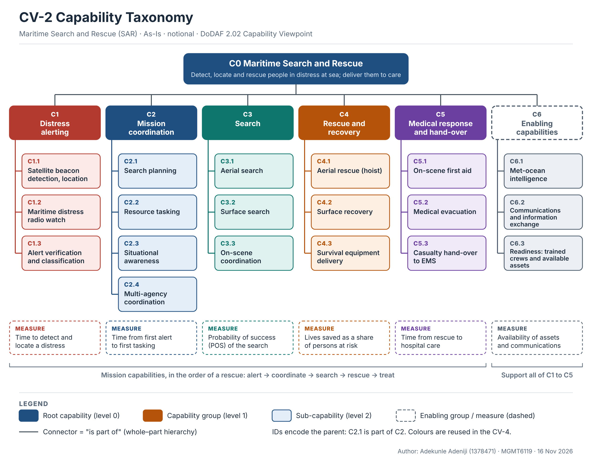
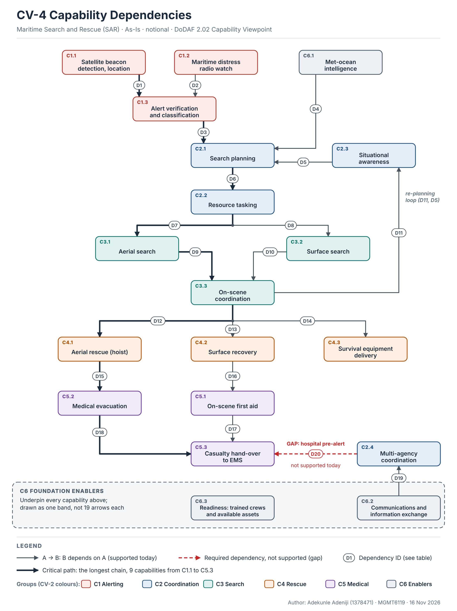

## 1. Introduction and architecture context

This submission develops two DoDAF 2.02 models from the Capability Viewpoint on the course list: **CV-2 Capability Taxonomy** and **CV-4 Capability Dependencies**. Both describe one notional enterprise: a maritime search-and-rescue (SAR) region whose mission is to detect, locate and rescue people in distress at sea, then deliver them to medical care.

The pair was chosen because each view needs the other. CV-2 answers *what must the enterprise be able to do, and how does that break down*. CV-4 answers *which capabilities rely on which*, so planners can see the critical path, single points of failure and gaps. The taxonomy defines the elements; the dependency view relates them. Every capability in the CV-4 is a sub-capability from the CV-2, with the same ID (Section 4).

The architecture's context is summarised below, in the style of an AV-1 Overview and Summary.

| Item | Description |
| --- | --- |
| Architecture name | Maritime SAR Capability Architecture (notional) |
| Purpose | Define the capabilities a SAR region needs and the dependencies between them, to support investment and gap analysis |
| Viewpoint | Capability Viewpoint: what the enterprise must be able to do, independent of who does it or which systems it uses |
| Scope | One root capability, 6 capability groups and 19 sub-capabilities, from first distress alert to hand-over of survivors to medical care |
| Time frame | Current ("As-Is") capability, with one required dependency marked as a gap |
| Out of scope | The organizations and systems that deliver each capability, phasing over time (CV-3), and costs |
| Stakeholders | SAR program managers, rescue coordination centre leaders, capability planners, enterprise architects |
| Assumptions | Notional and unclassified; based on publicly described SAR practice in the IAMSAR Manual; not an official model of any agency |
| Tool | Both views were drawn as vector diagrams (SVG) following DoDAF 2.02 conventions and exported as PNG images |

```{=openxml}
<w:p><w:r><w:br w:type="page"/></w:r></w:p>
```

## 2. View #1 – CV-2 Capability Taxonomy

The CV-2 breaks the mission capability, Maritime Search and Rescue, into six capability groups and 19 sub-capabilities, each with a unique ID, and gives each group a measure of effectiveness.

{width=6.5in}

*Figure 1. CV-2 Capability Taxonomy – Maritime SAR (notional).*

**DoDAF definition.** DoDAF 2.02 describes the CV-2 as a hierarchy of capabilities that specifies all the capabilities referenced across the architecture. It may also record measures, the desired effects, for each capability. Its job is to give one structured, shared list of capabilities that other views, such as the CV-4, can reference.

### 2.1 Key elements of the CV-2

| DoDAF CV-2 element | How it appears in Figure 1 |
| --- | --- |
| Capabilities | 26 capabilities on three levels: one root, six groups (C1 to C6) and 19 sub-capabilities (C1.1 to C6.3) |
| Hierarchy (whole–part relationships) | Connector lines from each parent to its children; each sub-capability belongs to exactly one group |
| Unique identifiers | A numbering scheme that encodes the parent: C2.1 is part of C2 |
| Measures of effectiveness | One measure under each group, such as time from first alert to first tasking |
| Capability groupings | Six colours, reused in the CV-4 so the two views read together |
| Enabling capabilities | Group C6, which supports the five mission groups rather than performing the mission itself |

### 2.2 Capability hierarchy and measures

| Group | Sub-capabilities (each *is part of* its group) | Measure of effectiveness |
| --- | --- | --- |
| C1 Distress alerting | C1.1 Satellite beacon detection and location; C1.2 Maritime distress radio watch; C1.3 Alert verification and classification | Time to detect and locate a distress |
| C2 Mission coordination | C2.1 Search planning; C2.2 Resource tasking; C2.3 Situational awareness; C2.4 Multi-agency coordination | Time from first alert to first tasking |
| C3 Search | C3.1 Aerial search; C3.2 Surface search; C3.3 On-scene coordination | Probability of success (POS) of the search |
| C4 Rescue and recovery | C4.1 Aerial rescue (hoist); C4.2 Surface recovery; C4.3 Survival equipment delivery | Lives saved as a share of persons at risk |
| C5 Medical response and hand-over | C5.1 On-scene first aid; C5.2 Medical evacuation; C5.3 Casualty hand-over to EMS | Time from rescue to hospital care |
| C6 Enabling capabilities | C6.1 Met-ocean intelligence; C6.2 Communications and information exchange; C6.3 Readiness: trained crews and available assets | Availability of assets and communications |

The hierarchy uses one relationship only: *is part of*. Groups C1 to C5 follow the order of a rescue, from alert to hospital. C6 sits beside them because every other capability draws on it. That split is deliberate: enablers are usually funded and managed differently from mission capabilities.

```{=openxml}
<w:p><w:r><w:br w:type="page"/></w:r></w:p>
```

## 3. View #2 – CV-4 Capability Dependencies

{height=8.25in}

*Figure 2. CV-4 Capability Dependencies – Maritime SAR (notional).*

The CV-4 links the 19 sub-capabilities with 20 dependencies. A chain of nine capabilities runs from beacon detection to hospital hand-over. One required dependency, a hospital pre-alert, is not supported today.

**DoDAF definition.** DoDAF 2.02 describes the CV-4 as the dependencies between planned capabilities and the definition of logical groupings of capabilities. It shows which capabilities rely on others, so a shortfall in one can be traced to every capability it affects.

### 3.1 Key elements of the CV-4

| DoDAF CV-4 element | How it appears in Figure 2 |
| --- | --- |
| Capabilities | The 19 sub-capabilities from the CV-2, with the same IDs and names |
| Dependencies | 20 arrows; an arrow from A to B means B depends on A (A enables B) |
| Logical groupings | Colour by CV-2 group (C1 to C6); C6.2 and C6.3 form a foundation band that underpins all capabilities |
| Dependency status | Solid arrow: supported today; dashed red arrow: required but not supported (a capability gap) |
| Feedback loop | On-scene reports update the picture, which drives re-planning (D11, D5) |

### 3.2 Dependencies

| ID | Enabling → dependent capability | Nature of the dependency |
| --- | --- | --- |
| D1 | C1.1 → C1.3 | Beacon detections must be verified and classified |
| D2 | C1.2 → C1.3 | Radio distress calls must be verified and classified |
| D3 | C1.3 → C2.1 | A confirmed distress case triggers search planning |
| D4 | C6.1 → C2.1 | Wind, current and drift data set the search area |
| D5 | C2.3 → C2.1 | The current picture drives re-planning |
| D6 | C2.1 → C2.2 | The search plan defines which assets to task |
| D7 | C2.2 → C3.1 | Aerial search needs tasked aircraft |
| D8 | C2.2 → C3.2 | Surface search needs tasked vessels |
| D9 | C3.1 → C3.3 | Air sightings feed on-scene coordination |
| D10 | C3.2 → C3.3 | The surface unit hosts the On-Scene Coordinator |
| D11 | C3.3 → C2.3 | On-scene situation reports build situational awareness |
| D12 | C3.3 → C4.1 | Hoist rescue starts once survivors are located and assigned |
| D13 | C3.3 → C4.2 | Surface recovery starts once survivors are located and assigned |
| D14 | C3.3 → C4.3 | Equipment drops are directed to the located survivors |
| D15 | C4.1 → C5.2 | Hoisted survivors are evacuated by air |
| D16 | C4.2 → C5.1 | Recovered survivors receive first aid aboard |
| D17 | C5.1 → C5.3 | Treated survivors are handed to EMS ashore |
| D18 | C5.2 → C5.3 | Evacuated survivors are handed to EMS at the hospital |
| D19 | C6.2 → C2.4 | Multi-agency coordination needs shared communications |
| D20 | C2.4 → C5.3 | Hospital pre-alert before survivors arrive: required, not supported today (gap) |

### 3.3 Modelling rules applied

- Arrows run from the enabling capability to the dependent one. Reading against the arrows shows what each capability needs.
- Dependencies join sub-capabilities, the level at which shortfalls are managed; groups are shown by colour.
- Foundation enablers C6.2 and C6.3 underpin every capability, so they are drawn as one band instead of 19 arrows each. Only the specific dependency D19 is drawn.
- The CV-4 shows capabilities, not organizations or systems: aerial search is a capability whichever unit delivers it.
- The only cycle, C2.1 → C2.2 → C3 → C3.3 → C2.3 → C2.1, is the deliberate search re-planning loop. Every other path flows from alert to hand-over.

## 4. Consistency and traceability between CV-2 and CV-4

The two views agree with no orphans: all 19 CV-2 sub-capabilities appear in the CV-4 with the same ID, name and colour, and the CV-4 adds no capability the CV-2 lacks.

| CV-2 group | Capabilities in the CV-4 | Dependencies entering the group | Dependencies leaving the group |
| --- | --- | --- | --- |
| C1 Distress alerting | C1.1, C1.2, C1.3 | None: the chain starts here | D3 |
| C2 Mission coordination | C2.1, C2.2, C2.3, C2.4 | D3, D4, D11, D19 | D7, D8, D20 |
| C3 Search | C3.1, C3.2, C3.3 | D7, D8 | D11, D12, D13, D14 |
| C4 Rescue and recovery | C4.1, C4.2, C4.3 | D12, D13, D14 | D15, D16 |
| C5 Medical response and hand-over | C5.1, C5.2, C5.3 | D15, D16, D20 | None: the chain ends here |
| C6 Enabling capabilities | C6.1, C6.2, C6.3 | None | D4, D19, plus the foundation band |

The remaining eight dependencies (D1, D2, D5, D6, D9, D10, D17, D18) stay inside one group. The group-level flow confirms the CV-2's ordering: dependencies move from C1 to C5, C6 feeds in, and one loop runs back from C3 to C2.

## 5. Critical analysis

Read together, the views show a long serial critical path, two choke points, enablers that no mission group owns, and one unsupported dependency that puts patient outcomes at risk.

**What the views reveal**

- **A nine-step critical path.** C1.1 → C1.3 → C2.1 → C2.2 → C3.1 → C3.3 → C4.1 → C5.2 → C5.3. Survival time at sea is short and every step adds delay. The CV-2 measures, such as time to detect and time to first tasking, should therefore be managed as one end-to-end time, not separately.
- **Two choke points.** Every search passes through C2.1 and C2.2, planning and tasking. Every rescue passes through C3.3 on-scene coordination, the most connected capability with 2 inputs and 4 outputs. A failure at either point stops all rescues, so both are first candidates for redundancy, such as a backup coordination centre or an alternate On-Scene Coordinator.
- **Redundancy exists in one place only.** C1.3 is fed by two independent capabilities, satellite (C1.1) and radio (C1.2). No other capability has a second source.
- **Enablers are the hidden dependency.** C6.2 and C6.3 underpin all 19 capabilities, but no mission group owns them. They are easy to cut under budget pressure, and the CV-4 shows the impact would be system-wide.
- **The gap.** D20, a hospital pre-alert, is required but not supported, so hospitals learn of casualties only on arrival. Closing it needs only C2.4 and C6.2 to be strengthened, which makes it a low-cost, high-value investment candidate.

**Limitations of the two views**

- They show what is needed, not who delivers it or when. They cannot show capacity, timing or the owning organization.
- Dependency strength is not graded. D4 (met data) and D7 (tasking) look the same, yet losing D7 stops the search while losing D4 only lowers its accuracy.
- The model is notional. It would need validation by SAR experts before any investment decision.

**Views from the course list that would extend the architecture**

| DoDAF view | What it would add |
| --- | --- |
| CV-1 Vision | The enterprise goals and desired effects these capabilities serve |
| CV-3 Capability Phasing | When each capability, including the fix for the gap, becomes available |
| CV-5 Capability to Organizational Development Mapping | Which organization delivers each capability, exposing who owns the C6 enablers |
| CV-6 Capability to Operational Activities Mapping | Which operational activities each capability supports |

```{=openxml}
<w:p><w:r><w:br w:type="page"/></w:r></w:p>
```

## References

Department of Defense Chief Information Officer. (2010). *The DoDAF architecture framework version 2.02*. U.S. Department of Defense. https://dodcio.defense.gov/Library/DoD-Architecture-Framework/

International Cospas-Sarsat Programme. (n.d.). *The Cospas-Sarsat system*. https://www.cospas-sarsat.int/

International Maritime Organization, & International Civil Aviation Organization. (2022). *IAMSAR manual: International aeronautical and maritime search and rescue manual* (Vols. I–III). International Maritime Organization.
